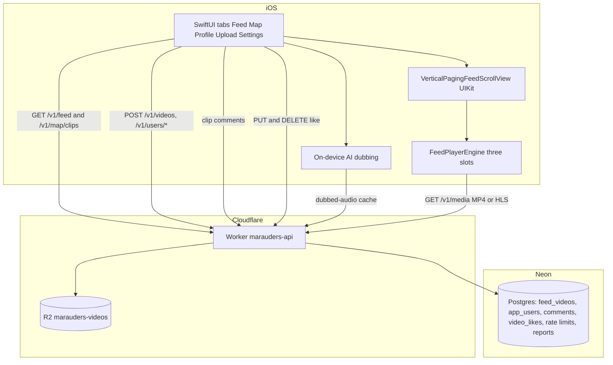
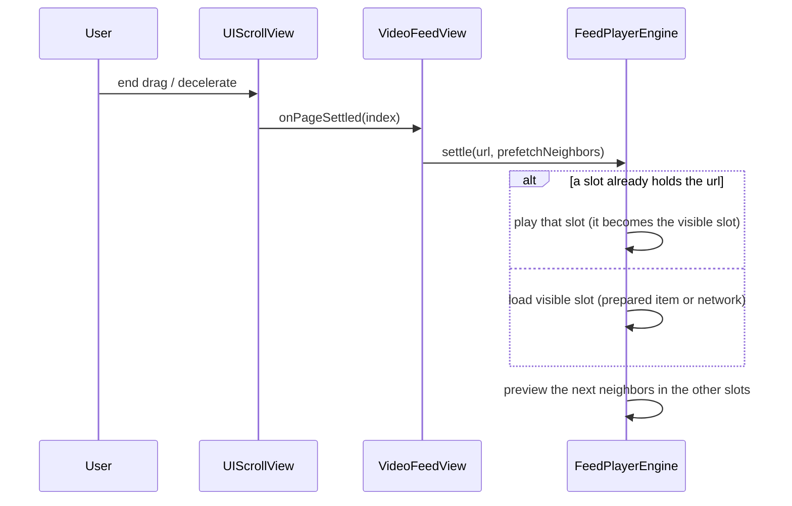
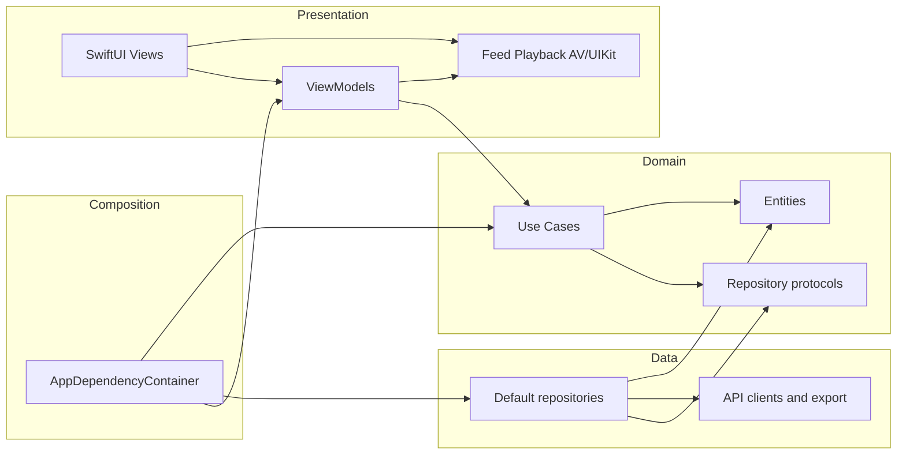
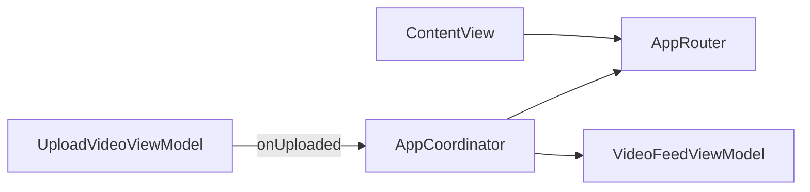
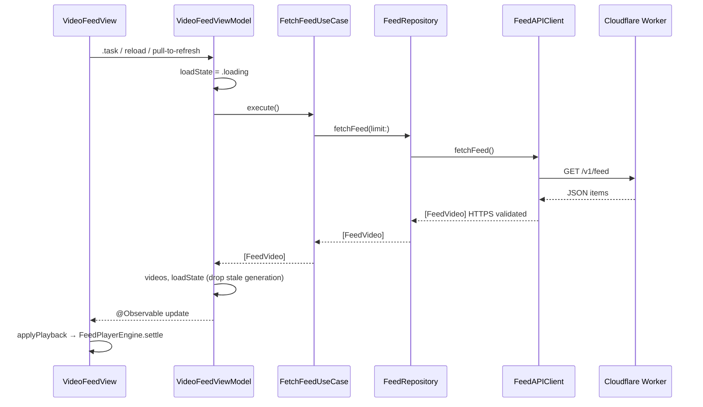
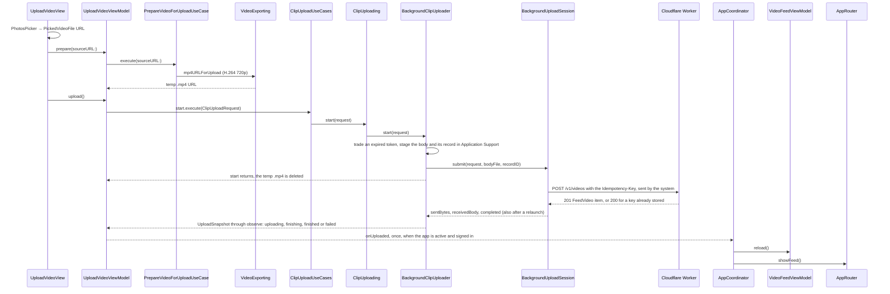
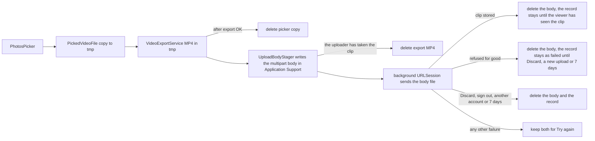

# Marauders — Architecture

Portfolio vertical-video app: **SwiftUI + AVFoundation** on iOS, **Cloudflare Workers + R2 + Neon** on the backend.

**Related:** [docs/adr/](docs/adr/) (decision records) · [deployment/video-pipeline.md](deployment/video-pipeline.md) (faststart, HLS) · [deployment/AI_DUBBING.md](deployment/AI_DUBBING.md) (AI dubbing, shared audio cache, language detection) · [docs/ci-cd.md](docs/ci-cd.md) (Jenkins → TestFlight)

## System context



| Surface | Responsibility |
|---------|----------------|
| `GET /v1/feed` | Paginated `{ items, viewerID }` via `limit` (default 20, max 50) + `cursor` (last item UUID) + optional `country` (ISO-2, joins uploader's `app_users.country`); public read, ordered `sort_order DESC, created_at DESC, id DESC`. Everyone sees the same clips, the viewer's own included; a supplied `Authorization` header is still validated (bad session → 401). `authorName` is the uploader's **live** `@handle` (`COALESCE(app_users.handle, feed_videos.author_name)`); each item also carries `authorAvatarURL` from `app_users.avatar_url`, `country`, coordinates and the optional `audioAssessment`; and, new with likes, `likeCount` (rows of `video_likes` for the clip) and `likedByViewer` (true when the signed-in viewer likes it; always false for a guest). `likedByViewer` comes from a second query (`SELECT video_id FROM video_likes WHERE user_id = … AND video_id = ANY(…)`) that runs only when the request carried a valid session, so the list query itself is still the same for every viewer. The count is a subquery in that list query: **until migration 018 has run the feed answers 500**, so migrate before deploying. `commentCount` (rows of `comments` for the clip) is a second subquery beside it; its table dates from migration 017. With follows each item also carries `postedByViewer` (the signed-in viewer uploaded it) and `authorFollowedByViewer` (they follow its uploader; `null` for a clip without an owner account, which nobody can follow), both false for a guest; they come from a third query (`authorRelations`: `feed_videos` by id with `EXISTS` on `user_follows`) that runs beside the like lookup, only for a valid session and a non-empty page. **Until migration 019 has run, a signed-in feed answers 500** (a guest's does not touch the table) |
| `GET /v1/map/clips` | Same handler and response as `/v1/feed`; the map tab calls it by its own path |
| `POST /v1/auth/apple` | `{ identityToken, country?, supportsRefreshTokens? }` → verify with Apple JWKS → upsert `app_users.country` → `{ accessToken, refreshToken? }` (HS256). A client that sends `supportsRefreshTokens: true` starts a refresh-token family and gets `refreshToken` with a **1-day** access token; without the flag (absent, `null` or `false`) the answer is `{ accessToken }` with a **30-day** one, so builds that cannot refresh are not signed out daily. Any other value of the flag is **400** |
| `POST /v1/auth/dev` | Debug sign-in for the Simulator: `{ secret, label, country?, supportsRefreshTokens? }` → `{ accessToken, refreshToken? }` for the stable user `dev:<label>` (the flag works as on `/v1/auth/apple`). Answers **404** unless the `DEV_LOGIN_SECRET` Worker secret (≥ 32 chars) is set; the app side is `#if DEBUG` and simulator-only. Shares the `auth` rate limit |
| `POST /v1/auth/refresh` | `{ refreshToken }` → `{ accessToken, refreshToken }` (1-day access token), no Bearer token needed. One SQL statement spends the presented token and inserts its successor in the same family. A token presented again within **60 s** (its answer was probably lost) gets another successor; reuse after that revokes the whole family. A body or token of the wrong shape is **400**; an unknown, revoked, expired or reused token is always the same **401** `{"error":"invalid refresh token"}`, so the answer says nothing about which check failed; a database failure is **500**, never 401. A refresh token lives **90 days from the moment it is issued**, so every rotation starts the 90 days again. Shares the `auth` rate limit |
| `POST /v1/auth/signout` | `{ refreshToken }` → **204**: revokes the token's whole family, also for a token the Worker does not know, an expired one or one that is already revoked (nothing can be learned from the answer); a malformed body is **400**. No Bearer token is needed, because the access token may well have expired. Shares the `auth` rate limit |
| `POST /v1/videos` | **Bearer** required; multipart `file` (MP4/MOV, ≤ 100 MB) + `latitude` + `longitude` + optional `caption` (≤500) + optional `audioAssessment` JSON (untrusted advisory, sanitized, stored in `feed_videos.audio_assessment`) → R2 + `feed_videos.owner_user_id`. Optional `Idempotency-Key` header (a UUID, lower-cased; the app sends one per upload and keeps it for every retry of that upload): a key this account already stored is answered **200** with the stored clip, with no body read and no R2 write, so a replay needs no multipart body; a new key is stored with the clip in `feed_videos.upload_key` (migration 023) and the clip is answered **201**, as it is without the header; a value that is not a UUID is **400** `Idempotency-Key must be a UUID`. A replay counts against the `upload` rate limit like any request |
| `DELETE /v1/videos/:id` | **Bearer** required; deletes the caller's own video row + its R2 object + every shared dubbed-audio object for that clip |
| `GET` / `POST /v1/videos/:id/dubbed-audio?lang=` | Shared AI dubbed-audio cache (one R2 object per clip revision and language, 22 languages). GET is public (`missing` / `ready` + URL; a bad `Authorization` header still gets 401); every call carries the clip's source hash (`?source=<sha256 of stream_url>` on GET, `X-Source-SHA256` on POST/report) and a mismatch returns 409 `clip source changed`; POST is first-write-wins, 409s if the clip changed mid-upload, and needs a **Bearer** and a raw `audio/mp4` body ≤ 4 MiB; `kind=text` (409 `dubbed audio not saved yet` until the audio exists) reads/writes the subtitle text (≤ 16 KiB). `/v1/videos/:id/thai-audio` is the legacy path (= `lang=th`). Contract in [AI_DUBBING.md](deployment/AI_DUBBING.md) |
| `POST /v1/videos/:id/dubbed-audio/report?lang=` | **Bearer** required; reports a bad shared dub. The clip owner or the audio's uploader removes it alone, otherwise 2 different reporters do (`dubbed_audio_reports`, migration 016) |
| `GET /v1/videos/:id/comments?limit=&cursor=` | Public read (a bad `Authorization` header still gets 401). Newest first (`created_at DESC, id DESC`), `limit` default 30 / max 50, `cursor` = id of the previous page's last comment (once that comment is deleted the page comes back empty with `nextCursor: null`, and the app starts over from the newest). `{ items, nextCursor }`; each item is `{ id, body, language, createdAt, authorName, authorAvatarURL, canDelete }` with the author's live handle and avatar, and `canDelete` true for the viewer's own comments and for every comment on the viewer's own clip. **404** `video not found` |
| `POST /v1/videos/:id/comments` | **Bearer** required; `{ body, language? }`, at most 16 KiB of JSON (else **413**; a malformed or interrupted body is **400**). The body is trimmed and control characters other than tab and line breaks are dropped; only its first 10 line breaks are kept and each later one is stored as a space, so one comment cannot run to hundreds of lines. It must be 1–500 code points, hold at least one character a reader can see (text made only of whitespace, zero-width marks, variation selectors, Hangul fillers, the Braille blank or U+FFFC is refused) and contain no unpaired surrogate, else **422**. `language` is kept only when it is one of the 22 dubbing languages (Norwegian variants become `nb`), otherwise stored as null. **201** `{ comment }`; **404** when the clip is gone; **401** `account not found` when the token is valid but its `app_users` row is gone (the token is verified without a database lookup, so it outlives the account, and a retry can never succeed); rate-limited per user (`comment`, below) |
| `DELETE /v1/videos/:id/comments/:commentId` | **Bearer** required; the comment's author or the clip's owner removes it → `{ status: "deleted" }`; anyone else, or an unknown id, gets **404** `comment not found` (`comments`, migration 017) |
| `PUT` / `DELETE /v1/videos/:id/like` | **Bearer** required; likes the clip as the caller, or takes the like back. Both are idempotent (`INSERT … ON CONFLICT DO NOTHING`, a `DELETE` of the caller's own row) and answer `{ liked, likeCount }` with the clip's count after the change, computed in the same statement (a CTE's changes are invisible to the statement's own snapshot, so the count adds or subtracts what the CTE changed). An unknown clip is **404** `video not found`; a token whose account is gone is **401** `account not found` (the foreign key breaks, which no retry fixes); limited per user (`like`, below) → **429** (`video_likes`, migration 018) |
| `POST /v1/users/me/location` | **Bearer** required; `{ latitude, longitude }` → `app_users.latitude/longitude` and `location_updated_at` (now) |
| `GET /v1/users/me/friend-locations` | **Bearer** required; `{ sharing, located, items: [{ handle, avatarURL, latitude, longitude, locationUpdatedAt }] }`: the last known locations of the accounts the caller follows that follow them back (a self-join of `user_follows`) and have `shares_location` on and a location, newest first, at most 500, coordinates rounded to three decimals (about 100 m). Answered only while the caller shares too and has a location of their own on file (`located`), so nobody sees others while staying unseen: otherwise `items: []` without looking. No account id is sent. A token whose account is gone is **401** `account not found` (`app_users.shares_location`, migration 020) |
| `PUT /v1/users/me/location-sharing` | **Bearer** required; `{ enabled: boolean }` (anything else **400**) → `UPDATE app_users SET shares_location` → `{ sharesLocation }`. Turning it on (off → on) also clears the stored `latitude` / `longitude` / `location_updated_at` in the same statement, so a location the Map tab stored before the caller agreed is never shown; a token whose account is gone is **401**; limited per user (`location-sharing`, below) → **429** |
| `GET /v1/users/me` | **Bearer** required; `{ handle, country, latitude, longitude, videoCount, avatarURL, followerCount, followingCount, sharesLocation, videos[] }` for the signed-in user (each clip with `postedByViewer: true`). **Until migration 020 has run it answers 500** (it reads `shares_location`) |
| `PATCH /v1/users/me` | **Bearer** required; `{ handle }` → normalize (`@lowercase`, `a-z0-9._`, 1–63, reserved names blocked) → `{ handle }`; unique violation → **409** |
| `POST /v1/users/me/avatar` | **Bearer** required; multipart `file` (JPEG/PNG ≤ 5 MB) → R2 `avatars/{uuid}.{jpg\|png}` → `{ avatarURL }`; replaces the previous object (best-effort delete) |
| `DELETE /v1/users/me/avatar` | **Bearer** required; clears `app_users.avatar_url`, deletes the R2 object → `{ avatarURL: null }` |
| `GET /v1/users/{handle}` | Public; `{ handle, country, videoCount, avatarURL, followerCount, followingCount, followedByViewer, isViewer, videos[] }` for any account. A supplied `Authorization` header is validated like the feed's (bad session → 401); with a valid one `followedByViewer` says whether the viewer follows the account and `isViewer` whether it is their own, both false for a guest. Each clip carries `postedByViewer` = `isViewer` and `authorFollowedByViewer` = `followedByViewer`. A handle whose percent-escapes do not decode is **400** `invalid handle` (it used to throw) |
| `PUT` / `DELETE /v1/users/{handle}/follow` | **Bearer** required; follows the account as the caller, or stops following it. Both are idempotent (`INSERT … ON CONFLICT DO NOTHING`, a `DELETE` of the caller's own row) and answer `{ following, followerCount, viewerFollowingCount }`: the account's follower count and how many accounts the caller follows, after the change, computed in the same statement like the likes'. The handle goes through `parseHandle` (`@` optional, any case; malformed, reserved or undecodable → **400** `invalid handle`); an unknown account is **404** `profile not found`; the caller's own handle writes nothing and is **422** `cannot follow yourself`; a token whose account is gone is **401** `account not found` (`user_follows_follower_user_id_fkey`); limited per user (`follow`, below) → **429** (`user_follows`, migration 019) |
| `GET /v1/users/{handle}/followers` and `/following` | **Bearer** required (a guest or a bad session is **401** `authentication required`); the accounts that follow the profile, or that it follows, as `{ items: [{ handle, avatarURL, followedByViewer, isViewer }], nextCursor }`, newest follow first and then the other account's id ascending, which is the order of `user_follows_followed_idx`, so the followers page needs no sort (the following list reads the account's rows through the primary key and sorts them). `followedByViewer` says whether the viewer follows that row's account and `isViewer` whether it is the viewer's own; no account id is ever sent. `limit` is the feed's (1–50, default 20; otherwise **400**); `cursor` is opaque: base64url of the last row's follow time as exact text (microseconds kept) and its handle, values rather than a pointer to a row, so it keeps working after that row is unfollowed; a cursor this Worker could not have made is **400** `invalid cursor`. The handle goes through `parseHandle` (`@` optional, any case; malformed or undecodable → **400** `invalid handle`); an unknown account is **404** `profile not found`; limited per user (`follow-list`, below) → **429**; a database error is a generic **500** `failed to load list` (SQLSTATE and message are logged, never sent). `Cache-Control: private, no-store`. Routed before the `/v1/users/*` profile route, which would read `alice/followers` as a handle |
| `GET /v1/media/{key}` | Progressive MP4/MOV (**Range 206**), HLS playlist + `.ts` segments, avatar JPEG/PNG, or shared dubbed audio (`translations/…`, `must-revalidate` because a removed dub can be replaced; videos and avatars are `immutable`) |

A `/health` GET answers without auth. All `/v1/*` routes return JSON errors as `{ "error": … }`, except `GET`/`HEAD /v1/media/*`, whose own errors are plain text (`not found`, `invalid range`, …).

---

## Trust boundaries

```text
┌─────────────────────────────────────────────────────────┐
│  iOS app (untrusted client)                             │
│  · HTTPS-only playback URLs                             │
│  · No secrets in repo; API base URL in plist            │
│  · Access token in Keychain; disposable caches only     │
│  · Debug log tab: DEBUG builds only                     │
└───────────────────────────┬─────────────────────────────┘
                            │ TLS
┌───────────────────────────▼─────────────────────────────┐
│  Cloudflare Worker (validation, upload authz)           │
│  · Reject invalid paths, MIME, size                     │
│  · DATABASE_URL, JWT_SIGNING_SECRET, APPLE_CLIENT_ID    │
│    (and optional DEV_LOGIN_SECRET) via wrangler secret  │
└───────────────┬─────────────────────┬───────────────────┘
                │                     │
         ┌──────▼──────┐       ┌──────▼──────┐
         │ Neon Postgres│       │ R2 bucket   │
         │ metadata     │       │ video, audio│
         └─────────────┘       └─────────────┘
```

| Zone | Sensitive data | Controls |
|------|----------------|----------|
| iOS | Access token and refresh token (Keychain, never logged); disposable feed/media cache in `Caches`; on-device language models; the body of a pending upload (the clip, its caption and its coordinates) in `Application Support/PendingUpload` until the Worker has stored the clip, the viewer discards it, or a launch or sign in finds it 7 days old | ATS HTTPS; the pending-upload folder is excluded from backup, holds no token, is never logged, and its body is deleted when the clip is stored, when the Worker refuses it for good, when the viewer discards it or signs out, when another account signs in and at the first launch or sign in after 7 days (*iOS — upload file lifecycle*); fail closed on non-HTTPS `streamURL`; cache keyed by account (a hash of the token's `sub`) and lifetime-limited; a 401 is first traded for a new token with the refresh token and the request repeated, and the session ends only when that cannot save it; without a refresh token, a token past its `exp`, or one the Worker answers 401, ends the session (the device only reads `exp`, the signature stays the Worker's to check) |
| Worker | `DATABASE_URL`, `JWT_SIGNING_SECRET`, `APPLE_CLIENT_ID`, optional `DEV_LOGIN_SECRET`; refresh tokens (`refresh_tokens` keeps only their SHA-256) | Secret bindings; input validation on every write; `/v1/auth/dev` inert (404) unless its secret is set; a refresh token is single use and reuse revokes its whole family; the refresh and sign-out routes log nothing, so a token, its hash or a driver error that echoes either never reaches a log line |
| R2 | Video objects | Key allowlist `videos/{uuid}.mp4\|mov` or `videos/{uuid}/master.m3u8\|segNNN.ts` |
| R2 | Avatar objects | Key allowlist `avatars/{uuid}.{jpg\|jpeg\|png}` |
| R2 | Shared AI dubbed audio (untrusted, user-supplied) | Key allowlist `translations/{uuid}/{sha256}-{lang}-v1.m4a`; server validates AAC/M4A structure and size; first complete write wins; removable by report |
| Neon | `stream_url`, users, feed rows | Parameterized SQL; pooled connection string |

### Rate limiting

Two layers, cheapest first:

1. **Cloudflare Rate Limiting binding** (`RATE_LIMITER`, `AUTH_RATE_LIMITER` in `wrangler.toml`) — an in-runtime, per-location counter with zero added latency, applied to every `/v1/*` request except `/v1/media/*` (`AUTH_RATE_LIMITER` 30 / 60 s on the four auth routes (sign-in, refresh and sign-out), `RATE_LIMITER` 120 / 60 s elsewhere). Best-effort only: `isRateLimited()` fails open, and the binding is per-PoP. *Note:* as of Oct 2026 this binding is unreliable on live Workers (returns `success: true` regardless — cf. workers-sdk#16097), so it is defence-in-depth, not the enforcement point.
2. **Neon-backed limiter** (authoritative): `enforceDatabaseRateLimit` (`src/rateLimit.ts`) does an atomic fixed-window `INSERT … ON CONFLICT` into `rate_limit_counters` keyed by `scope:actor`. Counts are exact across Cloudflare locations. Applied to sensitive endpoints (table below). Over the limit → `429` with `Retry-After`. Fails open if the database is unreachable.

| Scope | Actor | Limit | Storage |
|-------|-------|-------|---------|
| `auth` (`/v1/auth/apple`, `/v1/auth/dev`, `/v1/auth/refresh` and `/v1/auth/signout`, one shared bucket) | client IP | 30 / 60 s | Neon fixed window |
| `upload` (`POST /v1/videos` and `POST /v1/users/me/avatar`, one shared bucket) | user id | 10 / 60 s | Neon fixed window |
| `dubbed-audio-upload` | user id | 10 / 60 s | Neon fixed window |
| `dubbed-audio-report` | user id | 10 / 60 s | Neon fixed window |
| `comment` (`POST /v1/videos/:id/comments`) | user id | 10 / 60 s | Neon fixed window |
| `like` (`PUT` and `DELETE /v1/videos/:id/like`) | user id | 60 / 60 s | Neon fixed window |
| `follow` (`PUT` and `DELETE /v1/users/{handle}/follow`) | user id | 30 / 60 s | Neon fixed window |
| `follow-list` (`GET /v1/users/{handle}/followers` and `/following`) | user id | 60 / 60 s | Neon fixed window |
| `location-sharing` (`PUT /v1/users/me/location-sharing`) | user id | 20 / 60 s | Neon fixed window |
| all `/v1/*` except media | IP | 120 / 60 s (30 / 60 s on sign-in), see `wrangler.toml` | CF binding (per-PoP, best-effort) |

---

## iOS — feed playback

See **[ADR-001: UIKit paging + dual AVPlayer](docs/adr/001-feed-playback-dual-player.md)** for options and tradeoffs. The ADR records the original two-slot decision; the engine has since grown to **three** slots (below).

### Problem (historical)

Per-cell `AVPlayer` instances caused teardown races. A single player in a fixed SwiftUI overlay did not scroll with the finger and stuttered on `replaceCurrentItem` when the page changed.

### Current design

| Piece | Role |
|-------|------|
| `VerticalPagingFeedScrollView` | SwiftUI wrapper around `VerticalFeedPagingView`: `UIScrollView` + `isPagingEnabled` on a black background; owns one `FeedPlayerLayerHostView` per player slot |
| `FeedPlayerEngine` | **Three** `AVPlayer` slots (visible clip + up to two preview neighbors), prefetch via `FeedMediaPreparationService`, `settle(on:prefetchNeighbors:)` |
| `VideoFeedView` | SwiftUI chrome, buffering overlay, tap → play/pause, `FeedClipCaptionOverlay` (author / caption) and `FeedClipActionRail` (like and Comments buttons with their counts, audio choice and tappable avatar, bottom-right) for the current page |

Each slot's layer host is a **subview of the scroll view’s content**, positioned at `y = index(of its URL) × pageHeight`, so video moves with the user during a drag; slots without a URL are hidden. Paging only selects which clip should play; surfaces are not moved on settle.

### Settle sequence (after finger release)



### Prefetch

- `prefetch` / `warmURLs` build `AVPlayerItem` until **readyToPlay** (cached by URL, at most 5 prepared items, 6 s forward buffer).
- On settle, the visible slot prefers **prepared items**; the other slots preview up to **two** neighbors (paused at zero).
- **Startup cache** (`FeedStartupCache` / `SessionFeedStartupCache`): the feed list plus whole MP4s (≤ 12 MiB each, 6 h lifetime) in `Caches`, kept per signed-in session. When a cached feed was restored, the splash is dismissed without its minimum delay and a cached file is played instead of the network URL. Disabled under `UITEST`. Presentation reaches it through the `FeedStartupCaching` / `FeedMediaCaching` protocols in `Domain/Services`: the composition root hands the cache to `VideoFeedViewModel`, and `VideoFeedView` builds its `FeedPlayerEngine` from the media cache that view model carries.
- Buffering UI appears only after **~380 ms** of stall.

### UX / lifecycle

- **Tap** toggles play/pause (`FeedPlayerPhase.paused` when user-initiated).
- `AppRootView` splash (~650 ms min, skipped when the startup cache restored the feed) + initial feed load during splash.
- `scenePhase` / tab disappear → `pause()`; active → `settle` again, unless the comments sheet, the AI-audio choice or the sign-in screen the viewer is on the way to is up (`applyPlayback` keeps the clip paused then).

### Upload path (client)

`PhotosPicker` → `PickedVideoFile` → `AVAssetVideoLocationReader` pre-fills `ClipLocation` from the video's embedded ISO 6709 metadata (when present; `ClipLocationPickerView` lets the user search for or adjust the place) → `PrepareVideoForUploadUseCase` / `VideoExportService` (H.264 720p MP4) → `FastClipAudioInspector` classifies the exported audio on-device (speech / music / mixed, advisory only, never blocks upload) → `StartClipUploadUseCase` → `BackgroundClipUploader` → a background `URLSession` → `POST /v1/videos` (includes `latitude` / `longitude` from `ClipLocation`, the `audioAssessment` JSON, plus optional `caption` typed in the upload form; blank values are omitted; and an `Idempotency-Key`). The choice of a background session, what it was measured against and what it does not cover are in **[ADR-008](docs/adr/008-background-upload.md)**; the evidence is `docs/superpowers/notes/background-upload-spike.md`, cited below by its ids (A1, B6, D2 and so on). The uploader is Data and imports neither SwiftUI nor UIKit (whether the app is active is a closure the container hands over); `ClipUploading`, `UploadSnapshot` and the use cases are Domain, so Presentation reaches it only through `ClipUploadUseCases`.

**Hand-over.** `UploadVideoViewModel.upload()` holds a `beginBackgroundTask` (`BackgroundExecution`, about 30 seconds) only until the clip has been handed over, and calls `ClipUploadUseCases.start`. `BackgroundClipUploader.start` checks the clip (MP4 or MOV, more than 0 bytes and at most 100 MiB), trades an access token whose `exp` has passed for a new one through the shared `TokenRefresher`, writes the multipart body to `Application Support/PendingUpload/<id>.multipart` (`UploadBodyStager`: the form of `VideoUploadForm`, copied from the clip in 1 MiB chunks by `MultipartBodyWriter`, so a clip is never held whole in memory), saves the record `<id>.json` beside it, submits one task to the background session and returns. The Worker has not answered by then. From the hand-over on the system sends the file: the upload goes on when the viewer leaves the app or locks the phone and when the system ends the app (it relaunches the app in the background to say how it ended, D3), and a swipe-away still ends it (see *Limits* below). The view model only observes `UploadSnapshot`s and does no transfer of its own, and the export in `tmp` is deleted once `start` has returned. Fewer than the clip's size plus 50 MiB free fails before anything is written (`Not enough free space on this iPhone to upload the clip`): the check reads `volumeAvailableCapacityForImportantUsage`, a required-reason API that `PrivacyInfo.xcprivacy` declares as `NSPrivacyAccessedAPICategoryDiskSpace` with reason `E174.1`. The other start errors are `Uploading is not available` (no uploader, or the upload was discarded while it started) and `An upload is already in progress`. Under `UITEST` the view model gets an `IdleClipUploader`, which never uploads.

**One record, one slot.** There is one upload at a time: a `staged` or `uploading` record refuses a second `start`, and a `finished` or `failed` one is replaced by it. `UploadRecord` (version 1) holds the `id`, the account's `sub`, the body file name, the boundary, the byte count, the creation time and the state, and nothing else: no token, caption, coordinates or clip path (a finished record also holds the clip the Worker answered with, until the viewer has seen it). **The `id` is the idempotency key**: every submission of this body, Try again included, sends it as `Idempotency-Key` (lower-case), so the Worker answers a repeat with the clip it already stored instead of making a second one (see *Upload* under *Backend — video on write and read*).

| State | Meaning | The Upload tab shows |
|-------|---------|----------------------|
| `staged` | The body and the record are written; no task is known to be sending it yet | `Uploading… 0%` |
| `uploading(fraction, refreshedOnce)` | A task is sending the body; `refreshedOnce` says its 401 was already healed once (Try again clears it) | `Uploading… 42%` (rounded down), and `Finishing…` once every byte is sent |
| `finished(clip)` | The Worker stored the clip; the body is deleted and the record stays until the viewer has seen it | the feed reloads on the new clip |
| `failed(reason)` | The upload ended without a clip | the reason's text, with **Try again** when it can work and **Choose another video** |

**The session.** `SystemBackgroundUploadSession` (behind the seam `BackgroundUploadSession`, so the state machine is tested against a fake) owns the process's one `URLSession`, identifier `com.somsak.Marauders.upload`: `isDiscretionary = false`, cellular, expensive and constrained networks allowed, `timeoutIntervalForResource` of 24 hours (the ceiling for one upload, so a task that cannot finish ends as a failure and the tab never waits for ever) and `sessionSendsLaunchEvents = true`. It is made in `MaraudersApp.init`, before any view, so a relaunch by the system finds the session by its identifier and hands it the events it held at once; no `UIBackgroundModes` or other `Info.plist` entry is needed. A task is `uploadTask(with:fromFile:)` on the staged body (the only upload form a background session accepts): its `taskDescription` is the record id, its request is a `POST` with `Authorization: Bearer`, `Content-Type: multipart/form-data` with the recorded boundary and `Idempotency-Key`, a request timeout of 300 s, and the system is told to expect the body plus 1024 bytes out and 65 536 bytes back. The delegate's calls become an ordered `AsyncStream` of `UploadSessionEvent`s, made before the session so that nothing is lost before the uploader starts reading; the uploader applies them one at a time and keeps the Worker's answer up to 64 KiB. What the system does that the code relies on:

- For an upload task `urlSession(_:dataTask:didReceive:completionHandler:)` is never called (A1, B7), so the status is read from the task when it ends, and it wins over a transport error, because a task can hold the Worker's 200 and still end cancelled or with a lost connection (A4).
- `urlSessionDidFinishEvents` never arrives while the app is in the foreground (A1), and after a relaunch the system still lists a finished task until its events are delivered (B6, B5), so the uploader never filters its task list by state.
- A task created while the app is in the foreground starts at once (D1). One created in a background wake does not start until the app is active (D2, B5), so the app resubmits nothing in the background: `UploadPolicy.resubmitsWhileInBackground` is `false` in production, a 401 met in a background wake ends as `failed(interrupted)`, and the viewer's Try again at the next open sends it again.
- When the session has events for an app that is not running, the system relaunches it in the background within 0.11 s of the answer, and the scene's `.backgroundTask(.urlSession(id))` runs; there is no app delegate (D3, B6). The recreated session gets its events 0.10 to 0.24 s before the scene closure runs, so `awaitSystemEvents()` returns at once when they were already applied, and otherwise after 25 s at most.

**How an upload ends.** The status wins over a transport failure (the Worker answered). After every `await` in a change of state the uploader reads the record again: an event for a record that is gone, or not in a state that takes it, is ignored and recreates nothing, and a real answer that arrives after the `interrupted` verdict still wins.

| The task ends with | The record becomes | The viewer reads | Try again |
|--------------------|--------------------|------------------|-----------|
| 2xx and a clip with an https `streamURL` | `finished(clip)`, body deleted | the feed reloads on the clip, once, when the app is active and a viewer is signed in | |
| 2xx whose answer never arrived whole | one request with the same key and no body (`IdempotentReplayResolver`): the stored clip gives `finished(clip)`, anything else `failed(responseLost)` | `The clip may have been uploaded, but the answer was lost. Try again.` | yes |
| 401, the first for this submission | one refresh through the shared `TokenRefresher`, then the same body and key again with the new token, only while the app is active and only for the same account | `Uploading…` again from 0% | |
| 401 healed while the app is not active | `failed(interrupted)` | `The upload was interrupted. Try again.` | yes |
| 401 again, or a refresh the Worker rejects | `failed(sessionEnded)`; the token is reported to `AuthViewModel` | `Your session ended. Sign in to try again.` | yes |
| 401, and no refresh could be made (offline, 429, 5xx, no route) | `failed(unavailable)` | `The service is unavailable right now. Try again.` | yes |
| 429 | `failed(rateLimited)` | `Too many uploads, try again in a minute` | yes |
| 502, 503, 504 | `failed(unavailable)` | `The service is unavailable right now. Try again.` | yes |
| any other 4xx | `failed(rejected)`, body deleted | the Worker's `error` text, else `Upload failed (status N)` | no |
| any other status (a 500, say) | `failed(serverError)` | the Worker's `error` text, else `Upload failed (status N)` | yes |
| no status, the network failed | `failed(connection)` | the transport's own text | yes |
| no status, cancelled | `failed(interrupted)` | `The upload was interrupted. Try again.` | yes |
| (found when the body is sent again, or at launch) the body is gone | `failed(bodyMissing)` | `The clip is no longer on this iPhone. Choose the video again.` | no |

The app never sends a body again by itself after a 429, a 502, 503 or 504, any 5xx or a transport failure: nothing is retried until the viewer taps **Try again**. **Try again** (`retry()`) sends the same body under the same id and key, with the refresh flag cleared: with no token stored it fails as `sessionEnded`, a token of another account deletes the record and its body, an expired token is traded first, and nothing is sent when the session still lists the old task (its end settles the upload). **Choose another video** discards the upload (task, record and body) and clears the form, and picking another clip does the same for a failed upload.

**Launch, sign-in and sign-out.**

- **Launch.** `MaraudersApp.init` (unless UI tests run) takes `AppDependencyContainer.clipUploader`, the process's one `BackgroundClipUploader`, built as a static before any container exists, and starts `launch()`: it begins applying the session's events in order and then runs `reconcile()` on what is on disk. `reconcile()` also runs when a sign in completes, and never when the app returns to the foreground. It deletes a body that no record owns, a record 7 days after its `createdAt` (read from the record, never from a file date: file timestamps are privacy-manifest APIs) and, when an access token is stored, a record of another account (an unreadable `sub` counts as another account; with no token stored the record is kept). A `staged` record becomes `uploading` when the session lists its task and is sent now when it does not; an `uploading` record whose task is gone becomes `failed(interrupted)` (`failed(bodyMissing)` when its body is gone too); `finished` and `failed` records are kept, a finished one until the viewer has seen it. Everything this does needs neither the container nor a view, so a launch by the system can finish an upload alone.
- **Sign out and sign in.** A sign out discards the pending upload (task, record and body) before the stored session is cleared, and a sign in checks it against the account that signed in before the viewer is marked signed in. Both go through `TimeBoundedCall` with a limit of 3 s (`uploadHookTimeout`), so a stuck uploader never holds either back. A session the Worker ended (a 401 that a refresh cannot heal) keeps the upload as `failed(sessionEnded)`, so the same account can finish it after signing in again, until the first launch or sign in after the record is 7 days old; the uploader never signs anyone out and never clears a store, and reports the rejected token through a reporter that `AppRootView` connects once, from a `.task`, for the container it keeps (`AppDependencyContainer.connectUploaderRejections`, which reaches `AuthViewModel.handleRejectedAccessToken`): SwiftUI builds a container for every new root view and keeps only the first, so building one connects nothing. It works with none.
- **A finished clip reaches the feed once.** `UploadVideoViewModel` reports it to `onUploaded` (feed reload, focus on the clip, Feed tab) when the app is active and a viewer is signed in (`setAppActive` and `setSignedIn`, which `AppRootView` passes from the scene phase and from `AuthViewModel.isSignedIn`; both start off), whether the upload ended while the viewer watched or while the app was closed. The uploader's record is discarded first, so a crash in between costs only the move to the new clip, never a second report. While nobody is signed in (a session the Worker ended without a sign out) the finished record stays on disk: the next sign in deletes it when another account signs in, and keeps it for the same account, which is then shown the clip.

**Progress.** `UploadSnapshot.uploading(fraction:)` stays below 1 and every byte sent is `finishing`: `totalBytesSent` counts bytes handed to the socket, so it runs ahead of the wire (with the phone's Network Link Conditioner on its 3G profile it read 100% 52 s before the last byte left the phone, B8). The Upload tab shows `Uploading… 42%` (rounded down) and then `Finishing…` until the Worker has answered, so a full bar never means a finished upload and the row never says 100%. The uploader saves and publishes progress only when the whole percent changes.

**Limits** (the reasons are in [ADR-008](docs/adr/008-background-upload.md)):

- **A swipe-away ends the upload.** iOS cancels an app's background transfers when the viewer swipes the app away, and nothing prevents it: the next launch shows `The upload was interrupted. Try again.`, and the record and its body stay for Try again (checked on a phone on 2026-11-17: no request reached the Worker after the swipe, and Try again sent the same key and made one clip). (Ending the process with `devicectl` is not a swipe-away: the system relaunched the app, B6, and again with the real app on 2026-11-17.)
- **Leaving the app during "Preparing video…" is not covered.** The 720p export comes before the hand-over and nothing holds it awake (`UploadVideoViewModel.prepare` takes no background task, unlike `upload()`), so it still needs the app on screen; the background session takes over only when Upload is tapped.
- **A token refresh inside a background wake can be cut off by suspension**; [ADR-007](docs/adr/007-token-refresh.md) lists a refresh in a background wake as not covered. The token is checked when Upload is tapped, in the foreground, and traded first when its `exp` has passed (`start` and Try again do both), so a 401 in a background wake is rare.
- **A rejected token costs one whole upload before the 401 arrives** (B8: 346 s for a 12.4 MB body at 36 KB/s on the 3G profile, the answer 1.25 s after the last byte as an ordinary completion), and the body goes out a second time after the refresh. There is no probe before Try again and no watchdog on the 401 and 429 rows: the plan stands.
- **A `staged` record left by a crash** (the process ended between saving the record and submitting the task) is sent by `reconcile` at the next launch with the stored token as it is, without trading an expired one first as `start` and Try again do, so the 401 then comes only after the whole body; and at a background relaunch such a record waits for the foreground (D2).
- **A Try again on a key the Worker already stored costs a whole upload.** The Worker's answer to a stored key (spike A4) was measured on a phone on 2026-11-17: the same body sent twice under one key gave 201, then 200 (165 s after the tap on the 3G profile), and the second task completed, so Try again does not show `Uploading…` or `Finishing…` for the 24-hour resource timeout as the spike feared (A4a, an answer with the body unread): the request reaches the Worker only after the whole body has arrived. That upload time is paid again on a Try again for a key already stored (after `The clip may have been uploaded, but the answer was lost. Try again.` or after an interrupted upload). The replay with no body (`IdempotentReplayResolver`) was not run on a phone. A replay under another account only misses (the Worker scopes the key by owner) and ends as `The clip may have been uploaded, but the answer was lost. Try again.`
- **The Worker's memory limit for a large body is unmeasured** (it buffers a body two or three times over in an isolate with 128 MB, so the client's 100 MB cap may be above what it can take); this work does not make it worse.
- **The Worker's lost answer after a commit** is not handled: see *Known limit of the key* under *Upload* in *Backend — video on write and read*. A replay of that key answers 200 with a clip whose file is gone, which the viewer can delete from Profile.
- **The old in-process path stays in the code, unwired:** `UploadFeedVideoUseCase`, `VideoUploadRepository`, `DefaultVideoUploadRepository` and `VideoUploadAPIClient.upload`, with their tests. Nothing in Presentation or Composition names them, and deleting them is the owner's call. The avatar upload keeps the in-process `HTTPClient.upload`.

**Rollout.** Migration 023 first, then the Worker deploy, then the app; each step is the owner's own yes, and a push builds no TestFlight build. A build that sends the key to a Worker without migration 023 is not supported: with the key code and no column every keyed upload answers 500 `upload lookup failed` (`deployment/README.md`), and an older Worker ignores the header, so a repeat is not recognised. Builds already installed send no key, so they keep working throughout. Two device gates stood after migration 023 and the Worker deploy, and before any TestFlight build of this branch: the device check "the same body twice under one key gives 201, then 200, and the second task completes", and one run of `UploadBodyStagerTests` on a phone, because its `theBodyFileHasNoCompleteProtection` cannot fail on the simulator. Both passed on 2026-11-17 on the owner's phone ([ADR-008](docs/adr/008-background-upload.md), *Device checks*).

### Map tab

- **Data:** `GET /v1/map/clips` (same response as the feed, `forMap` in `FeedAPIClient`) via `VideoFeedViewModel.loadMapClips(country:)` into `mapFilteredClips`, independent of the feed list; clips with both `latitude` / `longitude` get a `FeedVideo.mapCoordinate`. The response also carries `authorName` / `caption`, used by client-side search.
- **Layout:** full-screen `Map` (no navigation bar) with the location sharing switch, a country filter button (flag, 🌐 for all) and a locate FAB. The map's root is an accessibility container (`map.root`), so the controls keep their own identifiers (before, the root's identifier replaced theirs). `MapView` tracks the visible region via `.onMapCameraChange(frequency: .onEnd)`. Sign out lives in the Profile tab.
- **Pins & clustering:** `MapClipClustering` collapses nearby clips into `MapClipCluster`s using a grid sized from the visible span, so zooming in breaks clusters apart again; single clips render as circular thumbnail pins (`MapClipPinView`) and clusters as a count bubble (`MapClusterPinView`) — tapping a cluster zooms in, tapping a single pin opens the shared `ClipPlayerView` in a sheet (looping, with a "Play in Feed" shortcut).
- **Search (hidden):** `MapClipSearch` filters already-loaded clips client-side by author handle, caption and country (no network round-trip) and re-fits the camera. `MapView.isSearchVisible` is `false` for now; the `MapSearchBar` pill and logic stay in place to re-enable later.
- **Country filter:** filter button → `MapCountryFilterSheet`; selection re-fetches `/v1/map/clips?country=<ISO2>`.
- **Near me:** the locate FAB recenters the camera on you (`MapClipProximity`); `MapClipProximity` also limits the pins to the visible region, and the clip player shows the distance from you when location is known.
- **Open in feed:** tap pin → `ClipPlayerView` → **Play in Feed** → `AppCoordinator` calls `ensureVideoLoaded`, which paginates with `cursor` until the clip is in memory, then `requestFocus(on:)` and `router.showFeed()`; `VideoFeedView` scrolls via `focusVideoID` / `consumeFocusRequest()`. The clip's author handle opens the public profile.
- **Auth:** Map, Upload and Profile gate on sign-in (`SignInRequiredView` / `SignInWithAppleGateView`; the Feed is open to guests). Sign-in needs location permission and detects the country (`SignInLocationViewModel`, changeable in `CountryPickerView`); `AuthViewModel` hands the `identityToken` to `SignInWithAppleUseCase` (Domain), which exchanges it through `POST /v1/auth/apple` (`AuthAPIClient`, behind `AuthAPIClientProtocol`, sending `supportsRefreshTokens: true`) and keeps the user id, the refresh token (when the Worker sends one) and then the access token in the Keychain stores (`KeychainAPIRefreshTokenStore` beside `KeychainAPIAccessTokenStore`; the pair travels as `AuthTokens`); authenticated requests send `Authorization: Bearer`. A sign out asked for in the Profile tab first switches the viewer's location sharing off on the Worker and then revokes the refresh token there (see *Location sharing*, *Signing out*). Debug builds on the Simulator can instead sign in through `/v1/auth/dev` (`SignInAsDevUserUseCase`, `DevAuthAPIClient`, secret passed via launch environment, never stored in the project). The session's rules, stores, clients, refresher and sign-in use cases live in the local package `Marauders-ios/Packages/MaraudersAuth` ([ADR-009](docs/adr/009-session-core-package.md)); `AuthViewModel` and the sign-in screens stay in the app.
- **Session end:** a session made on this build has a **1-day** access token and a **90-day** refresh token (sliding: every refresh starts the 90 days again), so a viewer who opens the app at least once every 90 days is never asked to sign in because a token ran out; a session made before this change, or against an older Worker, has a 30-day access token and no refresh token, and behaves as it always did. `AuthViewModel.restoreSession()` (run when the app opens and whenever the Map, Upload or Profile tab appears, so it also catches a token that runs out while the app is open; nothing re-checks the token on the Feed or Settings tabs, so the first 401 meets the refresh there) reads the access token's `exp` with `APIAccessTokenExpiry` and treats a token that is expired, or whose `exp` cannot be read, like a missing one: the stored session and tokens are cleared and the viewer is signed out, which brings up the sign-in gates, **unless a refresh token is stored**. Then the viewer stays signed in and the first request that gets a 401 trades the refresh token for a new pair; nothing is refreshed at launch or before the token expires, so opening the app asks the Worker nothing. A stored session that cannot be read is not one that has ended: from a restart of the iPhone until its first unlock the Keychain refuses every read although the items are there, and iOS can already have launched the app in the background. The stores therefore have a second read beside `load…()` (`readUserID()`, `readAccessToken()`, `readRefreshToken()`, each a `StoredCredential`) that answers `unavailable` for a Keychain that refused the read and `missing` when nothing usable is stored: no item, bytes that are not text, or an install check that did not pass (`KeychainItemReader`, which logs a refusal once an item, with the status and never a value; `load…()` answers nil to both, which is all a caller that only needs a token wants). On `unavailable` `restoreSession()` clears nothing and decides nothing: a viewer who is signed in stays so, one who is not is not signed in yet, and `storedSessionIsUnavailable` is set. `SavedSessionRestore`, which `ContentView` runs when the app opens and each time it comes to the foreground, then asks again at the next foreground, and stops the sending while closed only for a session that ended, never for one that could not be read. Only the parts the answer depends on are read, so a refresh token that cannot be read holds nothing back while the access token has not run out. After Apple answers the credential check, `restoreSession()` compares a session generation (bumped by sign-in, a rejection and every clearing of the stored session, never by a refresh), not the access token, because a refresh can change the token while Apple is answering. A 401 to a request that carried the token goes through the refresh first, and the session ends only when there is no refresh token to try, when the Worker rejects it, or when the request repeated with the new token is rejected too (see *iOS — HTTP API contract* below); a refresh that cannot be made (offline, 429, 5xx, a route that is not there) never ends it. Nothing opens the sign-in screen by itself: the viewer reaches it from a gate, the feed's sign-in prompts or **Sign in to comment**. Guests are unaffected.
- **Location:** Required to open the Map tab (`MapLocationRequiredView` gate + system permission). **Current Location** recenters the map after access is granted. The first fix delivered in a session is reported once to `POST /v1/users/me/location` via `ReportUserLocationUseCase` (composition root), so the account keeps a last-known location. A viewer who shares their location also reports through `ForegroundLocationReporter` while the app is in use and `BackgroundLocationMonitor` while it is closed (see *Location sharing*).

### Profile tab

- **Data:** `GET /v1/users/me` (Bearer) via `UserProfileAPIClient` → `UserProfile` (handle, country, last-known coords, clip count, `avatarURL`, `followerCount` / `followingCount` (optional: nil from a Worker without follows), and the user's own `[FeedVideo]`).
- **UI:** `ProfileView` shows a header (tappable avatar + `@handle` + country flag/name + a TikTok-style row of `ProfileStat`s: **Following**, **Followers** and **Clips**, the first two only when the Worker sent them, and each of them opens its list (`ProfileCountLink`, see **Follows**)), a 3-column grid of the user's clips and a **Sign Out** action. Tapping a clip plays it inline with `ClipPlayerView`; pull-to-refresh re-fetches.
- **Handle:** every account gets an auto `@user_<hex>` handle on sign-up. Tapping the handle opens an edit alert → `PATCH /v1/users/me` via `UpdateUserHandleUseCase`; server-normalized value is written back to the profile (409 → "already taken").
- **Avatar:** the header photo is a `PhotosPicker`; the picked image is downscaled to ≤ 512px + JPEG-encoded by `DefaultAvatarImagePreparer` inside `UpdateAvatarUseCase`, then `POST /v1/users/me/avatar` via `UserProfileAPIClient` (multipart); the returned URL updates the profile and is broadcast to the feed (`onAvatarChanged` → `VideoFeedViewModel.applyAuthorAvatar`). `AvatarView` falls back to a deterministic gradient + initial when there is no photo.
- **Delete:** long-press a clip (or tap the trash button in the player) → confirm → `DELETE /v1/videos/:id` via `DeleteUserClipUseCase`; the clip is removed from the grid optimistically and the count decremented.
- **State:** `ProfileViewModel` (`idle → loading → loaded/failed`) loads once via `loadIfNeeded()` and re-fetches on `reload()`. When the session ends, `ContentView` calls its `resetForSessionChange()`, so the next sign-in loads that account's profile instead of showing the last one, or the error of a load that failed as the session ended. The feed resets on every session change; the profile only when one ends, because after a sign-in the Profile tab may already be loading the new viewer's. A load or edit that was still out when the session ended can no longer write into the view model or raise an alert (a delete still tells the feed which clip went).
- **Auth:** gated on Sign in with Apple (same `SignInWithAppleGateView` as Upload/Map). When the session ends while the tab is open (expired token, 401 from the profile request itself), the tab falls back to this gate.
- **`ClipPlayerView`** is shared between the map pins and the profile grid (`Presentation/Common`).

### Public profiles (`@handle`)

- **Open:** tapping the author handle in the feed caption (`FeedClipCaptionOverlay`), the avatar in the right-edge rail (`FeedClipActionRail`) or the author on a map clip calls `AppRouter.openPublicProfile(handle:)`, which the `ContentView` `TabView` presents as a sheet.
- **Data:** `GET /v1/users/{handle}` via `UserProfileAPIClient.fetchPublicProfile` → `PublicUserProfile` (`handle`, country, count, `avatarURL`, `[FeedVideo]`, and the optional `followerCount`, `followingCount`, `followedByViewer`, `isViewer`). The Bearer goes along when the viewer is signed in; a 401 to it is retried once as a guest, like the feed and comments reads.
- **UI/State:** `PublicProfileView` + `PublicProfileViewModel` (`Presentation/Profile`) reuse `ProfileClipThumbnail` and `ClipPlayerView`; read-only (no delete), with `Retry` on failure. The view keeps its model in `@State`: the sheet's content closure runs again whenever `ContentView` does (a sign-in, for one), and a fresh model would sit idle with nothing loaded. What the profile shows and does lives in `PublicProfileScreen`; `PublicProfileView` only adds the sheet's `NavigationStack`, the close button and `publicProfile.root`, so a profile pushed from a follower list (`ProfileRoute.profile`) is the same screen.
- **Layout note:** the feed caption respects the bottom safe area so the tappable author clears the tab bar, while the video layers keep `.ignoresSafeArea()` for full-bleed playback.

### Follows

- **Feed:** a red "+" (with a thin white ring, so it stands apart from an avatar of the same red) sits half over the lower edge of the author's avatar on the rail (`FeedClipActionRail`, `feed.follow`, VoiceOver **Follow @handle**). Its extra tap room goes to the sides and below the dot only, so a tap on the face just above the dot still opens the profile. It only ever follows (`UserFollowsViewModel.follow`), as on TikTok; once followed it turns into a white tick for a second (`feed.followed`) and goes, from every clip of that author. It is left off the viewer's own clips (`postedByViewer`) and wherever the feed lacks the fields (an older Worker or startup cache: `FeedVideo.postedByViewer` / `authorFollowedByViewer` are optional). A guest's tap opens the shared sign-in like the heart does (`askGuestToSignIn`).
- **Profiles:** `PublicProfileView` shows **Following** / **Followers** / **Clips** and a red **Follow** button (`publicProfile.follow`) that turns grey **Following**; tapping that stops the follow. There is no button on the viewer's own profile (`isViewer`) or from a Worker without follows (`followedByViewer` nil). A guest's tap opens `SignInSheet` over the profile (the same view `ContentView` shows), so after signing in they are still on it; the profile reloads on every sign-in or sign-out for the new viewer's state, and nothing is followed on their behalf. The viewer's own Profile tab shows the new following count as soon as the Worker answers (`onViewerFollowingCountChange` → `ProfileViewModel.applyFollowingCount`), and a profile load that was out meanwhile does not put the older number back.
- **Lists:** **Following** and **Followers** are buttons (`ProfileCountLink`, VoiceOver hint "Opens the list"; the identifiers `profile.followingCount` / `profile.followerCount` and `publicProfile.…` stay on them). A signed-in viewer's tap pushes `ProfileRoute.followList(handle:kind:)` in the profile's own `NavigationStack` (the Profile tab's, or the public profile sheet's, which has one): `FollowListView`, one screen for both lists with a segmented switch (`followList.tabs`) that opens on the tapped one and loads a tab the first time it is shown. A row is a 44 pt avatar and the handle; it pushes that account's profile in the same stack (`ProfileRoute.profile` → `PublicProfileScreen`, so Back returns to the list and a pushed profile's own counts push on again), and every row but the viewer's own (`isViewer`) has the Follow / Following button, which reads and writes `UserFollowsViewModel` like the feed's "+" and every profile, so the row, the rail and the profile counts agree; an account the viewer stops following stays on the list until the next load, as on TikTok. `FollowListViewModel` (`@Observable`, one per tab) loads 30 rows a page and asks for the next when one of the last 5 appears; it keeps what it has when a refresh or a later page fails (a later page shows "Couldn't load more" with Try Again), drops an answer that arrives after a refresh or a sign-in or sign-out (a load generation), does not count a request that was cancelled as a failure (SwiftUI cancels the task that started a load when the viewer switches tab: a tab with nothing yet goes back to waiting and loads when it is shown again, and a cancelled page is asked for again by the next row that appears), ends the list when the Worker repeats the cursor it was sent, and shows a row once however often the Worker lists it (by normalized handle). The lists are for signed-in viewers: a guest sees the counts and a tap on one opens `SignInSheet` over the profile, after which nothing opens by itself; a list whose request comes back 401 shows "Sign in to see this list" (the shared transport has already ended the session). `ProfileNavigation` (built once by `AppDependencyContainer.profileNavigation` and handed down through `ContentView`) carries what the pushed screens need: the auth and follows view models and the factories for a profile's and a list's view model; `ProfileRouteDestination` resolves a route, and a pushed profile keeps its model in `@State`, since a destination closure runs again whenever the stack's content does.
- **Data:** `FollowsAPIClient` behind `UserFollowRepository` (`DefaultUserFollowRepository`) and `SetUserFollowUseCase`; `PUT` follows, `DELETE` stops following, both answer `UserFollowChange` (`following`, `followerCount`, `viewerFollowingCount`, negatives shown as 0). Handles are keyed by `UserHandle.normalized` (`@` + lowercase), the form the Worker stores. The lists: `FollowListAPIClient` behind `FollowListRepository` (`DefaultFollowListRepository`) and `LoadFollowListUseCase`; `GET` with the Bearer, `limit` and the cursor exactly as the Worker made it; a row's avatar is kept only when it is an http(s) URL with a host.
- **State:** `UserFollowsViewModel` (`@Observable`, one per app, shared by the rail and every profile) answers `isFollowing(handle, fallback:)` and `followerCount(of:fallback:)`, the fallback being what the asking screen loaded. A tap shows the flipped state at once (and ±1 on a known count); the Worker's answer then replaces the guess; a failure puts back what was known before. One request is out at a time across all accounts (a queue, oldest first): taps meanwhile change only what is sent next, and an account whose taps cancel out before its turn sends nothing. Two follows the Worker ran side by side would each count the viewer's follows without the other's row, so this also keeps `viewerFollowingCount` right. Unlike the likes, what was learned about an account beats the feed's word for good: the feed loaded `authorFollowedByViewer` before the follow, so a matching reload is not newer. A public profile load reads the model's clock (`stamp()`) before it starts and hands its answer back (`record`); it replaces what is known only when no change for that account is out and the Worker last answered about it before the load began, so a load read before a follow was written cannot undo it. Nothing here edits `VideoFeedViewModel.videos` (that would restart a paused clip). The flip side: a feed reload never overrides what the model learned, so a follow or unfollow made on another device shows on this one once that account's profile is opened, or after the next sign-in. `PublicProfileViewModel` numbers its loads and keeps only the newest one's answer, since the reload after a sign-in can overtake a pull to refresh.
- **Session change:** `ContentView` calls `UserFollowsViewModel.reset()` beside the likes'; a generation counter drops answers and profile loads from before it. A 401 to a follow that the refresh could not save ends the session through the shared transport. `FollowListView` drops what its lists loaded when `isSignedIn` changes (`resetForSessionChange`, before the next load), because a list belongs to the viewer who asked for it.

### Location sharing

- **Rules (the owner's):** opt-in, off by default; reciprocal (a viewer sees the last location of someone they follow who follows them back only while both share, and a viewer who does not share sees nobody); the latest location always shows, however old, with its age; the app sends the viewer's location while in use and, with Always location access, while closed, using the services that cost the least battery (2026-11-02, after Protego: the same switch, and everyone who shared before is asked again).
- **Switches:** a capsule on the Map tab's top bar (`map.shareLocation`, VoiceOver **Share location** / **Sharing location**, at least 44 pt tall so it grows with Dynamic Type) and a toggle in Settings (`settings.locationSharing`), which stays reachable when location access is off and the Map tab is shut; the Map tab's location gate also offers **Stop sharing location** (`map.stopSharing`). Off → an alert explains who will see what and asks before sharing; on → one tap stops at once. While the Worker has not said where it is (`sharing` nil) or a change is out, the capsule shows a spinner and is disabled; a failed change keeps it where it was, and the screen that asked shows the error (`setSharing` returns it).
- **Friends on the map:** `FriendPinView` annotations (`map.friend`): the avatar in a green ring with the handle and a relative age (`Date.RelativeFormatStyle`, localized by the system); a tap opens the public profile. While the viewer's own location is not on file yet a capsule says **Finding your location…** (`map.findingLocation`); while sharing with nobody to show, another says so (`map.friendsEmpty`). The map asks `GET /v1/users/me/friend-locations` again every 60 s while it is on screen, and drops the pins once no ask has worked for 5 minutes (`staleAfter`): the friend may have stopped meanwhile.
- **Reporting:** `ForegroundLocationReporter` asks a `CLLocationManager` of its own (100 m accuracy) for one fix and sends it with `ReportUserLocationUseCase`: when the app becomes active and every `interval` (5 min, counted from when the fix was asked for, with 10 s of timer slack) while it stays active, driven by a task in `ContentView` keyed on `scenePhase == .active && sharing == true`, and at once (forced) when the viewer turns sharing on. A fix asked for before a `reset()` (session end, or sharing turned off) or arriving when `shouldSend` says the viewer no longer shares is dropped unsent; a fix that never arrives is given up after 60 s. It never asks for permission and never runs in the background; a failed send is retried at the next chance. After the first report since sharing went on, the view model refreshes so the friends appear. The Map tab's own once-per-session report is unchanged.
- **While closed:** `BackgroundLocationMonitor` (one per app, `AppDependencyContainer.backgroundLocationMonitor`) runs significant-change monitoring (iOS wakes the app, or launches it again in the background, after about 500 m, at most every few minutes) and visit monitoring (an arrival is sent; a departure is where the viewer was, and moving on reports anyway) while the viewer shares and location access is Always. Neither needs the `location` background mode or shows the blue indicator. Whether the viewer shares is kept in `UserDefaults` (`locationSharing.sendsWhileClosed`) as the Worker last said it, because `MaraudersApp.init` calls `resume()` before any UI exists: a launch in the background for a location gets the event only once a location manager has started the services again. A launch without sharing stops them, in case a run before left them on; a launch before the first unlock after a restart (the saved choice reads as unset and `isProtectedDataAvailable` is false; the choice and the token stay readable while the iPhone is locked again after that) leaves them alone and resumes on `protectedDataDidBecomeAvailableNotification`. A fix older than 10 minutes or without a position is dropped; each report holds a background task until it is through. Reports go out with `whileClosed: true` (`ReportUserLocationUseCase.executeWhileClosed`): the Worker stores such a location only while the viewer shares and answers `sharesLocation`, so sharing turned off on another device (or by migration 021) stops this iPhone at its next move without anything being kept; an answer without the field (an older Worker) changes nothing. It has its own transport (`APITransportComposition.quiet`: the process-wide `TokenRefresher` over the bare client, no rejected-session reporting), so a 401 is first traded for a new token and the report is sent again, which is how a 1-day access token keeps sharing going while the app is closed. A `notAuthenticated` or a 401 that the refresh could not heal stops it until the Worker says the viewer shares again, and the next launch's own requests end the session; a refresh that is unavailable (no connection, a 5xx) is only logged and stops nothing. The session token is readable after the first unlock, so reports also go out while the iPhone is locked. `FriendLocationsViewModel` tells it what the Worker says on every refresh and change, stops it at once when the viewer turns sharing off, and on `reset(signedOut: true)`, which `SavedSessionRestore` (run by `ContentView`) also calls when the saved session does not come back at launch (expired or revoked, so a later sign-in of another account starts with it stopped; a saved session that could not be read has not ended and stops nothing, see **Session end**); a sign-in (the saved session coming back at launch is one) leaves it to the refresh that follows. Settings shows **Allow location access Always** (`settings.allowAlwaysLocation`) and says mutual followers see only where the viewer last used the app while sharing is on without Always access (`lacksAlwaysAccess`); sign-in asks for Always, but it can be lowered since.
- **State:** `FriendLocationsViewModel` (`@Observable`, one per app) holds `sharing`, `located` and `friends`; `ContentView` refreshes it each time the app becomes active while signed in (the viewer may have changed it on another device, or the last ask failed) and calls `reset(signedOut:)` on every session change (a generation counter drops answers from before; the reporter forgets its last report and drops a fix on its way). A sharing change bumps a revision as it starts and again when answered, so a refresh that was out across it cannot undo it. A 401 ends the session through the shared transport.
- **Consent again:** migration 021 turns `shares_location` off once for everyone, since they agreed to where they last used the app, not to where they are while it is closed; `db:migrate` replays every file, so the reset is tied to a `data_migrations` row and runs only the first time. The switch's confirmation and the Settings footer now say "also while Marauders is closed".
- **Signing out:** `AuthViewModel.signOut()` (async; the Profile tab's **Sign Out** button is disabled while it runs, `isSigningOut`, and a second call asks nothing more) first has `StopLocationSharingOnSignOutUseCase` send `PUT /v1/users/me/location-sharing { enabled: false }` with the session's token, which is why it runs before the token is cleared, then has `RevokeRefreshTokenOnSignOutUseCase` send `POST /v1/auth/signout { refreshToken }`, which revokes the refresh token's whole family on the Worker, then drops the viewer's pending upload (task, record and body, under a 3 s limit of its own: see *Upload path (client)*), and only then clears the session and both tokens, so the viewer's last location leaves their mutual followers' maps at those followers' next refresh. Both calls are best effort and never hold the sign out back: they share one 3 s window (`signOutWindow`; each request races a timer through `TimeBoundedCall` and the loser is cancelled, so a transport that ignores cancellation cannot hold it either), the sharing call goes first and the revoke gets what is left (no time left: the revoke is skipped and logged `no time left`), and a failure or a timeout is logged (`auth`, warning, never with a token) while the sign out goes on. The revoke reads the refresh token after the sharing call has finished, because that call can meet a 401 and refresh, which swaps the stored token; a revoke that does not get through leaves the token alive on the Worker until its 90 days are over. It runs only for a viewer who is signed in, and not for a session that ended without the viewer asking (see *Known limits*). The composition root sets `authViewModel.stopSharingOnSignOut` once the repositories exist, because they talk through the transport that reports a rejected token back to `AuthViewModel`. `ContentView` then calls `reset(signedOut: true)` as before. Nothing about sharing is kept on the iPhone for the next sign in, which asks the Worker like any launch: the switch shows off after a sign out that got through, and only the two switches (Settings, Map) ever send `enabled: true`, so the viewer chooses again. Sharing belongs to the account, not to the iPhone, so signing out on one iPhone also takes the account's others off the map (they notice at their next refresh or move).
- **Known limits:** sharing is switched off only by a sign out the viewer asks for, and only when that call gets through. A token the Worker already rejected (a 401, `handleRejectedAccessToken`, the forced sign out) cannot make it, and neither can a session whose token has run out with no refresh token to renew it (`restoreSession()` clears it without a request), a sign out with no connection, or one the Worker does not answer within 3 s; a revoked Apple credential (also found by `restoreSession()`) is not tried either. In those cases, like when the app is deleted, sharing stays on in the Worker, and as the latest location always shows, the last one stays on mutual sharers' maps until the user turns sharing off (the next sign in shows the switch on, as the Worker says). A session that ends in those ways calls the Worker for nothing, the sign-out route included: a refresh token it still holds is cleared on the iPhone only and stays valid on the Worker until its 90 days are over.
- **Data:** `LocationSharingAPIClient` behind `LocationSharingRepository` (`DefaultLocationSharingRepository`), `LoadFriendLocationsUseCase`, `SetLocationSharingUseCase`; a point off the Earth is left out, and `locationUpdatedAt` is read with `WorkerDateParser` (milliseconds included). The iOS location usage texts say a location is shown to others only when sharing is on and only to mutual followers, and that with it on the location goes out when the viewer moves, also while the app is closed.
- **UI tests:** `UITestLocationSharingRepository` starts off; `@traveler` (the fixture feed clip's author) follows back and shares, so they appear once the viewer follows them and shares.

### Comments

- **Open:** the **Comments** button at the top of the feed's right-edge rail (`FeedClipActionRail`, `feed.comments`) opens `CommentsView` as a medium / large sheet for the current clip. The feed pauses while the sheet is up and resumes when it closes, unless the viewer had paused the clip themselves (`FeedPlayerPhase.shouldResumeAfterInterruption`: only `.paused` stays paused, so a clip that was still buffering or had failed is started again; the AI-audio menu uses the same rule). A second tap on the button while a sheet is up or closing does not overwrite what the first one noted. Leaving through **Sign in to comment** keeps the clip paused behind the sign-in screen; it plays again when the viewer backs out of it.
- **Count:** under the bubble the rail shows the clip's `commentCount` in compact form (VoiceOver label **Comments**, the count as its value); a feed without the field (an older Worker or startup cache, `FeedVideo.commentCount` is optional) shows the word **Comments** instead. `CommentsViewModel.onCountChange` reports +1 for each post and −1 for each comment that leaves the list through a delete (also when someone else removed it first: the viewer saw it, so the count they saw held it). `VideoFeedView` adds those to `ClipCommentCounts`, which, like the likes, never edits `VideoFeedViewModel.videos` and gives way as soon as a reload brings another count for the clip. Comments other viewers write show on the next feed load.
- **Guests** can read. In place of the composer they get **Sign in to comment**, which closes the sheet first and opens the shared sign-in screen from the sheet's `onDismiss`, so two sheets are never stacked; after signing in the viewer is back on the feed, not in the sheet, and because every sign-in or sign-out reloads the feed (`ContentView` calls `resetForSessionChange()`) the feed starts again at its first clip, not at the one that was being commented on.
- **Data:** `CommentsAPIClient` behind `CommentRepository` (`DefaultCommentRepository`) and `LoadCommentsUseCase` / `PostCommentUseCase` / `DeleteCommentUseCase`. Pages are 30 comments, newest first; the next page loads when a row within 5 of the end appears, and a failed page waits for a tap on **Try Again** instead of looping. A 401 on a read that carried a token, once the refresh could not save it, is retried once as a guest, so an expired session never blocks reading; a refresh that is merely unavailable reads as a guest too, without ending anything. The same 401 also ends the session (see *iOS — HTTP API contract*): the sheet stays open with the comments the guest retry returned, and its composer gives way to **Sign in to comment** (a draft that was typed no longer keeps the sheet from being swiped away).
- **Rules:** `CommentRules` (Domain) trims the text and allows 1–500 Unicode scalars (the Worker counts code points) with at least one visible character (`hasVisibleCharacter`, the same rule as the Worker: not whitespace, control, default-ignorable, U+2800 or U+FFFC); `PostCommentUseCase` refuses anything else before a request is made. The Worker alone limits line breaks (10 per comment, see the endpoint table); the app shows the text the Worker stored. The app sends no `language` yet.
- **State:** `CommentsViewModel` (`idle → loading → loaded / failed`) keeps the list on screen when a refresh fails (unless the viewer's deletes emptied it meanwhile while older comments exist: then the failed screen with Retry takes over) and clears its message when the next refresh starts, drops a stale page that arrives after a newer reload (`loadGeneration`), does not start a next-page request while a refresh is in flight (`isReloading`; a row near the end that appeared meanwhile gets its page as soon as the refresh is over), and asks again (up to 3 requests) when a post or delete finished while the refresh request was out (the third answer is accepted as it is, minus the comments the viewer deleted and plus any post whose answer arrived during that request); a page request that overlapped a delete is asked once more. The comments the viewer deleted are remembered while the sheet is open, so no answer, however late, puts one back. The next page is requested after the last comment still listed rather than with the Worker's `nextCursor` (only its presence is used), so deleting the last row never strands the older ones; an empty page after a cursor, or deleting every listed comment while older ones exist, reloads from the newest. The draft is kept when a post fails and when the viewer typed more during the request. `AppDependencyContainer.makeCommentsViewModel` builds a fresh one each time the sheet opens; under `UITEST` the container uses `UITestCommentRepository` (not with `UITEST_REJECTED_SESSION`, which keeps the real comments client over the rejecting transport).
- **Composer:** while the draft holds text the sheet cannot be swiped away (`interactiveDismissDisabled`; the close button still can), the list dismisses the keyboard as it scrolls, a tap anywhere on the input pill focuses it, a failed post is announced to VoiceOver and the character counter has a spoken label.
- **Delete:** swipe a row with `canDelete` (the viewer's own comments, or any comment on the viewer's own clip) → confirm.

### Likes

- **Open:** the heart at the top of the feed's right-edge rail (`FeedClipActionRail`, `feed.like`, VoiceOver label **Like** / **Unlike** with the count as its value) sits above Comments and shows the clip's count in compact form. `VideoFeedView` hands it `ClipLikesViewModel.state(for:)` and a toggle closure; without a `likesViewModel` the rail has no heart.
- **Double tap:** as on TikTok, a double tap on the clip likes it and leaves a big heart where the finger was (`FeedHeartBurstLayer`: it pops in tilted a little, floats up and fades within a second; with Reduce Motion it only fades), and each further quick tap adds another heart. `VerticalFeedPagingView` tells the taps apart with `FeedTapSequence`: a tap waits `doubleTapInterval` (0.3 s) for a second one before it pauses or plays the clip, a second tap within it is a heart, and so is any tap within `heartRunInterval` (0.6 s) of the last heart; a swipe starts afresh. A double tap only ever likes (`ClipLikesViewModel.like`, which sends nothing for a clip the viewer already likes). The rail's heart is filled either way, white until liked and `Color.likeRed` after; it bounces and the phone gives a light haptic each time the viewer likes a clip. A guest's double tap opens sign-in like the heart does.
- **Guests** see the count. Tapping the heart pauses the clip (through the flag the AI-audio choice uses, `resumeAfterAudioChoice`) and opens the shared sign-in screen; backing out plays the clip again, signing in reloads the feed (which empties the pager) and the viewer taps the heart again, nothing is liked on their behalf.
- **Data:** `LikesAPIClient` behind `ClipLikeRepository` (`DefaultClipLikeRepository`) and `SetClipLikeUseCase`; `PUT` likes, `DELETE` takes the like back, both answer `ClipLikeState` (`liked`, `count`, a negative count is shown as 0). `FeedVideo.likeCount` / `likedByViewer` are optional so a Worker or a startup cache from before likes still decodes (no likes shown). The startup cache is already kept apart per session, so one viewer's `likedByViewer` is never shown to another.
- **State:** `ClipLikesViewModel` (`@Observable`, one per app) answers `state(for: clip)`. A tap shows the flipped state at once; the Worker's answer then replaces the guess with its own count; a failure (any `ClipLikeError`) puts back what the Worker last said, or what the feed said before the first tap. One request per clip is out at a time: taps made meanwhile change only what is sent next, and a request that would repeat what the Worker already holds is not sent. It never edits `VideoFeedViewModel.videos`: a change there runs `applyPlayback` → `settle`, which clears the viewer's pause, so liking would restart a clip they paused. Instead each clip the viewer touched has an entry remembering what the feed said (`likeCount`, `likedByViewer`) when they tapped; as soon as a reload says something else about that clip (after an upload, from the map, Try Again) the entry gives way to the feed, which is newer.
- **Session change:** `ContentView` calls `ClipLikesViewModel.reset()` next to `VideoFeedViewModel.resetForSessionChange()`; answers from before the reset are ignored (a generation counter). A 401 to a like ends the session through the shared transport like any other request.

### Settings tab and AI dubbing

Full detail (cache contract, local processing limits, language detection, Dutch/English/Spanish sources) is in **[deployment/AI_DUBBING.md](deployment/AI_DUBBING.md)**; this is only where it sits in the architecture.

- **Settings tab** (`SettingsView`): the viewer's **listening language** (`ListeningLanguageStore`, one of the 22 `ListeningLanguage.codes`, mirrored by `DUBBING_LANGUAGES` in the Worker) and **Language models** (`LanguageModelsView`: on-device speech / translation models and the detection model, downloaded on demand).
- **Dubbing runs on the viewer's iPhone** (`Presentation/Dubbing`, `DubbingViewModel`): the viewer explicitly picks original or AI audio. The player first asks the shared cache (the `DubbedAudioCaching` protocol in Domain, implemented by `DubbedAudioCacheClient` in `Data/API`: GET/POST `dubbed-audio`, subtitle text, report); on a miss it recognizes the clip's speech, translates (Apple Translation) and narrates with a system voice, then uploads the finished AAC/M4A so later viewers reuse it. Dubbing sources are English, Spanish and Dutch. Nothing about the clip's audio or transcript is sent to a third-party AI service.
- **Language detection** is also viewer-side: when a clip declares no language, `StagedClipLanguageDetector` picks up to two speech-like windows (`SpeechWindowSelector`) and names the language with the Whisper **base** model (WhisperKit, `WhisperEngine`, downloaded once via `LanguageDetectionModelStore`), falling back to system recognizers. Results are remembered per clip on the phone only (`DetectedLanguageMemo`).
- **Bad shared audio:** signed-in viewers can report a shared dub (`DubbedAudioReportMemory` remembers what this phone reported); the Worker removes it per the rules in the route table.
- **Layering note:** `DubbingViewModel` names no Data type. Saved audio comes through `DubbedAudioCaching` (client `DubbedAudioCacheClient` in `Data/API`), and the on-device engines through one `DubbingServices` value of Domain protocols: `ClipLanguageDetecting`, `ClipFileLoading`, `LanguageDetectionModelManaging`, `AcousticLanguageIdentifying`, `AcousticTranscribing`, `SystemSpeechTranscribing` (Apple's SpeechAnalyzer), `NarrationVoiceChoosing`, `TranscriptLanguageChecking` and a speech-permission closure. Their implementations are in `Data/Services`, `DubbingServices.onDevice()` (in `Composition/`) puts them together and `AppDependencyContainer.makeDubbingViewModel()` adds the cache. `AppRootView` puts that factory in the environment (`\.dubbingViewModelFactory`) and `ClipPlayerView` reads it, because a `@State` initial value cannot read the environment; a Debug build stops when it is missing, a Release build falls back to `DubbingServices.unavailable`, which hears nothing and downloads nothing. The Settings side works the same way: `LanguageModelsViewModel` gets its `LanguageModelManaging` from the container, and the picker asks which languages this iPhone cannot serve through `\.listeningLanguageAvailability`. What stays an exception to the strict "ViewModels use only use cases" rule below is that the speech, translation and language-detection pipeline lives in `Presentation/Dubbing`, next to the UI that drives it, so `DubbingViewModel` calls these protocols directly instead of going through use cases.
- **The viewer's stores** are built by the container, once each, and no type in `Presentation/` keeps a `static let shared`: `ListeningLanguageStore` (with the `DetectedLanguageMemo` it reads and the `ListeningLanguagePickerViewModel` that edits it), `DubbedAudioReportMemory`, `LanguageDetectionConsent` and `VideoThumbnailLoader`. Views read three of them from the environment, put there by `AppRootView` (`\.listeningLanguageStore`, `\.listeningLanguagePicker`, `\.videoThumbnailLoader`), through `installedValue(_:forKey:fallback:)`: a Debug build stops when one is missing, a Release build falls back to a store of its own. A `DubbingViewModel` gets the memo, the report memory and the consent as constructor arguments, so the feed, the player, the Settings screens and the dubbing all see the same choice. In a UI test run each store's `forApp` factory returns it on a wiped `marauders.uitest.*` suite, the listening store also on a fixed English and Thai viewer. The `static let shared` that remain are process-wide resources outside `Presentation/`: `AppLogStore` in `Shared/`, and `WhisperEngine`, `LanguageDetectionModelStore` and `SessionFeedStartupCache` in `Data/Services`.

### Swift 6 concurrency

| Setting | Value |
|---------|--------|
| Language | **Swift 6** (`SWIFT_VERSION = 6.0`) |
| Deployment target | **iOS 27.0** (`IPHONEOS_DEPLOYMENT_TARGET`, the same for the app and both test targets) |
| Default isolation | **MainActor** (`SWIFT_DEFAULT_ACTOR_ISOLATION`, app target only) |
| Strictness | Approachable concurrency (`SWIFT_APPROACHABLE_CONCURRENCY`) |

**Actors.** Seven, each owning state that several callers share, or work that must stay off the main actor:

| Actor | Owns |
|-------|------|
| `FeedMediaPreparationService` | `AVURLAsset` cache, prefetch until `readyToPlay`, `beginPlaybackItem` for visible-slot loads — runs off the main actor between `await` points |
| `FeedStartupCache` | The startup cache's files in `Caches` (two clips at most, 12 MiB each, 6 h); see **Startup cache** under Prefetch |
| `WhisperEngine` | The one on-device Whisper model for language detection and transcription: loaded once however many callers ask, unloaded after 20 s without use |
| `LanguageDetectionModelStore` | The Whisper model's files: one install that every caller joins (a caller that is cancelled stops waiting, the download goes on), and removal that stops a running install first |
| `VideoThumbnailLoader` | Thumbnails for HTTPS clips (the map pins and the profile grid), 40 at most in memory; the container builds the one the app uses and the views read it from `\.videoThumbnailLoader` |
| `TokenRefresher` | The one refresh in flight ([ADR-007](docs/adr/007-token-refresh.md)): requests that meet a 401 together wait for the same call to the Worker (callers of the same account share its answer, anyone else waits for it to end and is looked at on its own), which runs in a task the actor owns, so a caller that goes away does not cancel it; an answer that is not a verdict stands for 10 s for that refresh token, so a Worker that cannot answer is not asked once per request; the stored tokens are read and written in one hop to the main actor, so a refresh that finishes after a sign out, or after another account signed in, writes nothing. The process has one, shared by the container, `BackgroundLocationMonitor` and `BackgroundClipUploader` |
| `BackgroundClipUploader` | The pending upload ([ADR-008](docs/adr/008-background-upload.md)): the state machine of its record, the background session's events applied one at a time, and the `UploadSnapshot`s published to whoever watches. After every `await` in a change of state it reads the record again, so a late or reentrant event (a completion after Discard, after a sign out or after the `interrupted` verdict) changes nothing and recreates nothing; the stored token is read in one hop to the main actor. It never needs the container or a view, so a launch by the system can finish an upload alone. The process has one (`AppDependencyContainer.clipUploader`), made in `MaraudersApp.init` |

**Isolation model (intentional split):**

- **MainActor:** `FeedPlayerEngine`, ViewModels, `AppLogStore`, SwiftUI views — `AVPlayer` control and UI state only. It is the default, so a Domain or Data type that must not be tied to it is marked `nonisolated`.
- **`@concurrent`:** with approachable concurrency a `nonisolated async` function keeps running on its caller's actor (`NonisolatedNonsendingByDefault`), so long file or media work that is not inside an actor opts out with `@concurrent`: `MultipartBodyWriter` and `UploadBodyStager.stage` (clips up to 100 MB), `FastClipAudioInspector.inspect`, `DubbedAudioCacheEncoding.encode`, `SpeechAudioPreparation.chunks` and `detectionWindows`.
- **Sendable value types:** `FeedVideo`, `FeedPlayerPhase`, `FeedLoadState`, API DTOs, `FeedAPIClient` / `VideoUploadAPIClient` — safe across `Task` boundaries.
- **Callbacks into `async`:** `withChecked(Throwing)Continuation` wraps completion-handler and delegate APIs, for example the `URLSession` download in `FeedCacheDownloader`, the speech permission request and the MP4 export for upload.
- **Callbacks into the main actor:** UIKit scroll callbacks already run there, so `VerticalFeedPagingView` reports a settled page straight to its `@MainActor` delegate. AVFoundation and Core Animation observers (`PlayerSlot` in `FeedPlayerEngine.swift`, and `FeedPlayerLayerHostView`) get closures that are not isolated to the main actor, so they hop back with `Task { @MainActor in … }` and first check that the item or layer is still the current one.
- **Not checked by the compiler:** `FeedCacheDownloader`, `NarrationFileWriter` and `AudioClassificationScores` are `@unchecked Sendable` (a framework calls them back on its own thread) and guard their state with an `NSLock`; the three `nonisolated(unsafe)` properties of `FeedCacheDownloader` are only touched under that lock. The `UITest…` doubles are `@unchecked Sendable` too. `Translation` and `WhisperKit` are imported `@preconcurrency`, which relaxes Sendable diagnostics for their types.
- **Feed reload:** `VideoFeedViewModel` ignores stale API results when a newer `reload()` started while the previous request was in flight.
- **Feed pagination:** scroll near the end → `loadMoreIfNearEnd` with `cursor` = last loaded id; upload → `reload()`; Map tab → `syncHeadWithServer()` merges new clips into the shared list (pins update).
- **Tests:** engine tests `@MainActor`; `FeedMediaPreparationServiceTests` cover HTTPS rules on the actor; `FeedStartupCacheTests` and `LanguageDetectionModelStoreTests` swap the download and install work for fakes, so no network is needed.

See **[ADR-002](docs/adr/002-ios-concurrency.md)** for rationale.

### MVVM + Clean Architecture

See **[ADR-003](docs/adr/003-mvvm-clean-architecture.md)**. Packaging: **[ADR-004](docs/adr/004-single-app-target.md)** (one Xcode app target, folder boundaries) as amended by **[ADR-009](docs/adr/009-session-core-package.md)**: the session core is a local Swift package, `Marauders-ios/Packages/MaraudersAuth`, linked into the app target. The target also uses two remote SwiftPM packages, both public: lottie-spm and WhisperKit (pinned to 1.1.1). HTTP goes through `URLSession` (`URLSessionHTTPClient`), so there is no networking dependency and a fresh clone builds without a token.

| Layer | Folder | Role |
|-------|--------|------|
| Composition | `Composition/` | `AppDependencyContainer` wires use cases |
| Domain | `Domain/`, and the package target `MaraudersAuth` | `FeedVideo`, repository protocols, use cases. In the package: the token rules, the session's store protocols, the sign-in use cases |
| Data | `Data/`, and the package target `MaraudersAuthData` | API clients, `Default*Repository`, export. In the package: the Keychain stores, `TokenRefresher`, `InstallationSessionGuard`, the auth clients |
| Shared | `Shared/` | Small helpers every layer may use, with no UI framework and no other layer's types: `AppLog` / `AppLogStore` (`Logging/`), `AppRuntimeConfiguration` / `UITestFeedMode` / `DevLogin` (`Configuration/`) |
| Presentation | `Presentation/` | SwiftUI Views + ViewModels; `Feed/Playback/` for AVFoundation |

#### Dependency rules

One app target and one local package. Inside the app target the boundaries are **folder + convention** ([ADR-004](docs/adr/004-single-app-target.md)); the package's two targets are held apart by the compiler ([ADR-009](docs/adr/009-session-core-package.md)). Arrows show the allowed dependency direction.



| Layer | May import / call | Must not |
|-------|-------------------|----------|
| **Domain** | `Foundation`, and the Domain-level module `MaraudersAuth` | SwiftUI, UIKit, AVFoundation, PhotosUI, `URLSession` in use cases; Data, Presentation or Shared types; the module `MaraudersAuthData` |
| **Data** | Domain, Shared, both modules of the session package (+ Apple frameworks needed for I/O) | SwiftUI; Presentation types |
| **Presentation (ViewModel)** | Domain use cases and entities, Shared, the module `MaraudersAuth` | Data types (`FeedAPIClient`, `VideoUploadAPIClient`, concrete `Default*Repository`, `KeychainAPIAccessTokenStore`, …); the module `MaraudersAuthData`; Composition types |
| **Presentation (View)** | ViewModels; playback types in `Feed/Playback/`; Shared | Use cases or repositories directly (except wiring in previews) |
| **Shared** | `Foundation` and other non-UI frameworks (`os`, `Observation`) | SwiftUI, UIKit; types of any other layer; either module of the session package |
| **Composition** | Domain, Data, Shared, Presentation ViewModels, both modules of the session package | UI layout |

**Playback exception:** `FeedPlayerEngine` is presentation infrastructure. `VideoFeedView` drives it for scroll/settle; it is not a domain use case.

**Enforcement.** `Marauders-ios/Scripts/check-layers.sh` checks the rules above and reports each break as an Xcode warning. It runs as the *Run Script layer check* build phase of the app target, in Debug builds only (Release and archive skip it, like the swift-format lint phase), and a rule break never fails the build; `--strict` makes it exit 1, for a CI job. A type belongs to the folder that declares it at the top level. The script flags:

- a Domain file that imports anything but `Foundation` or a Domain-level module, or names a Data, Presentation or Shared type;
- a Data file that imports `SwiftUI` or names a Presentation type;
- a Presentation file that names a Data or Composition type, and a `*View.swift` file that also names a Domain use case or repository;
- a Shared file that imports `SwiftUI` or `UIKit`, or names a type of another layer.

Comments, string literals and `#Preview` blocks are skipped, and `Composition/` and `App/` are not restricted. Not checked: that a ViewModel reaches Domain through use cases rather than repositories, and `URLSession` inside a use case (review only).

**Local packages.** `Marauders-ios/Scripts/layer-modules.txt` lists the folders outside `Marauders/` that belong to a layer, one `<Layer>: <folder>` per line: today the two source folders of the session package, `Sources/MaraudersAuth` as Domain and `Sources/MaraudersAuthData` as Data. The script treats a file there as a file of that layer. The rules above apply to it, and the types it declares belong to that layer, so a Presentation file that names `KeychainAPIAccessTokenStore`, or a view that names `SignInWithAppleUseCase`, is flagged exactly as before the move. An `import` of one of these modules is judged like naming a type of its layer: `import MaraudersAuth` is fine wherever a Domain type may be named, and `import MaraudersAuthData` is flagged in `Domain/`, `Presentation/` and `Shared/`. A listed folder that does not exist, an unknown layer name and a malformed line stop the script with an error, so a typo cannot quietly leave a folder unchecked. What the script cannot give, the compiler does: `MaraudersAuth` cannot use `MaraudersAuthData`, and neither can use the app.

Findings accepted for now are listed, one per line with the reason, in `Marauders-ios/Scripts/layer-exceptions.txt` (for example `AppRootView` naming `AppDependencyContainer`, the root that builds the object graph). The script also warns about a line that no longer matches anything, so the list only shrinks: fix the dependency, then delete its line, and never add a line just to silence a new warning. The script's own tests: `sh Marauders-ios/Scripts/tests/check-layers-tests.sh`.

#### Navigation (Coordinator / Router)

See **[ADR-005](docs/adr/005-coordinator-router.md)**.

| Type | Role |
|------|------|
| `AppRouter` | Observable tab state (`MainTab`: feed, map, profile, upload, settings, and log in DEBUG); views bind `TabView(selection:)`; also presents the public-profile sheet (`openPublicProfile(handle:)`) |
| `AppCoordinator` | Cross-tab flows: splash feed load, upload finished → reload feed + show feed tab, map **Play in Feed** → load clip + focus it + show feed tab |
| ViewModels | Feature logic only; no direct tab switching |



#### MVVM flow (feed reload)



#### MVVM flow (upload)



(`AppCoordinator` performs reload + tab change; see ADR-005. The view model never names the uploader: `UploadVideoViewModel → ClipUploadUseCases → ClipUploading → BackgroundClipUploader → BackgroundUploadSession`, with `SystemBackgroundUploadSession` as the session in the app and a fake in tests. The in-process `UploadFeedVideoUseCase` → `VideoUploadRepository` → `VideoUploadAPIClient` chain this flow used to take is unwired.)

### Module map

```text
Marauders-ios/Marauders/
  App/              MaraudersApp
  Composition/      AppDependencyContainer, DubbingServices+OnDevice, UITestRejectedSession
  Domain/           Entities, Repositories (protocols), Services (protocols), UseCases
  Data/             API/, Auth/ (AuthModuleBridge: the app's side of the session package), Repositories/,
                    Services/ (export, caches, speech, Whisper),
                    Upload/ (BackgroundClipUploader, SystemBackgroundUploadSession, UploadRecordStore, UploadBodyStager, IdempotentReplayResolver)
  Shared/           Logging/ (AppLog, AppLogStore), Configuration/ (AppRuntimeConfiguration, UITestFeedMode, DevLogin)
  Presentation/
    Navigation/     AppRouter, AppCoordinator, MainTab
    Main/           ContentView, SavedSessionRestore
    Splash/         AppRootView, SplashView
    Auth/           AuthViewModel, sign-in gate, country picker
    Feed/           VideoFeedView, VideoFeedViewModel, FeedClipActionRail
    Feed/Playback/  FeedPlayerEngine, VerticalPagingFeedScrollView, FeedMediaPreparationService, …
    Comments/       CommentsView, CommentRow, CommentsViewModel (sheet opened from the feed rail)
    Map/            MapView, MapViewModel, clustering, proximity, search, country filter, VideoThumbnailLoader (the \.videoThumbnailLoader environment key)
    Profile/        ProfileView, PublicProfileView + view models
    Upload/         UploadVideoView, UploadVideoViewModel, ClipLocationPicker, PickedVideoFile, TemporaryFileCleanup
    Settings/       SettingsView, listening-language picker (the \.listeningLanguageAvailability environment key), language models
    Dubbing/        DubbingViewModel, DubbingServices, NarrationFileWriter, language-detection memo, ListeningLanguageStore, the \.dubbingViewModelFactory, \.listeningLanguageStore and \.listeningLanguagePicker environment keys
    Common/         AvatarView, ClipPlayerView, LocationManagerDelegateBridge, installedValue (the Debug stop for an environment key nobody installed)
    Debug/          DebugLogView (the log tab of DEBUG builds), CopyableStatusBanner

Marauders-ios/Packages/MaraudersAuth/   the session core, a local Swift package (ADR-009)
  Sources/MaraudersAuth/       Domain half: token rules, AuthTokens, the store protocols, AuthAPIClientProtocol,
                               TokenRefreshing, SignInWithAppleUseCase
  Sources/MaraudersAuthData/   Data half: Keychain stores, InstallationSessionGuard, TokenRefresher, AuthAPIClient,
                               DevAuthAPIClient, and the seams the app fills (AuthTransport, AuthLog)
```

### iOS — HTTP API contract

Clients live in `Data/API/`, except the two auth clients, which live in the session package ([ADR-009](docs/adr/009-session-core-package.md)); ViewModels never call them directly ([ADR-003](docs/adr/003-mvvm-clean-architecture.md)). Base URL: `APIConfiguration.plist` → Info.plist (`https` origin only). A 401 in the *Error mapping* column is one that a refresh could not save: the refresh layer sits below every client and has already traded the token and sent the request again (see *A 401 is refreshed first* below), except for `/v1/videos`, whose 401 `BackgroundClipUploader` heals itself through the same `TokenRefresher` (see *Upload path (client)*).

| Endpoint | Client | Method | Timeout | Client-side validation | Success | Error mapping |
|----------|--------|--------|---------|------------------------|---------|----------------|
| `/v1/feed?limit=&cursor=&country=` (map: `/v1/map/clips`) | `FeedAPIClient` | GET (Bearer when signed in; a 401 on a request that carried a token is retried once as a guest) | 30s | `limit` 1…50; each `streamURL` must be **HTTPS** | `FeedPage` (`[FeedVideo]` + `hasMore`) | `invalidLimit`, `invalidResponse`, `serverError(status)`; **retry** up to 3× on 502/503/504 + transient `URLError` ([ADR-006](docs/adr/006-feed-get-retry.md)) |
| `/v1/videos` | `BackgroundClipUploader` (`Data/Upload/`, over a background `URLSession`); its form is `VideoUploadForm`, which the unwired in-process `VideoUploadAPIClient` shares | POST multipart `file`, `latitude`, `longitude`, optional `caption`, `audioAssessment` (Bearer; `Content-Type` with the recorded boundary; `Idempotency-Key: <upload id, lower-case>`, the same for every submission of one body, so a repeat is answered with the clip already stored) | 300s per request, 24 h for the whole upload (`timeoutIntervalForResource`) | MIME `video/mp4` \| `video/quicktime`; size 1…100 MB; coords WGS84 | `FeedVideo` (+ optional lat/lng): 201 for a new clip, 200 for a key already stored | `start` throws `unsupportedFormat`, `fileTooLarge`, `notAuthenticated`, `SessionRefreshUnavailableError` (an expired token that could not be traded) or a `ClipUploadError`; every ending after the hand-over is an `UploadSnapshot.failed` (texts and rules in *Upload path (client)*) |
| `/v1/users/me/location` | `UserLocationAPIClient` | POST JSON `{ latitude, longitude }` (Bearer) | 15s | coords WGS84 (validated server-side) | 200 `{ latitude, longitude }` | `notAuthenticated`, `serverError(status)`, `invalidResponse` |
| `/v1/users/me/friend-locations` | `LocationSharingAPIClient` | GET (Bearer) | 15s | none | `FriendLocations` (`sharing`, `[FriendLocation]`; points off the Earth dropped) | `signInRequired` (no token or 401), `rateLimited` (429), `serverError(status)`, `invalidResponse` |
| `/v1/users/me/location-sharing` | `LocationSharingAPIClient` | PUT JSON `{ enabled }` (Bearer; a sign out sends `false` before the token is cleared, giving up after 3 s) | 15s | none | `Bool` (`sharesLocation`) | `signInRequired` (no token or 401), `rateLimited` (429), `serverError(status)`, `invalidResponse` |
| `/v1/users/me` | `UserProfileAPIClient` | GET (Bearer) | 15s | none | `UserProfile` (handle, country, coords, count, `avatarURL`, optional `followerCount` / `followingCount`, `[FeedVideo]`) | `notAuthenticated`, `notFound`, `serverError(status)`, `invalidResponse` |
| `/v1/users/me` | `UserProfileAPIClient` | PATCH JSON `{ handle }` (Bearer) | 15s | handle `a-z0-9._`, 1–63 | `{ handle }` (normalized) | `notAuthenticated`, `handleTaken` (409), `invalidHandle` (400), `serverError(status)`, `invalidResponse` |
| `/v1/users/me/avatar` | `UserProfileAPIClient` | POST multipart `file` (Bearer) | 60s | image downscaled ≤ 512px, JPEG `image/jpeg` | `{ avatarURL }` | `notAuthenticated`, `unsupportedFormat`, `fileTooLarge`, `serverError(status)`, `invalidResponse` |
| `/v1/users/me/avatar` | `UserProfileAPIClient` | DELETE (Bearer) | 15s | none | `{ avatarURL: null }` | `notAuthenticated`, `serverError(status)`, `invalidResponse` |
| `/v1/users/{handle}` | `UserProfileAPIClient` | GET (Bearer when signed in; a 401 on a request that carried a token is retried once as a guest) | 15s | none | `PublicUserProfile` (handle, country, count, `avatarURL`, `[FeedVideo]`, optional `followerCount`, `followingCount`, `followedByViewer`, `isViewer`) | `notFound`, `invalidHandle` (400), `serverError(status)`, `invalidResponse` |
| `/v1/users/{handle}/follow` | `FollowsAPIClient` | PUT to follow, DELETE to stop (Bearer) | 15s | none | `UserFollowChange` (`following`, `followerCount`, `viewerFollowingCount`, never below 0) | `signInRequired` (no token or 401, which ends the session), `notFound` (404, or 400 for a handle the Worker cannot read), `cannotFollowSelf` (422), `rateLimited` (429), `invalidResponse`, `serverError(status)` |
| `/v1/users/{handle}/followers` and `/following` | `FollowListAPIClient` | GET (Bearer) with `limit` (1–50) and `cursor` (as the Worker made it) | 15s | none | `FollowListPage` (`[FollowListEntry]` of handle, `avatarURL` (http(s) only), `followedByViewer`, `isViewer`; `nextCursor`) | `signInRequired` (no token, which sends no request, or 401, which ends the session), `notFound` (404), `rateLimited` (429), `invalidResponse`, `serverError(status)` |
| `/v1/videos/:id` | `UserProfileAPIClient` | DELETE (Bearer) | 15s | video id is a UUID | 204/200 | `notAuthenticated`, `notFound`, `serverError(status)`, `invalidResponse` |
| `/v1/videos/:id/comments?limit=&cursor=` | `CommentsAPIClient` | GET (Bearer optional; a 401 on a request that carried a token is retried once as a guest) | 15s | `limit` 1…50 | `CommentPage` (`[Comment]` + `nextCursor`) | `notFound`, `serverError(status)`, `invalidResponse` |
| `/v1/videos/:id/comments` | `CommentsAPIClient` | POST JSON `{ body, language? }` (Bearer) | 15s | none in the client; `PostCommentUseCase` trims and enforces 1…500 Unicode scalars with a visible one | `Comment` | `signInRequired` (no token or 401, which includes the Worker's `account not found`), `notFound`, `invalidBody` (400 / 422), `rateLimited` (429), `serverError(status)` (413 and 5xx), `invalidResponse` |
| `/v1/videos/:id/comments/:commentId` | `CommentsAPIClient` | DELETE (Bearer) | 15s | none | 2xx | `signInRequired`, `notFound`, `serverError(status)` |
| `/v1/videos/:id/like` | `LikesAPIClient` | PUT to like, DELETE to take it back (Bearer) | 15s | none | `ClipLikeState` (`liked`, `likeCount` as `count`, never below 0) | `signInRequired` (no token or 401, which ends the session), `notFound`, `rateLimited` (429), `invalidResponse`, `serverError(status)` |

Not in the table: `POST /v1/auth/apple` and the debug-only `/v1/auth/dev` (`AuthAPIClient`, `DevAuthAPIClient`, 30s; both send `supportsRefreshTokens: true` and read `{ accessToken, refreshToken? }` as `AuthTokens`), `POST /v1/auth/refresh` (30s; a 400 or 401 is `AuthAPIError.refreshRejected`, any other status `serverError`, a 200 that is not a full pair `invalidResponse`) and `POST /v1/auth/signout` (10s), which `AuthAPIClient` sends over the bare `URLSessionHTTPClient` (handed to it by `HTTPClientAuthTransport` in `Data/Auth/AuthModuleBridge.swift`), so a 401 to them is never refreshed or reported, and the dubbed-audio routes (`DubbedAudioCacheClient`, see [AI_DUBBING.md](deployment/AI_DUBBING.md)).

**A 401 is refreshed first, and ends the session only when the refresh cannot save it** ([ADR-007](docs/adr/007-token-refresh.md)). `APITransportComposition` (`Composition/`) lists how the clients are layered, outer to inner: `RejectedSessionReportingHTTPClient` ← `TokenRefreshingHTTPClient` ← `RetryingHTTPClient` ← `URLSessionHTTPClient`. The feed's stack has no `RetryingHTTPClient` (it repeats its own reads); every other client in the table sits on the first stack, except `/v1/videos`, whose 401 `BackgroundClipUploader` heals itself through the same `TokenRefresher` (see *Upload path (client)*). When the Worker answers 401 to a request whose `Authorization` header carried a Bearer token, `TokenRefreshingHTTPClient` asks the process's one `TokenRefresher` for a token to replace the rejected one, and then:

- **`.refreshed(token)`:** the same request goes out once more with the new token (an upload with the same parts: a 401 means nothing was applied) and whatever that answers goes back. The replay passes through the retry layer, so a read that was refreshed and then met a 503 is still repeated. A second 401 is reported with the **new** token (`reportRejectedReplay`): the reporter above only sees the old token of the request it sent, which a session that has moved on to the new one ignores.
- **`.rejected`** (no refresh token is stored, or the Worker answered the refresh with 400 or 401): the original 401 goes back, and `RejectedSessionReportingHTTPClient` calls `AuthViewModel.handleRejectedAccessToken(_:)` with the token **before** it hands the response back, so the viewer is already signed out when the client throws.
- **`.unavailable`** (the refresh call failed in transport, or the Worker answered 429, a 5xx, a missing route (404 or 405, which is what a Worker rolled back past this change answers) or a malformed 200): the request throws and **a caller never sees a 401**, so nobody is signed out and the session is kept. A `URLError` comes through as it is, so a caller's own retry of transient failures still applies; anything else is one `SessionRefreshUnavailableError`, which every client reports as a service error ("try again"). The reads that retry as a guest on a 401 (feed and map clips, comments, a public profile) read as a guest on it too (`HTTPClient.dataFallingBackToGuest`), so a session the Worker no longer accepts, or a refresh route that misbehaves, never keeps clips or comments from the viewer.

The clients keep their own error mapping above (`serverError(401)`, `notAuthenticated`, `signInRequired`). `TokenRefresher` makes one call to `POST /v1/auth/refresh` at a time. A request that meets the same rejection, or the rejection of another token of the same account (`sub`), waits for it; a request of anyone else waits for the call to end and is then looked at on its own, so a refresh for one viewer is never the answer for another. If the stored access token is no longer the rejected one and belongs to the same account (`sub`), another request has refreshed, and it hands that token out without a call. A call that failed in transport, or that the Worker answered with 502, 503 or 504, is repeated once after about a second (the Worker takes the same token again within 60 s); a 429 is not repeated. An answer that is not a verdict (a failure that repeated, a 429, a 5xx, a missing route, a malformed 200, an answer that could not be saved) stands for 10 s for the refresh token it was asked with: a request that meets a rejection in that time gets the same `.unavailable` without a call, and the Worker is asked again after it. The new refresh token is saved first and the access token second, and nothing is written when the viewer signed out, or in again, while the Worker was answering. It logs `refreshed`, `rejected` or `unavailable (<error type>)` (`api.refresh`) and never a token. The report is ignored when the token is no longer the stored one, so a late answer to an old request cannot end a newer session, and a request without a token (a guest's, or the sign-in exchange itself) is never reported. `DubbedAudioCacheClient` and `BackgroundLocationMonitor` sit on `APITransportComposition.quiet` (`TokenRefreshingHTTPClient` over the bare client): they refresh and repeat their request, but have no reporter, so their 401s still do not end the session.

**Tests:** `FeedAPIClientTests`, `VideoUploadAPIClientTests`, `UserLocationAPIClientTests`, `UserProfileAPIClientTests`, `CommentsAPIClientTests` use `StubURLProtocol` (no live network in CI); `RejectedSessionReportingTests` covers the wrapper and `SessionExpiryTests` the same real clients over it.

**Not implemented:** certificate pinning (ATS + HTTPS validation only). Authorization is attached through `APIAuthorization` (Keychain access token); the background uploader reads the same token through `APIAccessTokenStore`.

**Retried by hand, not automatically:** the app never sends a video's body again by itself after a 429, a 502, 503 or 504, any other 5xx or a transport failure (and the in-process `RetryingHTTPClient` never retried an upload); the viewer taps **Try again**, which sends the same body under the same key, so the Worker can never make a second clip. The only automatic repeats are the one 401 healed with a refreshed token while the app is active, and the request with no body that asks the Worker for a clip whose answer was lost (see *Upload path (client)*).

### iOS — upload file lifecycle (staging)

User videos are **never** written to Documents or the photo library. Until an upload has been handed over, the client-side bytes stay in **`NSTemporaryDirectory()`**. From the hand-over on, the body (the clip, its caption and its coordinates) lives in **`Application Support/PendingUpload`**, which survives the app being ended by the system, until the upload is over.



| Stage | Location | Removed when |
|-------|----------|----------------|
| Library import | `PickedVideoFile` → tmp | After successful export, or when user picks another clip / clears |
| H.264 export | tmp `.mp4` (`uploadFileURL`) | Once the uploader has staged the body (when `start` returns), or after a failed prepare, new pick, or reset. A start that fails (no space, no usable session) keeps it, so the viewer can tap Upload again |
| Staged body | `Application Support/PendingUpload/<id>.multipart`; the clip is copied into it in 1 MiB chunks | The Worker stored the clip; a 4xx other than 401 and 429 (the Worker refused the upload for good); Discard (**Choose another video**, or a sign out); a new upload, which takes the slot of a failed one; a record of another account (at launch, at a sign in, on Try again); the first launch or sign in after the record is 7 days old; no record owns it at launch (an orphan). It stays after a failure that allows Try again |
| Record | `Application Support/PendingUpload/<id>.json` beside the body | The viewer has seen the finished clip (the view model discards it just before it reports the clip to the feed); Discard; a new upload, which takes the slot of a finished or failed one; a record of another account; the first launch or sign in after its `createdAt` is 7 days old |
| Avatar multipart body | tmp (`URLSessionHTTPClient.upload`, the in-process path the avatar upload keeps) | Immediately after the upload completes |

The staged folder is excluded from backup, and its files keep the default file protection, never `.complete`, so a locked phone can still read the body. Only `UploadRecordStore` deletes inside it, and `TemporaryFileCleanup` only deletes URLs under the system temp directory (defense in depth). Logs record byte counts and outcomes, not file paths or video content: the uploader's lines (`AppLog` category `upload.bg`) hold the first 8 characters of the record id and a state name, never a token, path, caption, coordinate or response body.

---

## Backend — video on write and read

### Upload

1. Read the optional `Idempotency-Key` header, before the body. Not a UUID: **400**. A key this account already stored (`feed_videos.upload_key`) is answered **200** with that clip at once: no body is read and R2 is not touched. A lookup that fails is a **500** `upload lookup failed` that writes nothing, so a retry cannot make the duplicate the key exists to prevent. Without the header this step does nothing.
2. Validate multipart `file` (size, MIME).
3. For MP4 ≤ 80 MB: **faststart** remux (`moov` before `mdat`) in the Worker.
4. `put` to R2; insert `stream_url` → `/v1/media/videos/{object-uuid}.mp4`. With a key the insert is `ON CONFLICT (owner_user_id, upload_key) WHERE upload_key IS NOT NULL DO NOTHING`: when a request with the same key stored its clip first, no row comes back, so the Worker deletes the object it just wrote, looks the key up and answers **200** with the winner's clip (a lookup that finds nothing is a 500 `database write failed: upload key conflict`).

`feed_videos.id` (row UUID) **≠** R2 object UUID in the path; both appear in API responses.

**Known limit of the key:** if the insert commits but its answer never reaches the Worker, the rollback in step 4 deletes the R2 object although the row exists, and a replay of that key then answers **200** with a clip whose file is gone. The clip can be deleted from Profile like any other.

### HLS (optional, ops script)

`npm run video:hls -- <feed_videos.id>` downloads the row’s current MP4 (if needed), ffmpeg → `videos/{object-uuid}/master.m3u8` + `segNNN.ts`, updates `stream_url`. AVPlayer needs no app change.

### Media GET

- Keys: `videos/{uuid}.mp4|mov`, `videos/{uuid}/master.m3u8`, `videos/{uuid}/segNNN.ts`, `avatars/{uuid}.jpg|jpeg|png`, `translations/{clip-uuid}/{sha256}-{lang}-v1.m4a` (shared dubbed audio)
- `Accept-Ranges: bytes`, `ETag` / `304`, `Content-Disposition: inline`

### Operational scripts

| Script | Purpose |
|--------|---------|
| `npm run dev` / `npm run deploy` | `wrangler dev` / `wrangler deploy`; secrets are set with `wrangler secret put` (see `wrangler.toml`) |
| `npm run db:migrate` | Apply `sql/001`…`023` in order (`IF NOT EXISTS` statements; `004_purge_feed_videos.sql` is not in the list) |
| `npm run db:purge` | (`db:migrate` and `db:purge` read `DATABASE_URL` from `backend/.dev.vars`; purge also accepts the env var) Clear `feed_videos` + delete R2 objects referenced by URLs |
| `npm run video:hls` | ffmpeg HLS from feed row → R2 + update `stream_url` |
| `npm run test:feed` / `test:dubbed-audio` / `test:dev-auth` / `test:comments` / `test:likes` / `test:follows` / `test:auth-refresh` / `test:upload-idempotency` | Backend checks, see **Tests** |

### Data model

Migrations live in `backend/sql/` (`001`…`023`); `scripts/reset-all-data.sql` is a manual wipe script, not a migration.

| Table | Purpose | Notable columns / migration |
|-------|---------|------------------------------|
| `feed_videos` | One row per clip | `id`, `stream_url` (HTTPS check), `author_name`, `caption` (≤ 500), `sort_order`, `created_at`; `latitude` / `longitude` (005); `owner_user_id` → `app_users` (006); `audio_assessment jsonb` (015); `upload_key UUID`, nullable (023): the key of the upload that stored the clip, NULL for clips from before 023 and for requests without an `Idempotency-Key`, unique per `(owner_user_id, upload_key)` through the partial index `feed_videos_owner_upload_key_uidx` (`WHERE upload_key IS NOT NULL`); `music_title` dropped (013) |
| `app_users` | Accounts (Apple `sub`, or `dev:<label>`) | `apple_sub` unique (006); `country` + index (007, 008); `latitude` / `longitude` / `location_updated_at` (009); `handle` (011, backfilled into feed rows by 012); `avatar_url` (014); `shares_location` boolean, not null, default false: whether mutual followers who share see the user's last location (020) |
| `rate_limit_counters` | Neon fixed-window limiter | `bucket_key` PK, `window_start`, `count` (010) |
| `dubbed_audio_reports` | Reports against shared AI dubs | PK (`video_id`, `language`, `source_hash`, `reporter_user_id`), cascades with clip and user (016) |
| `comments` | Comments on a clip | `id`, `video_id` → `feed_videos` and `author_user_id` → `app_users` (both cascade), `body` (1–500 characters), `language` (nullable base code; the app does not send it yet), `created_at`; index `(video_id, created_at DESC, id DESC)` (017) |
| `video_likes` | One row per viewer who likes a clip | PK (`video_id` → `feed_videos`, `user_id` → `app_users`, both cascade) keeps a viewer to one like per clip and serves the per-clip count; `created_at`; index `(user_id, video_id)` for "which of these clips does this viewer like" (018) |
| `user_follows` | One row per follower and account they follow | PK (`follower_user_id`, `followed_user_id`, both → `app_users`, both cascade) keeps a follower to one row per account and serves the viewer's own following count and "does the viewer follow these authors"; `CHECK` `user_follows_not_self`; `created_at`; index `(followed_user_id, created_at DESC, follower_user_id)` for follower counts and the newest-first follower list, which it serves without a sort (019); the following list reads the account's rows through the primary key and sorts them |
| `refresh_tokens` | One row per refresh token ever issued | `id`, `user_id` → `app_users` (cascade), `family_id` (every token that descends from one sign-in), `token_hash` (SHA-256 hex; the token itself is never stored; unique index), `created_at`, `expires_at` (90 days after it was issued), `used_at` (set when it is rotated), `revoked_at` (set by a sign out, or on the whole family when a spent token comes back after the 60 s leeway); index on `family_id` (022). Nothing purges old rows yet |

R2 (`marauders-videos`) holds `videos/`, `avatars/` and `translations/` objects (see Media GET). Dubbed audio and its subtitle text are keyed by clip id, SHA-256 of the clip's `stream_url` and language, so a changed source never reuses an old dub.

---

## Failure modes

| Symptom | Likely cause | Mitigation |
|---------|----------------|------------|
| Spinner forever | Bad `stream_url`, 404 media | In-app retry; fix DB/R2; `db:purge` |
| Hitch on release only | Next clip not yet preloaded in a neighbor slot | Wait on clip for prefetch; HLS; `video:hls` |
| Scroll smooth but black gap | Empty feed | Feed shows an empty-state error (`feed.error`) with retry |
| Bad AI dubbed audio | Machine translation / narration error | Viewer reports it; owner/uploader (1) or two viewers remove the shared file |
| Signed out without tapping Sign Out | The session had no refresh token (made before token refresh, or against an older Worker) and its 30-day access token ran out or the Worker answered 401 to it; or the refresh token was not accepted: idle for 90 days, a refresh token used a second time after the 60 s leeway (looks like theft and ends its family, which a response lost for longer than that can cause), account removed | `restoreSession()` and the first 401 that the refresh cannot save clear the stored session and show the sign-in gates; the viewer signs in again. A refresh that cannot be made (offline, 429, 5xx, a Worker without the route) signs nobody out |
| Signed-in requests fail with "try again" after a Worker rollback | The app is ahead of the Worker: a Worker without `/v1/auth/refresh` answers 405, which the app reads as "refresh unavailable" once a 1-day access token has run out; nobody is signed out and public reads fall back to guest | Deploy the Worker again (migration 022 stays in place) |
| Comments sheet says "This clip is no longer available." on every clip | The app is ahead of the Worker: the old Worker has no comments route and answers 404 `not found` (a clip that really is gone gives the same text, with 404 `video not found`) | Deploy the Worker, after migration 017 |
| Comments sheet says "Couldn't load comments" on every clip | Offline, or the Worker is deployed but migration 017 was not run (500 `failed to load comments`) | Run 017; `npx wrangler tail` shows `comments list failed 42P01 …` while the request is retried |
| Feed says it could not load right after a deploy (500 `failed to load feed`) | The Worker with likes is deployed but migration 018 was not run: the feed query counts `video_likes` | Run `npm run db:migrate`; `npx wrangler tail` shows the feed failing with `42P01` (relation does not exist) |
| The heart jumps back after a tap | The like request failed (offline, Worker without the like route: 405 / 400, or rate limit 429) so the app put back what the Worker last said | Check the Worker is deployed and migrated; `npx wrangler tail` while tapping |
| Slow MP4 start | No faststart / large file | Re-upload; HLS script |
| Mixed HLS + MP4 in feed | By design during migration | Convert remaining rows with `video:hls` |

---

## Future (not implemented)

- Per-user upload quotas and feed visibility policies (global feed today; `owner_user_id` stored on upload)
- Automatic HLS transcode queue (Worker Queue + ffmpeg worker)
- Metrics: time-to-first-frame after settle, rebuffer count
- Adaptive HLS ladder (multi-bitrate `master.m3u8`)
- Offline cache / `AVAssetDownloadTask`
- Comments: reporting and blocking
- Follows: a Following feed

---

## Tests

- **Unit (`MaraudersTests`, Swift Testing, 1251 `@Test` functions across 105 files):** feed engine and media preparation (`FeedPlayerEngineTests`, `FeedMediaPreparationServiceTests`, `FeedPagingGestureTests`), feed view model and startup cache, API clients on `StubURLProtocol` (no network), map (clustering, proximity, search, view model with `FakeLocationManager`), profile / public profile view models, comments (`CommentRulesTests`, `CommentsAPIClientTests`, `PostCommentUseCaseTests`, `CommentsViewModelTests`), likes (`LikesAPIClientTests`, `ClipLikesViewModelTests` on a gated stub repository: optimistic count, failure rollback, one request at a time, reload and session-change handling; `FeedVideoLikeFieldsTests`), follow lists (`FollowListAPIClientTests` on `StubURLProtocol`: the Bearer guard before any request, the URL and its limit, the status mapping, an avatar that is missing or not an http(s) address; `FollowListUseCaseTests`; `FollowListViewModelTests` on a gated stub repository: paging and the prefetch distance, a Worker that repeats the cursor or a row, a refresh, a sign-in or a sign-out overtaking a request, a failure keeping the rows already shown, a cancelled request that is not a failure, the sign-in rule), sign-in + location, session end (`APIAccessTokenExpiryTests` for expired, valid, malformed and `exp`-less tokens; `RejectedSessionReportingTests` and `SessionExpiryTests` for `restoreSession()` and for a 401 signing the viewer out through the real API clients, with no network), sign out (`StopLocationSharingOnSignOutUseCaseTests`: sharing is switched off on the Worker, a failure never throws, a call that never answers is given up at the timeout and cancelled, an answer in time is not overruled by the timer; `SignOutLocationSharingTests`: the Worker is asked while the session still holds its token and before the viewer is signed out, a failure or no answer neither holds the sign out back nor goes unlogged, a second tap while one is running asks once, a rejected or expired token and a viewer who is not signed in ask nothing, and after a sign out the next sign-in finds sharing off with nothing sending again; its end-to-end suite runs the real `LocationSharingAPIClient` over `StubURLProtocol` for the request, a 401 and an unreachable Worker), token refresh (`TokenRefresherTests`: N concurrent callers make one call, the stored-token shortcut and its same-account rule, each outcome, the repeat after a failure to reach the Worker, the save order, nothing written after a sign out or a new sign-in, the log never holding a token; `TokenRefreshingHTTPClientTests`: the replay with the new header, a guest left alone, an upload replayed with its parts, `.unavailable` never reaching a caller as a 401, a second 401 reported with the new token; `APITransportCompositionTests`: the three stacks as the container builds them, over a recording transport; `GuestFallbackTests`, plus the 401 and unavailable cases of the feed, comments and public profile client tests: a read falls back to a guest; `RefreshTokenStoreTests` and `InstallationSessionGuardTests`: the Keychain store and the once-per-install clearing; `SessionStoreReadTests`: a Keychain that refuses a read answers `unavailable` and never `missing`, one that keeps refusing is logged once an item, and a store kept in memory reads what it holds; `AuthAPIClientTests`: the flag, the three routes and their status mapping; `RevokeOnSignOutTests`: the revoke inside the sign-out window, after sharing, never holding it back, and never for a session that ended without the viewer asking; `SessionExpiryTests` and `AuthViewModelTests`: a stored refresh token keeps a session whose access token ran out, a refresh that happens while Apple is answering does not undo it, a stored session that cannot be read is neither cleared nor ended and comes back once it can be read, and `SavedSessionRestore` over the real `FriendLocationsViewModel` and `BackgroundLocationMonitor` keeps the iPhone sending while closed for such a session, stops it for one that ended, and asks again at the foreground only when the launch could not read; `DebugSessionFaultTests`: the Debug-only launch argument; `FeedStartupCacheTests`: the startup feed kept per account across a refresh), upload use cases, the dubbing stack (listening languages, dubbing plan and sources, shared cache, reports, language detection, speech-window selection, model store, Settings language models), and the session package (`SessionStorageNamesTests`: the Keychain service and account names, the accessibility class and the install marker's place, none of which an update may change, and that the tests see the guard the app set at launch, which holds only while the app and the tests share one copy of the package; `AuthLogBridgeTests`: a line the package logs reaches `AppLog` at its level; `AuthModuleBridgeTests`: an error of the app's HTTP client comes through the bridge as it is, so the refresher still asks again after it; `AuthTransportTests`: a transport that is on no actor can build and read an answer; `AuthAPIClientTests` compares the whole address of the four auth requests). A few `*DeviceTests` files target real-device behavior.
- **UI (`MaraudersUITests`, XCTest):** smoke and flow tests with deterministic mock data: feed / map / upload / profile tabs, empty feed, delete own clip, place search, public profile from feed avatar and map clip, avatar control, streaming feed swipes, guest sign-in gates, country change at sign-in, location-denied, the AI-audio choice, and the comments sheet (read, post, delete offered only on comments the viewer may delete, guest sign-in gate that leaves the viewer on the feed (signing in swaps the button for the composer; the clip stays paused behind the sign-in screen and plays again when the viewer backs out of it), closing it with the button or a swipe, with or without the keyboard up, and a half-written comment surviving a swipe), and a rejected session (the 401 signs the viewer out: Profile and Upload fall back to the sign-in gate, and the comments sheet stays open and readable as a guest). Likes: the heart likes and unlikes a clip, a guest's tap opens sign-in with the clip paused (and plays again on back), and a like the Worker rejects with 401 signs the viewer out and takes the heart back. Follow lists: both lists open from the counts on the Profile tab and start empty; a followed account is listed and its row opens its profile (Back returns to the list); the button on a row follows and unfollows with the profile's count in step and the row stays; another account's Followers list the viewer on a row without a Follow button, and that row opens the viewer's own profile; a guest's tap on a count asks to sign in and opens nothing afterwards (`UITestFollowListRepository`: nobody follows the viewer, the viewer's Following is what they followed in the run, one page, no cursor). Sign out and sharing: a viewer who turns sharing on, signs out and signs in again finds the Settings switch off until they turn it on themselves (`UITestLocationSharingRepository` stands in for the Worker).
- **Backend (`backend/scripts`, plain Node):** `npm run test:feed` (real router, auth and SQL builder against a database spy), `npm run test:dubbed-audio` (shared audio cache, reports), `npm run test:dev-auth` (esbuild-bundled `test/authDev.test.ts` on `node:test` with a fake users module), `npm run test:comments` (`test/comments.test.ts` for text and language normalization and `test/commentsRoutes.test.ts` for the real `worker.fetch` router with a recording fake of the Neon driver, on the same esbuild + `node:test` setup: auth, validation, the 16 KiB request cap (announced length, streamed pieces), status codes, the text of each statement (pinned whole, so any edit to it needs the test changed too) and the values bound to it, the generic 500 and what is logged for it (SQLSTATE and message, never the comment), and `commentCount` in every query that lists clips; it does not run the SQL itself, which has not been executed against a real Postgres). `test-upload.mjs` and `test-audio-assessment.mjs` exist but have no npm script. `npm run typecheck` runs `tsc --noEmit`. `npm run test:follows` (`test/follows.test.ts`, `test/followLists.test.ts` and `test/friendLocations.test.ts` through the same esbuild + `node:test` setup; `followLists.test.ts` covers `GET /v1/users/{handle}/followers` and `/following` in 15 tests: the page's shape and order, the limit's default and the extra row read to decide `nextCursor`, continuing after a cursor (the exact timestamp text and the handle it names) and the cursor's round trip, `followedByViewer` / `isViewer`, the route being reached before the profile catch-all, 401 / 429 / 503 / 404 / 400 / 500 with the database message never sent and its SQLSTATE logged, and handles in any case with or without `@`; the list SQL was also run against PGlite 0.5.8 (PostgreSQL 18.3 in WASM) through the real Worker, 13 of 13 checks passing in a throwaway harness that is not kept in the repo: both orders with equal follow times broken by account id, three pages in a row with equal times across a page edge, a cursor whose row was unfollowed, renamed or deleted, rows one microsecond apart, `followedByViewer` / `isViewer`, a list as long as the profile's count, an unknown handle, `@Alice` and `alice`; with 5,000 followers a followers page reads `limit + 1` entries of `user_follows_followed_idx` and has no sort node, while a Following page sorts the account's follows in memory (about 3 ms for 2,000 accounts); `friendLocations.test.ts` covers the two location-sharing routes, their auth, validation, rate limit and SQL shape, and `sharesLocation` on `/me`; `follows.test.ts`: auth on both verbs, handle parsing (case, `@`, reserved, undecodable escapes), the count SQL shape, 404 / 401 / 422 / 429 / 500 mapping that never leaks the database message, follower counts and `followedByViewer` / `isViewer` on both profiles and `postedByViewer` / `authorFollowedByViewer` in the feed and map, with no follow lookup for a guest or an empty page; the follow SQL has not been run on a real Postgres). `npm run test:likes` (`test/likes.test.ts` through the same esbuild + `node:test` setup: auth on both verbs, the count SQL shape, 404 / 401 / 429 / 500 mapping that never leaks the database message, and `likeCount` / `likedByViewer` in the feed, with no like lookup for a guest). The like SQL was also run against PGlite 0.5.8 (PostgreSQL 18.3 in WASM): repeats count once, unlike of a missing like changes nothing, a vanished clip is 404, an unknown user breaks `video_likes_user_id_fkey`, and the rows go with the clip. `npm run test:auth-refresh` (`test/authRefresh.test.ts`, 59 tests, through the same esbuild + `node:test` setup, with the fake Neon driver and a fake Apple identity-token check that never contacts Apple: the primitives (a token's shape and hash, the 1-day and 30-day access tokens), the issue, rotation, family-revoke and database-failure statements, `POST /v1/auth/refresh` and `/v1/auth/signout` through the real `worker.fetch` router (400, the one 401 body, a 500 that is never a 401, 204 for a token it does not know, no Bearer token needed), the shared `auth` limit on both limiters, no log line that holds a token or its hash, and sign-in on both routes with and without `supportsRefreshTokens`). The rotation SQL was also run against PGlite 0.5.8 (PostgreSQL 18.3 in WASM): first use, a second use inside the 60 s leeway, reuse after it (the family is revoked), an expired token, a revoked one and sign-out, 9 of 9 cases; the script was temporary and is not in the repo. PGlite has one connection, so two simultaneous uses of one token are not shown: they rest on READ COMMITTED (the second `UPDATE` waits for the first and re-checks `used_at IS NULL`), and the app's refresher makes one call at a time. `npm run test:upload-idempotency` (`test/uploadIdempotency.test.ts`, 15 tests, through the same esbuild + `node:test` setup with the fake Neon driver and a fake R2 bucket; it does not run the SQL): the key parser (any case of a UUID is lower-cased, anything else is refused), the insert without a key (the statement every earlier build ran, with no `upload_key` and no `ON CONFLICT`), the insert with a key (the conflict clause, and no row back means another request won), the lookup (scoped to the account and the key), and `POST /v1/videos` with and without the header: a request without it takes the path it always took, a value that is not a UUID is a 400 before anything is read or stored, a stored key is answered 200 with no body read and no R2 call (a replay with no multipart body too, while an unknown key with no body is refused and stores nothing), a new key is stored with the clip and answered 201, two requests with one key leave one clip and the loser deletes its object, a loser whose winner is gone is a 500 that leaves no object, a key belongs to the account that sent it, a failed lookup is a 500 that writes nothing, and a replay counts against the `upload` rate limit. The upload-key SQL was also run against PGlite 0.5.8 (PostgreSQL 18.3 in WASM) through the real `insertFeedVideo` and `findFeedVideoByUploadKey`, 12 of 12 checks passing in a throwaway script that is not kept in the repo: migration 023 twice, the column and its unique partial index, a keyed insert, the same key again (`UploadKeyConflictError`, one row), the same key for another account, two inserts without a key, the lookup per account and key with a replay answer equal to the first answer, and the rollback `DROP COLUMN` taking the index with it (an upload without a key still works afterwards, a keyed one fails until 023 is back). PGlite has one connection, so two simultaneous inserts with one key are not shown: they rest on the unique index (the second `INSERT` waits for the first and then inserts nothing).
- **Layer checker (`Marauders-ios/Scripts/tests`, plain `sh`, no Xcode needed):** `sh Marauders-ios/Scripts/tests/check-layers-tests.sh` runs `check-layers.sh` on a small fake source tree per case: one case per rule, plus comments and strings, nested and private types, `#if` blocks, `#Preview` blocks, a name declared in two layers, the exceptions list (including a line that no longer matches), the module folders of local packages (a type declared in one, the layer's rules inside one, an import of its module, an exception for one of its files, a folder that is not there, a malformed line, a comment after a folder) and the exit statuses; 31 cases. It prints every failed expectation with the checker's output and exits 1 when any failed.
- Run iOS tests: Xcode **Product → Test** or `xcodebuild test -scheme Marauders` (the fastlane `test` lane runs `MaraudersTests` only and emits JUnit + Cobertura coverage).
- **CI state:** the `Jenkinsfile` currently runs Checkout → Install dependencies → Resolve Swift packages → Deploy to TestFlight (`main` only). The **Unit tests** and **Coverage report** stages are commented out ("temporarily disabled to keep the TestFlight build fast"), so CI does not run any tests today. [docs/ci-cd.md](docs/ci-cd.md) still describes the older flow with unit tests and should be read with that caveat.

### UI test launch flags (`UITEST`)

Pass these via `XCUIApplication.launchArguments` (and matching `launchEnvironment` keys where noted) so UI tests do not hit the network or wait on splash.

| Flag / env | Effect |
|------------|--------|
| `UITEST` (`UITEST=1` in env) | Composition root uses `UITestFeedRepository` (plus a stub profile repository, an in-memory `UITestCommentRepository` and an in-memory `UITestClipLikeRepository`) instead of the real ones (with `UITEST_REJECTED_SESSION` the real profile, comments and likes repositories stay); the startup cache is off and the splash skips its 650 ms minimum after the first feed load completes. |
| `UITEST_EMPTY_FEED` (`UITEST_EMPTY_FEED=1` in env) | Mock repository returns an empty list → feed shows the empty-state error UI (message contains `Feed is empty`). Requires `UITEST`. |
| `UITEST_STREAMING_FEED` | Mock feed of streaming clips for the swipe / paging tests. |
| `UITEST_GUEST` | Starts signed out, to test the sign-in gates. |
| `UITEST_REJECTED_SESSION` | Starts signed in, but with an in-memory session (`UITestRejectedSession`, never the Keychain) whose token a stub transport (`UITestRejectingHTTPClient`) answers with 401. The same object is the in-memory refresh token store and holds no refresh token, so the `TokenRefresher` the container builds over it answers `.rejected` without a call, and the real `AuthViewModel`, `RejectedSessionReportingHTTPClient`, `TokenRefreshingHTTPClient` and API clients must sign the viewer out. A guest's comments read gets one canned comment. Requires `UITEST`. |
| `UITEST_LOCATION_DENIED` | Sign-in location check reports permission denied. |

Resolution lives in `UITestFeedMode` / `AppRuntimeConfiguration` (`Shared/Configuration/`) and is applied when `AppDependencyContainer` wires the feed repository. Splash awaits `VideoFeedViewModel.awaitInitialLoad()` so smoke tests assert against a settled feed state.

Key accessibility identifiers used by tests: `feed.root`, `feed.error`, `feed.comments`, `feed.like`, `feed.pausedIndicator`, `comments.root`, `comments.input`, `comments.send`, `comments.row`, `comments.close`, `comments.signIn`, `comments.delete`, `comments.confirmDelete`, `map.root`, `settings.root`, `upload.pickVideo`, `upload.caption`.

### Debug launch argument: a real rotation on a phone

`DEBUG_INVALIDATE_ACCESS_TOKEN` (`DebugSessionFault`, `Composition/`) is not a UI test flag. It exists so one real 401, refresh and replay can be seen against the deployed Worker with a real session, which no test of the Worker or of the app can stand in for, and which the dev sign-in (Simulator only, and off in production) cannot give since an access token lasts a day. Sign in with Apple on the phone with a Debug build, then launch it again with the argument (in Xcode: the scheme's **Arguments Passed On Launch**). `MaraudersApp.init()` calls `DebugSessionFault.applyIfRequested()` right after `InstallationSessionGuard.bootstrap()`, which is what makes the stored token readable: with the argument and an access token stored, it replaces the token with one of a valid format that is not a JWT, so the clients still send it and the Worker answers 401. The log then shows `auth` `debug fault: access token replaced …` followed, at the first request that carries it, by `api.refresh` `refreshed`, and the viewer stays signed in with a new token pair. It reaches only the foreground clients' 401 heal: the token it stores has no readable `sub`, so the background uploader refuses it (`Sign in required to upload`) before any refresh, and with it stored a launch or a Try again deletes a waiting upload as another account's, so leave it off while an upload waits ([ADR-008](docs/adr/008-background-upload.md), *Device checks*). The whole of it is `#if DEBUG`: a Release build has neither the code nor the argument's text.
