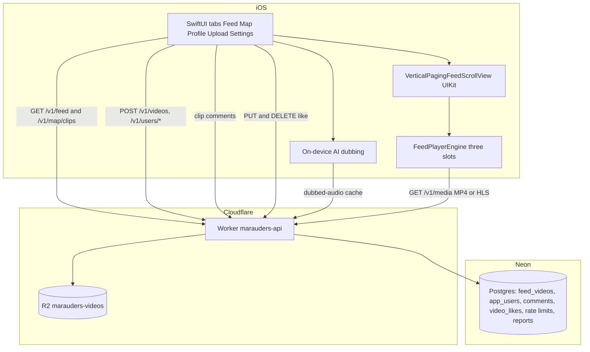
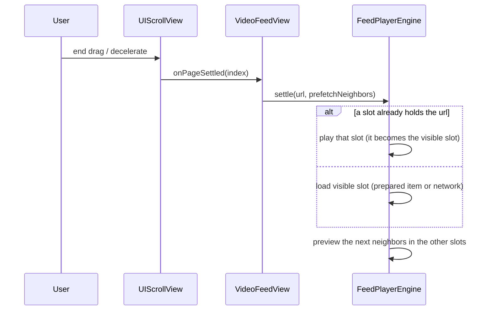
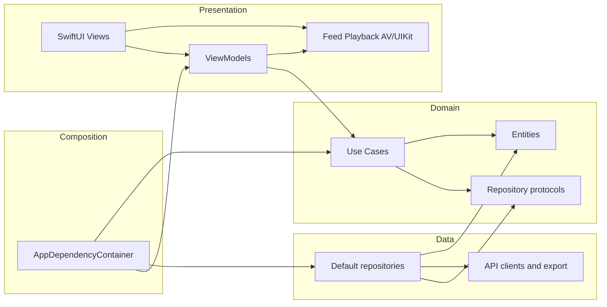
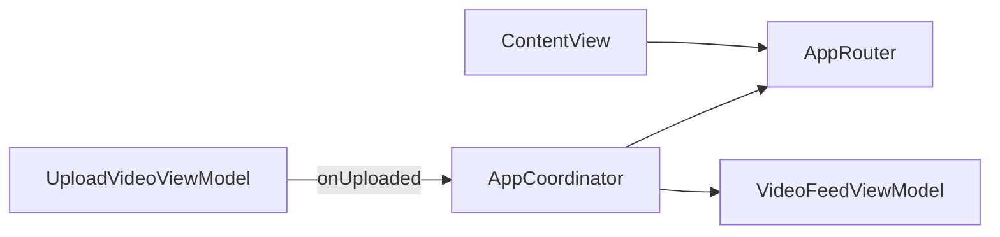
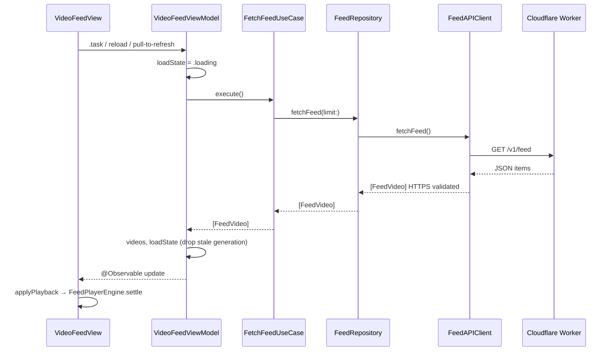
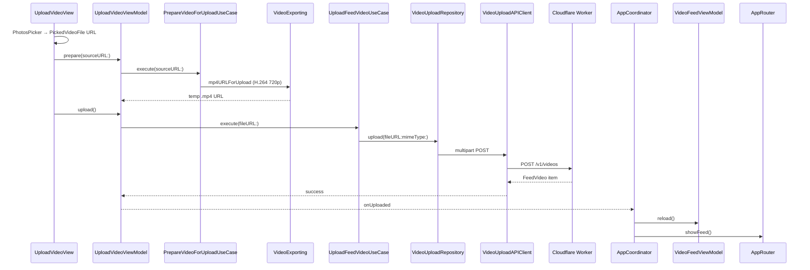
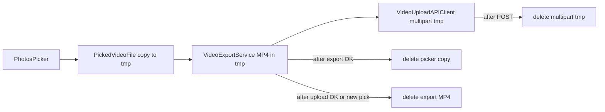

# Marauders — Architecture

Portfolio vertical-video app: **SwiftUI + AVFoundation** on iOS, **Cloudflare Workers + R2 + Neon** on the backend.

**Related:** [docs/adr/](docs/adr/) (decision records) · [deployment/video-pipeline.md](deployment/video-pipeline.md) (faststart, HLS) · [deployment/AI_DUBBING.md](deployment/AI_DUBBING.md) (AI dubbing, shared audio cache, language detection) · [docs/ci-cd.md](docs/ci-cd.md) (Jenkins → TestFlight)

## System context



| Surface | Responsibility |
|---------|----------------|
| `GET /v1/feed` | Paginated `{ items, viewerID }` via `limit` (default 20, max 50) + `cursor` (last item UUID) + optional `country` (ISO-2, joins uploader's `app_users.country`); public read, ordered `sort_order DESC, created_at DESC, id DESC`. Everyone sees the same clips, the viewer's own included; a supplied `Authorization` header is still validated (bad session → 401). `authorName` is the uploader's **live** `@handle` (`COALESCE(app_users.handle, feed_videos.author_name)`); each item also carries `authorAvatarURL` from `app_users.avatar_url`, `country`, coordinates and the optional `audioAssessment`; and, new with likes, `likeCount` (rows of `video_likes` for the clip) and `likedByViewer` (true when the signed-in viewer likes it; always false for a guest). `likedByViewer` comes from a second query (`SELECT video_id FROM video_likes WHERE user_id = … AND video_id = ANY(…)`) that runs only when the request carried a valid session, so the list query itself is still the same for every viewer. The count is a subquery in that list query: **until migration 018 has run the feed answers 500**, so migrate before deploying. `commentCount` (rows of `comments` for the clip) is a second subquery beside it; its table dates from migration 017. With follows each item also carries `postedByViewer` (the signed-in viewer uploaded it) and `authorFollowedByViewer` (they follow its uploader; `null` for a clip without an owner account, which nobody can follow), both false for a guest; they come from a third query (`authorRelations`: `feed_videos` by id with `EXISTS` on `user_follows`) that runs beside the like lookup, only for a valid session and a non-empty page. **Until migration 019 has run, a signed-in feed answers 500** (a guest's does not touch the table) |
| `GET /v1/map/clips` | Same handler and response as `/v1/feed`; the map tab calls it by its own path |
| `POST /v1/auth/apple` | `{ identityToken, country? }` → verify with Apple JWKS → upsert `app_users.country` → `{ accessToken }` (HS256, 30d) |
| `POST /v1/auth/dev` | Debug sign-in for the Simulator: `{ secret, label, country? }` → `{ accessToken }` for the stable user `dev:<label>`. Answers **404** unless the `DEV_LOGIN_SECRET` Worker secret (≥ 32 chars) is set; the app side is `#if DEBUG` and simulator-only. Shares the `auth` rate limit |
| `POST /v1/videos` | **Bearer** required; multipart `file` (MP4/MOV, ≤ 100 MB) + `latitude` + `longitude` + optional `caption` (≤500) + optional `audioAssessment` JSON (untrusted advisory, sanitized, stored in `feed_videos.audio_assessment`) → R2 + `feed_videos.owner_user_id` |
| `DELETE /v1/videos/:id` | **Bearer** required; deletes the caller's own video row + its R2 object + every shared dubbed-audio object for that clip |
| `GET` / `POST /v1/videos/:id/dubbed-audio?lang=` | Shared AI dubbed-audio cache (one R2 object per clip revision and language, 22 languages). GET is public (`missing` / `ready` + URL; a bad `Authorization` header still gets 401); every call carries the clip's source hash (`?source=<sha256 of stream_url>` on GET, `X-Source-SHA256` on POST/report) and a mismatch returns 409 `clip source changed`; POST is first-write-wins, 409s if the clip changed mid-upload, and needs a **Bearer** and a raw `audio/mp4` body ≤ 4 MiB; `kind=text` (409 `dubbed audio not saved yet` until the audio exists) reads/writes the subtitle text (≤ 16 KiB). `/v1/videos/:id/thai-audio` is the legacy path (= `lang=th`). Contract in [AI_DUBBING.md](deployment/AI_DUBBING.md) |
| `POST /v1/videos/:id/dubbed-audio/report?lang=` | **Bearer** required; reports a bad shared dub. The clip owner or the audio's uploader removes it alone, otherwise 2 different reporters do (`dubbed_audio_reports`, migration 016) |
| `GET /v1/videos/:id/comments?limit=&cursor=` | Public read (a bad `Authorization` header still gets 401). Newest first (`created_at DESC, id DESC`), `limit` default 30 / max 50, `cursor` = id of the previous page's last comment (once that comment is deleted the page comes back empty with `nextCursor: null`, and the app starts over from the newest). `{ items, nextCursor }`; each item is `{ id, body, language, createdAt, authorName, authorAvatarURL, canDelete }` with the author's live handle and avatar, and `canDelete` true for the viewer's own comments and for every comment on the viewer's own clip. **404** `video not found` |
| `POST /v1/videos/:id/comments` | **Bearer** required; `{ body, language? }`, at most 16 KiB of JSON (else **413**; a malformed or interrupted body is **400**). The body is trimmed and control characters other than tab and line breaks are dropped; only its first 10 line breaks are kept and each later one is stored as a space, so one comment cannot run to hundreds of lines. It must be 1–500 code points, hold at least one character a reader can see (text made only of whitespace, zero-width marks, variation selectors, Hangul fillers, the Braille blank or U+FFFC is refused) and contain no unpaired surrogate, else **422**. `language` is kept only when it is one of the 22 dubbing languages (Norwegian variants become `nb`), otherwise stored as null. **201** `{ comment }`; **404** when the clip is gone; **401** `account not found` when the token is valid but its `app_users` row is gone (the token is verified without a database lookup, so it outlives the account, and a retry can never succeed); rate-limited per user (`comment`, below) |
| `DELETE /v1/videos/:id/comments/:commentId` | **Bearer** required; the comment's author or the clip's owner removes it → `{ status: "deleted" }`; anyone else, or an unknown id, gets **404** `comment not found` (`comments`, migration 017) |
| `PUT` / `DELETE /v1/videos/:id/like` | **Bearer** required; likes the clip as the caller, or takes the like back. Both are idempotent (`INSERT … ON CONFLICT DO NOTHING`, a `DELETE` of the caller's own row) and answer `{ liked, likeCount }` with the clip's count after the change, computed in the same statement (a CTE's changes are invisible to the statement's own snapshot, so the count adds or subtracts what the CTE changed). An unknown clip is **404** `video not found`; a token whose account is gone is **401** `account not found` (the foreign key breaks, which no retry fixes); limited per user (`like`, below) → **429** (`video_likes`, migration 018) |
| `POST /v1/users/me/location` | **Bearer** required; `{ latitude, longitude }` → `app_users.latitude/longitude` and `location_updated_at` (now) |
| `GET /v1/users/me/friend-locations` | **Bearer** required; `{ sharing, located, items: [{ handle, avatarURL, latitude, longitude, locationUpdatedAt }] }`: the last known locations of the accounts the caller follows that follow them back (a self-join of `user_follows`) and have `shares_location` on and a location, newest first, at most 500, coordinates rounded to three decimals (about 100 m). Answered only while the caller shares too and has a location of their own on file (`located`), so nobody sees others while staying unseen: otherwise `items: []` without looking. No account id is sent. A token whose account is gone is **401** `account not found` (`app_users.shares_location`, migration 020) |
| `PUT /v1/users/me/location-sharing` | **Bearer** required; `{ enabled: boolean }` (anything else **400**) → `UPDATE app_users SET shares_location` → `{ sharesLocation }`. Turning it on (off → on) also clears the stored `latitude` / `longitude` / `location_updated_at` in the same statement, so a location the Map tab stored before the caller agreed is never shown; a token whose account is gone is **401**; limited per user (`location-sharing`, below) → **429** |
| `GET /v1/users/me` | **Bearer** required; `{ handle, country, latitude, longitude, videoCount, avatarURL, followerCount, followingCount, sharesLocation, videos[] }` for the signed-in user (each clip with `postedByViewer: true`). **Until migration 020 has run it answers 500** (it reads `shares_location`) |
| `PATCH /v1/users/me` | **Bearer** required; `{ handle }` → normalize (`@lowercase`, `a-z0-9._`, 1–63, reserved names blocked) → `{ handle }`; unique violation → **409** |
| `POST /v1/users/me/avatar` | **Bearer** required; multipart `file` (JPEG/PNG ≤ 5 MB) → R2 `avatars/{uuid}.{jpg\|png}` → `{ avatarURL }`; replaces the previous object (best-effort delete) |
| `DELETE /v1/users/me/avatar` | **Bearer** required; clears `app_users.avatar_url`, deletes the R2 object → `{ avatarURL: null }` |
| `GET /v1/users/{handle}` | Public; `{ handle, country, videoCount, avatarURL, followerCount, followingCount, followedByViewer, isViewer, videos[] }` for any account. A supplied `Authorization` header is validated like the feed's (bad session → 401); with a valid one `followedByViewer` says whether the viewer follows the account and `isViewer` whether it is their own, both false for a guest. Each clip carries `postedByViewer` = `isViewer` and `authorFollowedByViewer` = `followedByViewer`. A handle whose percent-escapes do not decode is **400** `invalid handle` (it used to throw) |
| `PUT` / `DELETE /v1/users/{handle}/follow` | **Bearer** required; follows the account as the caller, or stops following it. Both are idempotent (`INSERT … ON CONFLICT DO NOTHING`, a `DELETE` of the caller's own row) and answer `{ following, followerCount, viewerFollowingCount }`: the account's follower count and how many accounts the caller follows, after the change, computed in the same statement like the likes'. The handle goes through `parseHandle` (`@` optional, any case; malformed, reserved or undecodable → **400** `invalid handle`); an unknown account is **404** `profile not found`; the caller's own handle writes nothing and is **422** `cannot follow yourself`; a token whose account is gone is **401** `account not found` (`user_follows_follower_user_id_fkey`); limited per user (`follow`, below) → **429** (`user_follows`, migration 019) |
| `GET /v1/users/{handle}/followers` and `/following` | **Bearer** required (a guest or a bad session is **401** `authentication required`); the accounts that follow the profile, or that it follows, as `{ items: [{ handle, avatarURL, followedByViewer, isViewer }], nextCursor }`, newest follow first and then the other account's id ascending, which is the order of `user_follows_followed_idx`, so the followers page needs no sort (the following list reads the account's rows through the primary key and sorts them). `followedByViewer` says whether the viewer follows that row's account and `isViewer` whether it is the viewer's own; no account id is ever sent. `limit` is the feed's (1–50, default 20; otherwise **400**); `cursor` is opaque: base64url of the last row's follow time as exact text (microseconds kept) and its handle, values rather than a pointer to a row, so it keeps working after that row is unfollowed; a cursor this Worker could not have made is **400** `invalid cursor`. The handle goes through `parseHandle` (`@` optional, any case; malformed or undecodable → **400** `invalid handle`); an unknown account is **404** `profile not found`; limited per user (`follow-list`, below) → **429**; a database error is a generic **500** `failed to load list` (SQLSTATE and message are logged, never sent). `Cache-Control: private, no-store`. Routed before the `/v1/users/*` profile route, which would read `alice/followers` as a handle |
| `GET /v1/media/{key}` | Progressive MP4/MOV (**Range 206**), HLS playlist + `.ts` segments, avatar JPEG/PNG, or shared dubbed audio (`translations/…`, `must-revalidate` because a removed dub can be replaced; videos and avatars are `immutable`) |

A `/health` GET answers without auth. All `/v1/*` routes return JSON errors as `{ "error": … }`, except `GET`/`HEAD /v1/media/*`, whose own errors are plain text (`not found`, `invalid range`, …).

---

## Trust boundaries

```text
┌─────────────────────────────────────────────────────────┐
│  iOS app (untrusted client)                             │
│  · HTTPS-only playback URLs                             │
│  · No secrets in repo; API base URL in plist            │
│  · Access token in Keychain; disposable caches only     │
│  · Debug log tab: DEBUG builds only                     │
└───────────────────────────┬─────────────────────────────┘
                            │ TLS
┌───────────────────────────▼─────────────────────────────┐
│  Cloudflare Worker (validation, upload authz)           │
│  · Reject invalid paths, MIME, size                     │
│  · DATABASE_URL, JWT_SIGNING_SECRET, APPLE_CLIENT_ID    │
│    (and optional DEV_LOGIN_SECRET) via wrangler secret  │
└───────────────┬─────────────────────┬───────────────────┘
                │                     │
         ┌──────▼──────┐       ┌──────▼──────┐
         │ Neon Postgres│       │ R2 bucket   │
         │ metadata     │       │ video, audio│
         └─────────────┘       └─────────────┘
```

| Zone | Sensitive data | Controls |
|------|----------------|----------|
| iOS | Access token (Keychain); disposable feed/media cache in `Caches`; on-device language models | ATS HTTPS; fail closed on non-HTTPS `streamURL`; cache keyed by session and lifetime-limited; a token past its `exp`, or one the Worker answers 401, ends the session (the device only reads `exp`, the signature stays the Worker's to check) |
| Worker | `DATABASE_URL`, `JWT_SIGNING_SECRET`, `APPLE_CLIENT_ID`, optional `DEV_LOGIN_SECRET` | Secret bindings; input validation on every write; `/v1/auth/dev` inert (404) unless its secret is set |
| R2 | Video objects | Key allowlist `videos/{uuid}.mp4\|mov` or `videos/{uuid}/master.m3u8\|segNNN.ts` |
| R2 | Avatar objects | Key allowlist `avatars/{uuid}.{jpg\|jpeg\|png}` |
| R2 | Shared AI dubbed audio (untrusted, user-supplied) | Key allowlist `translations/{uuid}/{sha256}-{lang}-v1.m4a`; server validates AAC/M4A structure and size; first complete write wins; removable by report |
| Neon | `stream_url`, users, feed rows | Parameterized SQL; pooled connection string |

### Rate limiting

Two layers, cheapest first:

1. **Cloudflare Rate Limiting binding** (`RATE_LIMITER`, `AUTH_RATE_LIMITER` in `wrangler.toml`) — an in-runtime, per-location counter with zero added latency, applied to every `/v1/*` request except `/v1/media/*` (`AUTH_RATE_LIMITER` 30 / 60 s on the two sign-in routes, `RATE_LIMITER` 120 / 60 s elsewhere). Best-effort only: `isRateLimited()` fails open, and the binding is per-PoP. *Note:* as of Oct 2026 this binding is unreliable on live Workers (returns `success: true` regardless — cf. workers-sdk#16097), so it is defence-in-depth, not the enforcement point.
2. **Neon-backed limiter** (authoritative): `enforceDatabaseRateLimit` (`src/rateLimit.ts`) does an atomic fixed-window `INSERT … ON CONFLICT` into `rate_limit_counters` keyed by `scope:actor`. Counts are exact across Cloudflare locations. Applied to sensitive endpoints (table below). Over the limit → `429` with `Retry-After`. Fails open if the database is unreachable.

| Scope | Actor | Limit | Storage |
|-------|-------|-------|---------|
| `auth` (`/v1/auth/apple` and `/v1/auth/dev`) | client IP | 30 / 60 s | Neon fixed window |
| `upload` (`POST /v1/videos` and `POST /v1/users/me/avatar`, one shared bucket) | user id | 10 / 60 s | Neon fixed window |
| `dubbed-audio-upload` | user id | 10 / 60 s | Neon fixed window |
| `dubbed-audio-report` | user id | 10 / 60 s | Neon fixed window |
| `comment` (`POST /v1/videos/:id/comments`) | user id | 10 / 60 s | Neon fixed window |
| `like` (`PUT` and `DELETE /v1/videos/:id/like`) | user id | 60 / 60 s | Neon fixed window |
| `follow` (`PUT` and `DELETE /v1/users/{handle}/follow`) | user id | 30 / 60 s | Neon fixed window |
| `follow-list` (`GET /v1/users/{handle}/followers` and `/following`) | user id | 60 / 60 s | Neon fixed window |
| `location-sharing` (`PUT /v1/users/me/location-sharing`) | user id | 20 / 60 s | Neon fixed window |
| all `/v1/*` except media | IP | 120 / 60 s (30 / 60 s on sign-in), see `wrangler.toml` | CF binding (per-PoP, best-effort) |

---

## iOS — feed playback

See **[ADR-001: UIKit paging + dual AVPlayer](docs/adr/001-feed-playback-dual-player.md)** for options and tradeoffs. The ADR records the original two-slot decision; the engine has since grown to **three** slots (below).

### Problem (historical)

Per-cell `AVPlayer` instances caused teardown races. A single player in a fixed SwiftUI overlay did not scroll with the finger and stuttered on `replaceCurrentItem` when the page changed.

### Current design

| Piece | Role |
|-------|------|
| `VerticalPagingFeedScrollView` | SwiftUI wrapper around `VerticalFeedPagingView`: `UIScrollView` + `isPagingEnabled` on a black background; owns one `FeedPlayerLayerHostView` per player slot |
| `FeedPlayerEngine` | **Three** `AVPlayer` slots (visible clip + up to two preview neighbors), prefetch via `FeedMediaPreparationService`, `settle(on:prefetchNeighbors:)` |
| `VideoFeedView` | SwiftUI chrome, buffering overlay, tap → play/pause, `FeedClipCaptionOverlay` (author / caption) and `FeedClipActionRail` (like and Comments buttons with their counts, audio choice and tappable avatar, bottom-right) for the current page |

Each slot's layer host is a **subview of the scroll view’s content**, positioned at `y = index(of its URL) × pageHeight`, so video moves with the user during a drag; slots without a URL are hidden. Paging only selects which clip should play; surfaces are not moved on settle.

### Settle sequence (after finger release)



### Prefetch

- `prefetch` / `warmURLs` build `AVPlayerItem` until **readyToPlay** (cached by URL, at most 5 prepared items, 6 s forward buffer).
- On settle, the visible slot prefers **prepared items**; the other slots preview up to **two** neighbors (paused at zero).
- **Startup cache** (`FeedStartupCache` / `SessionFeedStartupCache`): the feed list plus whole MP4s (≤ 12 MiB each, 6 h lifetime) in `Caches`, kept per signed-in session. When a cached feed was restored, the splash is dismissed without its minimum delay and a cached file is played instead of the network URL. Disabled under `UITEST`.
- Buffering UI appears only after **~380 ms** of stall.

### UX / lifecycle

- **Tap** toggles play/pause (`FeedPlayerPhase.paused` when user-initiated).
- `AppRootView` splash (~650 ms min, skipped when the startup cache restored the feed) + initial feed load during splash.
- `scenePhase` / tab disappear → `pause()`; active → `settle` again, unless the comments sheet, the AI-audio choice or the sign-in screen the viewer is on the way to is up (`applyPlayback` keeps the clip paused then).

### Upload path (client)

`PhotosPicker` → `PickedVideoFile` → `AVAssetVideoLocationReader` pre-fills `ClipLocation` from the video's embedded ISO 6709 metadata (when present; `ClipLocationPickerView` lets the user search for or adjust the place) → `PrepareVideoForUploadUseCase` / `VideoExportService` (H.264 720p MP4) → `FastClipAudioInspector` classifies the exported audio on-device (speech / music / mixed, advisory only, never blocks upload) → `UploadFeedVideoUseCase` → `POST /v1/videos` (includes `latitude` / `longitude` from `ClipLocation`, the `audioAssessment` JSON, plus optional `caption` typed in the upload form; blank values are omitted).

### Map tab

- **Data:** `GET /v1/map/clips` (same response as the feed, `forMap` in `FeedAPIClient`) via `VideoFeedViewModel.loadMapClips(country:)` into `mapFilteredClips`, independent of the feed list; clips with both `latitude` / `longitude` get a `FeedVideo.mapCoordinate`. The response also carries `authorName` / `caption`, used by client-side search.
- **Layout:** full-screen `Map` (no navigation bar) with the location sharing switch, a country filter button (flag, 🌐 for all) and a locate FAB. The map's root is an accessibility container (`map.root`), so the controls keep their own identifiers (before, the root's identifier replaced theirs). `MapView` tracks the visible region via `.onMapCameraChange(frequency: .onEnd)`. Sign out lives in the Profile tab.
- **Pins & clustering:** `MapClipClustering` collapses nearby clips into `MapClipCluster`s using a grid sized from the visible span, so zooming in breaks clusters apart again; single clips render as circular thumbnail pins (`MapClipPinView`) and clusters as a count bubble (`MapClusterPinView`) — tapping a cluster zooms in, tapping a single pin opens the shared `ClipPlayerView` in a sheet (looping, with a "Play in Feed" shortcut).
- **Search (hidden):** `MapClipSearch` filters already-loaded clips client-side by author handle, caption and country (no network round-trip) and re-fits the camera. `MapView.isSearchVisible` is `false` for now; the `MapSearchBar` pill and logic stay in place to re-enable later.
- **Country filter:** filter button → `MapCountryFilterSheet`; selection re-fetches `/v1/map/clips?country=<ISO2>`.
- **Near me:** the locate FAB recenters the camera on you (`MapClipProximity`); `MapClipProximity` also limits the pins to the visible region, and the clip player shows the distance from you when location is known.
- **Open in feed:** tap pin → `ClipPlayerView` → **Play in Feed** → `AppCoordinator` calls `ensureVideoLoaded`, which paginates with `cursor` until the clip is in memory, then `requestFocus(on:)` and `router.showFeed()`; `VideoFeedView` scrolls via `focusVideoID` / `consumeFocusRequest()`. The clip's author handle opens the public profile.
- **Auth:** Map, Upload and Profile gate on sign-in (`SignInRequiredView` / `SignInWithAppleGateView`; the Feed is open to guests). Sign-in needs location permission and detects the country (`SignInLocationViewModel`, changeable in `CountryPickerView`); `identityToken` → `POST /v1/auth/apple` → access token in Keychain; authenticated requests send `Authorization: Bearer`. Debug builds on the Simulator can instead sign in through `/v1/auth/dev` (`DevAuthAPIClient`, secret passed via launch environment, never stored in the project).
- **Session end:** the access token is a 30-day JWT. `AuthViewModel.restoreSession()` (run when the app opens and whenever the Map, Upload or Profile tab appears, so it also catches a token that runs out while the app is open; nothing re-checks the token on the Feed or Settings tabs, so the first 401 ends the session there) reads its `exp` with `APIAccessTokenExpiry` and treats a token that is expired, or whose `exp` cannot be read, like a missing one: the stored session and token are cleared and the viewer is signed out, which brings up the sign-in gates. A 401 to a request that carried the token ends the session the same way (see *iOS — HTTP API contract* below). Nothing opens the sign-in screen by itself: the viewer reaches it from a gate, the feed's sign-in prompts or **Sign in to comment**. Guests are unaffected.
- **Location:** Required to open the Map tab (`MapLocationRequiredView` gate + system permission). **Current Location** recenters the map after access is granted. The first fix delivered in a session is reported once to `POST /v1/users/me/location` via `ReportUserLocationUseCase` (composition root), so the account keeps a last-known location. A viewer who shares their location also reports through `ForegroundLocationReporter` while the app is in use and `BackgroundLocationMonitor` while it is closed (see *Location sharing*).

### Profile tab

- **Data:** `GET /v1/users/me` (Bearer) via `UserProfileAPIClient` → `UserProfile` (handle, country, last-known coords, clip count, `avatarURL`, `followerCount` / `followingCount` (optional: nil from a Worker without follows), and the user's own `[FeedVideo]`).
- **UI:** `ProfileView` shows a header (tappable avatar + `@handle` + country flag/name + a TikTok-style row of `ProfileStat`s: **Following**, **Followers** and **Clips**, the first two only when the Worker sent them, and each of them opens its list (`ProfileCountLink`, see **Follows**)), a 3-column grid of the user's clips and a **Sign Out** action. Tapping a clip plays it inline with `ClipPlayerView`; pull-to-refresh re-fetches.
- **Handle:** every account gets an auto `@user_<hex>` handle on sign-up. Tapping the handle opens an edit alert → `PATCH /v1/users/me` via `UpdateUserHandleUseCase`; server-normalized value is written back to the profile (409 → "already taken").
- **Avatar:** the header photo is a `PhotosPicker`; the picked image is downscaled to ≤ 512px + JPEG-encoded by `DefaultAvatarImagePreparer` inside `UpdateAvatarUseCase`, then `POST /v1/users/me/avatar` via `UserProfileAPIClient` (multipart); the returned URL updates the profile and is broadcast to the feed (`onAvatarChanged` → `VideoFeedViewModel.applyAuthorAvatar`). `AvatarView` falls back to a deterministic gradient + initial when there is no photo.
- **Delete:** long-press a clip (or tap the trash button in the player) → confirm → `DELETE /v1/videos/:id` via `DeleteUserClipUseCase`; the clip is removed from the grid optimistically and the count decremented.
- **State:** `ProfileViewModel` (`idle → loading → loaded/failed`) loads once via `loadIfNeeded()` and re-fetches on `reload()`. When the session ends, `ContentView` calls its `resetForSessionChange()`, so the next sign-in loads that account's profile instead of showing the last one, or the error of a load that failed as the session ended. The feed resets on every session change; the profile only when one ends, because after a sign-in the Profile tab may already be loading the new viewer's. A load or edit that was still out when the session ended can no longer write into the view model or raise an alert (a delete still tells the feed which clip went).
- **Auth:** gated on Sign in with Apple (same `SignInWithAppleGateView` as Upload/Map). When the session ends while the tab is open (expired token, 401 from the profile request itself), the tab falls back to this gate.
- **`ClipPlayerView`** is shared between the map pins and the profile grid (`Presentation/Common`).

### Public profiles (`@handle`)

- **Open:** tapping the author handle in the feed caption (`FeedClipCaptionOverlay`), the avatar in the right-edge rail (`FeedClipActionRail`) or the author on a map clip calls `AppRouter.openPublicProfile(handle:)`, which the `ContentView` `TabView` presents as a sheet.
- **Data:** `GET /v1/users/{handle}` via `UserProfileAPIClient.fetchPublicProfile` → `PublicUserProfile` (`handle`, country, count, `avatarURL`, `[FeedVideo]`, and the optional `followerCount`, `followingCount`, `followedByViewer`, `isViewer`). The Bearer goes along when the viewer is signed in; a 401 to it is retried once as a guest, like the feed and comments reads.
- **UI/State:** `PublicProfileView` + `PublicProfileViewModel` (`Presentation/Profile`) reuse `ProfileClipThumbnail` and `ClipPlayerView`; read-only (no delete), with `Retry` on failure. The view keeps its model in `@State`: the sheet's content closure runs again whenever `ContentView` does (a sign-in, for one), and a fresh model would sit idle with nothing loaded. What the profile shows and does lives in `PublicProfileScreen`; `PublicProfileView` only adds the sheet's `NavigationStack`, the close button and `publicProfile.root`, so a profile pushed from a follower list (`ProfileRoute.profile`) is the same screen.
- **Layout note:** the feed caption respects the bottom safe area so the tappable author clears the tab bar, while the video layers keep `.ignoresSafeArea()` for full-bleed playback.

### Follows

- **Feed:** a red "+" (with a thin white ring, so it stands apart from an avatar of the same red) sits half over the lower edge of the author's avatar on the rail (`FeedClipActionRail`, `feed.follow`, VoiceOver **Follow @handle**). Its extra tap room goes to the sides and below the dot only, so a tap on the face just above the dot still opens the profile. It only ever follows (`UserFollowsViewModel.follow`), as on TikTok; once followed it turns into a white tick for a second (`feed.followed`) and goes, from every clip of that author. It is left off the viewer's own clips (`postedByViewer`) and wherever the feed lacks the fields (an older Worker or startup cache: `FeedVideo.postedByViewer` / `authorFollowedByViewer` are optional). A guest's tap opens the shared sign-in like the heart does (`askGuestToSignIn`).
- **Profiles:** `PublicProfileView` shows **Following** / **Followers** / **Clips** and a red **Follow** button (`publicProfile.follow`) that turns grey **Following**; tapping that stops the follow. There is no button on the viewer's own profile (`isViewer`) or from a Worker without follows (`followedByViewer` nil). A guest's tap opens `SignInSheet` over the profile (the same view `ContentView` shows), so after signing in they are still on it; the profile reloads on every sign-in or sign-out for the new viewer's state, and nothing is followed on their behalf. The viewer's own Profile tab shows the new following count as soon as the Worker answers (`onViewerFollowingCountChange` → `ProfileViewModel.applyFollowingCount`), and a profile load that was out meanwhile does not put the older number back.
- **Lists:** **Following** and **Followers** are buttons (`ProfileCountLink`, VoiceOver hint "Opens the list"; the identifiers `profile.followingCount` / `profile.followerCount` and `publicProfile.…` stay on them). A signed-in viewer's tap pushes `ProfileRoute.followList(handle:kind:)` in the profile's own `NavigationStack` (the Profile tab's, or the public profile sheet's, which has one): `FollowListView`, one screen for both lists with a segmented switch (`followList.tabs`) that opens on the tapped one and loads a tab the first time it is shown. A row is a 44 pt avatar and the handle; it pushes that account's profile in the same stack (`ProfileRoute.profile` → `PublicProfileScreen`, so Back returns to the list and a pushed profile's own counts push on again), and every row but the viewer's own (`isViewer`) has the Follow / Following button, which reads and writes `UserFollowsViewModel` like the feed's "+" and every profile, so the row, the rail and the profile counts agree; an account the viewer stops following stays on the list until the next load, as on TikTok. `FollowListViewModel` (`@Observable`, one per tab) loads 30 rows a page and asks for the next when one of the last 5 appears; it keeps what it has when a refresh or a later page fails (a later page shows "Couldn't load more" with Try Again), drops an answer that arrives after a refresh or a sign-in or sign-out (a load generation), does not count a request that was cancelled as a failure (SwiftUI cancels the task that started a load when the viewer switches tab: a tab with nothing yet goes back to waiting and loads when it is shown again, and a cancelled page is asked for again by the next row that appears), ends the list when the Worker repeats the cursor it was sent, and shows a row once however often the Worker lists it (by normalized handle). The lists are for signed-in viewers: a guest sees the counts and a tap on one opens `SignInSheet` over the profile, after which nothing opens by itself; a list whose request comes back 401 shows "Sign in to see this list" (the shared transport has already ended the session). `ProfileNavigation` (built once by `AppDependencyContainer.profileNavigation` and handed down through `ContentView`) carries what the pushed screens need: the auth and follows view models and the factories for a profile's and a list's view model; `ProfileRouteDestination` resolves a route, and a pushed profile keeps its model in `@State`, since a destination closure runs again whenever the stack's content does.
- **Data:** `FollowsAPIClient` behind `UserFollowRepository` (`DefaultUserFollowRepository`) and `SetUserFollowUseCase`; `PUT` follows, `DELETE` stops following, both answer `UserFollowChange` (`following`, `followerCount`, `viewerFollowingCount`, negatives shown as 0). Handles are keyed by `UserHandle.normalized` (`@` + lowercase), the form the Worker stores. The lists: `FollowListAPIClient` behind `FollowListRepository` (`DefaultFollowListRepository`) and `LoadFollowListUseCase`; `GET` with the Bearer, `limit` and the cursor exactly as the Worker made it; a row's avatar is kept only when it is an http(s) URL with a host.
- **State:** `UserFollowsViewModel` (`@Observable`, one per app, shared by the rail and every profile) answers `isFollowing(handle, fallback:)` and `followerCount(of:fallback:)`, the fallback being what the asking screen loaded. A tap shows the flipped state at once (and ±1 on a known count); the Worker's answer then replaces the guess; a failure puts back what was known before. One request is out at a time across all accounts (a queue, oldest first): taps meanwhile change only what is sent next, and an account whose taps cancel out before its turn sends nothing. Two follows the Worker ran side by side would each count the viewer's follows without the other's row, so this also keeps `viewerFollowingCount` right. Unlike the likes, what was learned about an account beats the feed's word for good: the feed loaded `authorFollowedByViewer` before the follow, so a matching reload is not newer. A public profile load reads the model's clock (`stamp()`) before it starts and hands its answer back (`record`); it replaces what is known only when no change for that account is out and the Worker last answered about it before the load began, so a load read before a follow was written cannot undo it. Nothing here edits `VideoFeedViewModel.videos` (that would restart a paused clip). The flip side: a feed reload never overrides what the model learned, so a follow or unfollow made on another device shows on this one once that account's profile is opened, or after the next sign-in. `PublicProfileViewModel` numbers its loads and keeps only the newest one's answer, since the reload after a sign-in can overtake a pull to refresh.
- **Session change:** `ContentView` calls `UserFollowsViewModel.reset()` beside the likes'; a generation counter drops answers and profile loads from before it. A 401 to a follow ends the session through the shared transport. `FollowListView` drops what its lists loaded when `isSignedIn` changes (`resetForSessionChange`, before the next load), because a list belongs to the viewer who asked for it.

### Location sharing

- **Rules (the owner's):** opt-in, off by default; reciprocal (a viewer sees the last location of someone they follow who follows them back only while both share, and a viewer who does not share sees nobody); the latest location always shows, however old, with its age; the app sends the viewer's location while in use and, with Always location access, while closed, using the services that cost the least battery (2026-11-02, after Protego: the same switch, and everyone who shared before is asked again).
- **Switches:** a capsule on the Map tab's top bar (`map.shareLocation`, VoiceOver **Share location** / **Sharing location**, at least 44 pt tall so it grows with Dynamic Type) and a toggle in Settings (`settings.locationSharing`), which stays reachable when location access is off and the Map tab is shut; the Map tab's location gate also offers **Stop sharing location** (`map.stopSharing`). Off → an alert explains who will see what and asks before sharing; on → one tap stops at once. While the Worker has not said where it is (`sharing` nil) or a change is out, the capsule shows a spinner and is disabled; a failed change keeps it where it was, and the screen that asked shows the error (`setSharing` returns it).
- **Friends on the map:** `FriendPinView` annotations (`map.friend`): the avatar in a green ring with the handle and a relative age (`Date.RelativeFormatStyle`, localized by the system); a tap opens the public profile. While the viewer's own location is not on file yet a capsule says **Finding your location…** (`map.findingLocation`); while sharing with nobody to show, another says so (`map.friendsEmpty`). The map asks `GET /v1/users/me/friend-locations` again every 60 s while it is on screen, and drops the pins once no ask has worked for 5 minutes (`staleAfter`): the friend may have stopped meanwhile.
- **Reporting:** `ForegroundLocationReporter` asks a `CLLocationManager` of its own (100 m accuracy) for one fix and sends it with `ReportUserLocationUseCase`: when the app becomes active and every `interval` (5 min, counted from when the fix was asked for, with 10 s of timer slack) while it stays active, driven by a task in `ContentView` keyed on `scenePhase == .active && sharing == true`, and at once (forced) when the viewer turns sharing on. A fix asked for before a `reset()` (session end, or sharing turned off) or arriving when `shouldSend` says the viewer no longer shares is dropped unsent; a fix that never arrives is given up after 60 s. It never asks for permission and never runs in the background; a failed send is retried at the next chance. After the first report since sharing went on, the view model refreshes so the friends appear. The Map tab's own once-per-session report is unchanged.
- **While closed:** `BackgroundLocationMonitor` (one per app, `AppDependencyContainer.backgroundLocationMonitor`) runs significant-change monitoring (iOS wakes the app, or launches it again in the background, after about 500 m, at most every few minutes) and visit monitoring (an arrival is sent; a departure is where the viewer was, and moving on reports anyway) while the viewer shares and location access is Always. Neither needs the `location` background mode or shows the blue indicator. Whether the viewer shares is kept in `UserDefaults` (`locationSharing.sendsWhileClosed`) as the Worker last said it, because `MaraudersApp.init` calls `resume()` before any UI exists: a launch in the background for a location gets the event only once a location manager has started the services again. A launch without sharing stops them, in case a run before left them on; a launch before the first unlock after a restart (the saved choice reads as unset and `isProtectedDataAvailable` is false; the choice and the token stay readable while the iPhone is locked again after that) leaves them alone and resumes on `protectedDataDidBecomeAvailableNotification`. A fix older than 10 minutes or without a position is dropped; each report holds a background task until it is through. Reports go out with `whileClosed: true` (`ReportUserLocationUseCase.executeWhileClosed`): the Worker stores such a location only while the viewer shares and answers `sharesLocation`, so sharing turned off on another device (or by migration 021) stops this iPhone at its next move without anything being kept; an answer without the field (an older Worker) changes nothing. It has its own transport (Keychain token, no rejected-session reporting): a `notAuthenticated` or 401 stops it until the Worker says the viewer shares again, and the next launch's own requests end the session. The session token is readable after the first unlock, so reports also go out while the iPhone is locked. `FriendLocationsViewModel` tells it what the Worker says on every refresh and change, stops it at once when the viewer turns sharing off, and on `reset(signedOut: true)`, which `ContentView` also calls when the saved session does not come back at launch (expired or revoked, so a later sign-in of another account starts with it stopped); a sign-in (the saved session coming back at launch is one) leaves it to the refresh that follows. Settings shows **Allow location access Always** (`settings.allowAlwaysLocation`) and says mutual followers see only where the viewer last used the app while sharing is on without Always access (`lacksAlwaysAccess`); sign-in asks for Always, but it can be lowered since.
- **State:** `FriendLocationsViewModel` (`@Observable`, one per app) holds `sharing`, `located` and `friends`; `ContentView` refreshes it each time the app becomes active while signed in (the viewer may have changed it on another device, or the last ask failed) and calls `reset(signedOut:)` on every session change (a generation counter drops answers from before; the reporter forgets its last report and drops a fix on its way). A sharing change bumps a revision as it starts and again when answered, so a refresh that was out across it cannot undo it. A 401 ends the session through the shared transport.
- **Consent again:** migration 021 turns `shares_location` off once for everyone, since they agreed to where they last used the app, not to where they are while it is closed; `db:migrate` replays every file, so the reset is tied to a `data_migrations` row and runs only the first time. The switch's confirmation and the Settings footer now say "also while Marauders is closed".
- **Known limits:** signing out stops the iPhone sending but, like deleting the app, does not turn sharing off, and as the latest location always shows, the last one stays on mutual sharers' maps until the user turns sharing off.
- **Data:** `LocationSharingAPIClient` behind `LocationSharingRepository` (`DefaultLocationSharingRepository`), `LoadFriendLocationsUseCase`, `SetLocationSharingUseCase`; a point off the Earth is left out, and `locationUpdatedAt` is read with `WorkerDateParser` (milliseconds included). The iOS location usage texts say a location is shown to others only when sharing is on and only to mutual followers, and that with it on the location goes out when the viewer moves, also while the app is closed.
- **UI tests:** `UITestLocationSharingRepository` starts off; `@traveler` (the fixture feed clip's author) follows back and shares, so they appear once the viewer follows them and shares.

### Comments

- **Open:** the **Comments** button at the top of the feed's right-edge rail (`FeedClipActionRail`, `feed.comments`) opens `CommentsView` as a medium / large sheet for the current clip. The feed pauses while the sheet is up and resumes when it closes, unless the viewer had paused the clip themselves (`FeedPlayerPhase.shouldResumeAfterInterruption`: only `.paused` stays paused, so a clip that was still buffering or had failed is started again; the AI-audio menu uses the same rule). A second tap on the button while a sheet is up or closing does not overwrite what the first one noted. Leaving through **Sign in to comment** keeps the clip paused behind the sign-in screen; it plays again when the viewer backs out of it.
- **Count:** under the bubble the rail shows the clip's `commentCount` in compact form (VoiceOver label **Comments**, the count as its value); a feed without the field (an older Worker or startup cache, `FeedVideo.commentCount` is optional) shows the word **Comments** instead. `CommentsViewModel.onCountChange` reports +1 for each post and −1 for each comment that leaves the list through a delete (also when someone else removed it first: the viewer saw it, so the count they saw held it). `VideoFeedView` adds those to `ClipCommentCounts`, which, like the likes, never edits `VideoFeedViewModel.videos` and gives way as soon as a reload brings another count for the clip. Comments other viewers write show on the next feed load.
- **Guests** can read. In place of the composer they get **Sign in to comment**, which closes the sheet first and opens the shared sign-in screen from the sheet's `onDismiss`, so two sheets are never stacked; after signing in the viewer is back on the feed, not in the sheet, and because every sign-in or sign-out reloads the feed (`ContentView` calls `resetForSessionChange()`) the feed starts again at its first clip, not at the one that was being commented on.
- **Data:** `CommentsAPIClient` behind `CommentRepository` (`DefaultCommentRepository`) and `LoadCommentsUseCase` / `PostCommentUseCase` / `DeleteCommentUseCase`. Pages are 30 comments, newest first; the next page loads when a row within 5 of the end appears, and a failed page waits for a tap on **Try Again** instead of looping. A 401 on a read that carried a token is retried once as a guest, so an expired session never blocks reading. The same 401 also ends the session (see *iOS — HTTP API contract*): the sheet stays open with the comments the guest retry returned, and its composer gives way to **Sign in to comment** (a draft that was typed no longer keeps the sheet from being swiped away).
- **Rules:** `CommentRules` (Domain) trims the text and allows 1–500 Unicode scalars (the Worker counts code points) with at least one visible character (`hasVisibleCharacter`, the same rule as the Worker: not whitespace, control, default-ignorable, U+2800 or U+FFFC); `PostCommentUseCase` refuses anything else before a request is made. The Worker alone limits line breaks (10 per comment, see the endpoint table); the app shows the text the Worker stored. The app sends no `language` yet.
- **State:** `CommentsViewModel` (`idle → loading → loaded / failed`) keeps the list on screen when a refresh fails (unless the viewer's deletes emptied it meanwhile while older comments exist: then the failed screen with Retry takes over) and clears its message when the next refresh starts, drops a stale page that arrives after a newer reload (`loadGeneration`), does not start a next-page request while a refresh is in flight (`isReloading`; a row near the end that appeared meanwhile gets its page as soon as the refresh is over), and asks again (up to 3 requests) when a post or delete finished while the refresh request was out (the third answer is accepted as it is, minus the comments the viewer deleted and plus any post whose answer arrived during that request); a page request that overlapped a delete is asked once more. The comments the viewer deleted are remembered while the sheet is open, so no answer, however late, puts one back. The next page is requested after the last comment still listed rather than with the Worker's `nextCursor` (only its presence is used), so deleting the last row never strands the older ones; an empty page after a cursor, or deleting every listed comment while older ones exist, reloads from the newest. The draft is kept when a post fails and when the viewer typed more during the request. `AppDependencyContainer.makeCommentsViewModel` builds a fresh one each time the sheet opens; under `UITEST` the container uses `UITestCommentRepository` (not with `UITEST_REJECTED_SESSION`, which keeps the real comments client over the rejecting transport).
- **Composer:** while the draft holds text the sheet cannot be swiped away (`interactiveDismissDisabled`; the close button still can), the list dismisses the keyboard as it scrolls, a tap anywhere on the input pill focuses it, a failed post is announced to VoiceOver and the character counter has a spoken label.
- **Delete:** swipe a row with `canDelete` (the viewer's own comments, or any comment on the viewer's own clip) → confirm.

### Likes

- **Open:** the heart at the top of the feed's right-edge rail (`FeedClipActionRail`, `feed.like`, VoiceOver label **Like** / **Unlike** with the count as its value) sits above Comments and shows the clip's count in compact form. `VideoFeedView` hands it `ClipLikesViewModel.state(for:)` and a toggle closure; without a `likesViewModel` the rail has no heart.
- **Double tap:** as on TikTok, a double tap on the clip likes it and leaves a big heart where the finger was (`FeedHeartBurstLayer`: it pops in tilted a little, floats up and fades within a second; with Reduce Motion it only fades), and each further quick tap adds another heart. `VerticalFeedPagingView` tells the taps apart with `FeedTapSequence`: a tap waits `doubleTapInterval` (0.3 s) for a second one before it pauses or plays the clip, a second tap within it is a heart, and so is any tap within `heartRunInterval` (0.6 s) of the last heart; a swipe starts afresh. A double tap only ever likes (`ClipLikesViewModel.like`, which sends nothing for a clip the viewer already likes). The rail's heart is filled either way, white until liked and `Color.likeRed` after; it bounces and the phone gives a light haptic each time the viewer likes a clip. A guest's double tap opens sign-in like the heart does.
- **Guests** see the count. Tapping the heart pauses the clip (through the flag the AI-audio choice uses, `resumeAfterAudioChoice`) and opens the shared sign-in screen; backing out plays the clip again, signing in reloads the feed (which empties the pager) and the viewer taps the heart again, nothing is liked on their behalf.
- **Data:** `LikesAPIClient` behind `ClipLikeRepository` (`DefaultClipLikeRepository`) and `SetClipLikeUseCase`; `PUT` likes, `DELETE` takes the like back, both answer `ClipLikeState` (`liked`, `count`, a negative count is shown as 0). `FeedVideo.likeCount` / `likedByViewer` are optional so a Worker or a startup cache from before likes still decodes (no likes shown). The startup cache is already kept apart per session, so one viewer's `likedByViewer` is never shown to another.
- **State:** `ClipLikesViewModel` (`@Observable`, one per app) answers `state(for: clip)`. A tap shows the flipped state at once; the Worker's answer then replaces the guess with its own count; a failure (any `ClipLikeError`) puts back what the Worker last said, or what the feed said before the first tap. One request per clip is out at a time: taps made meanwhile change only what is sent next, and a request that would repeat what the Worker already holds is not sent. It never edits `VideoFeedViewModel.videos`: a change there runs `applyPlayback` → `settle`, which clears the viewer's pause, so liking would restart a clip they paused. Instead each clip the viewer touched has an entry remembering what the feed said (`likeCount`, `likedByViewer`) when they tapped; as soon as a reload says something else about that clip (after an upload, from the map, Try Again) the entry gives way to the feed, which is newer.
- **Session change:** `ContentView` calls `ClipLikesViewModel.reset()` next to `VideoFeedViewModel.resetForSessionChange()`; answers from before the reset are ignored (a generation counter). A 401 to a like ends the session through the shared transport like any other request.

### Settings tab and AI dubbing

Full detail (cache contract, local processing limits, language detection, Dutch/English/Spanish sources) is in **[deployment/AI_DUBBING.md](deployment/AI_DUBBING.md)**; this is only where it sits in the architecture.

- **Settings tab** (`SettingsView`): the viewer's **listening language** (`ListeningLanguageStore`, one of the 22 `ListeningLanguage.codes`, mirrored by `DUBBING_LANGUAGES` in the Worker) and **Language models** (`LanguageModelsView`: on-device speech / translation models and the detection model, downloaded on demand).
- **Dubbing runs on the viewer's iPhone** (`Presentation/Dubbing`, `DubbingViewModel`): the viewer explicitly picks original or AI audio. The player first asks the shared cache (`DubbedAudioCacheClient`: GET/POST `dubbed-audio`, subtitle text, report); on a miss it recognizes the clip's speech, translates (Apple Translation) and narrates with a system voice, then uploads the finished AAC/M4A so later viewers reuse it. Dubbing sources are English, Spanish and Dutch. Nothing about the clip's audio or transcript is sent to a third-party AI service.
- **Language detection** is also viewer-side: when a clip declares no language, `StagedClipLanguageDetector` picks up to two speech-like windows (`SpeechWindowSelector`) and names the language with the Whisper **base** model (WhisperKit, `WhisperEngine`, downloaded once via `LanguageDetectionModelStore`), falling back to system recognizers. Results are remembered per clip on the phone only (`DetectedLanguageMemo`).
- **Bad shared audio:** signed-in viewers can report a shared dub (`DubbedAudioReportMemory` remembers what this phone reported); the Worker removes it per the rules in the route table.
- **Layering note:** the dubbing clients and view model live in `Presentation/Dubbing`, next to the UI that drives them, so they are an exception to the strict "ViewModels use only use cases" rule below.

### Swift 6 concurrency

| Setting | Value |
|---------|--------|
| Language | **Swift 6** (`SWIFT_VERSION = 6.0`) |
| Deployment target | **iOS 26.5** (`IPHONEOS_DEPLOYMENT_TARGET`) |
| Default isolation | **MainActor** (`SWIFT_DEFAULT_ACTOR_ISOLATION`) |
| Strictness | Approachable concurrency (`SWIFT_APPROACHABLE_CONCURRENCY`) |

**Isolation model (intentional split):**

- **MainActor:** `FeedPlayerEngine`, ViewModels, `AppLogStore`, SwiftUI views — `AVPlayer` control and UI state only.
- **`FeedMediaPreparationService` (actor):** `AVURLAsset` cache, prefetch until `readyToPlay`, `beginPlaybackItem` for visible-slot loads — runs off the main actor between `await` points.
- **Sendable value types:** `FeedVideo`, `FeedPlayerPhase`, `FeedLoadState`, API DTOs, `FeedAPIClient` / `VideoUploadAPIClient` — safe across `Task` boundaries.
- **UIKit bridge:** `VerticalPagingFeedScrollView` settle callbacks use `Task { @MainActor in … }` before updating bindings / engine.
- **Feed reload:** `VideoFeedViewModel` ignores stale API results when a newer `reload()` started while the previous request was in flight.
- **Feed pagination:** scroll near the end → `loadMoreIfNearEnd` with `cursor` = last loaded id; upload → `reload()`; Map tab → `syncHeadWithServer()` merges new clips into the shared list (pins update).
- **Tests:** engine tests `@MainActor`; `FeedMediaPreparationServiceTests` cover HTTPS rules on the actor.

See **[ADR-002](docs/adr/002-ios-concurrency.md)** for rationale.

### MVVM + Clean Architecture

See **[ADR-003](docs/adr/003-mvvm-clean-architecture.md)**. Packaging: **[ADR-004](docs/adr/004-single-app-target.md)** (single Xcode target, folder boundaries; splitting into local SPM modules deferred). The target does use remote SwiftPM packages: POC_MyLibrary, Alamofire, waypointsdk (private JFrog registry), lottie-spm and WhisperKit (pinned to 1.1.1).

| Layer | Folder | Role |
|-------|--------|------|
| Composition | `Composition/` | `AppDependencyContainer` wires use cases |
| Domain | `Domain/` | `FeedVideo`, repository protocols, use cases |
| Data | `Data/` | API clients, `Default*Repository`, export |
| Presentation | `Presentation/` | SwiftUI Views + ViewModels; `Feed/Playback/` for AVFoundation |

#### Dependency rules

Single app target — boundaries are **folder + convention** ([ADR-004](docs/adr/004-single-app-target.md)). Arrows show allowed compile-time dependency direction.



| Layer | May import / call | Must not |
|-------|-------------------|----------|
| **Domain** | `Foundation` only | SwiftUI, UIKit, AVFoundation, PhotosUI, `URLSession` in use cases |
| **Data** | Domain (+ Apple frameworks needed for I/O) | SwiftUI; Presentation types |
| **Presentation (ViewModel)** | Domain use cases and entities | `FeedAPIClient`, `VideoUploadAPIClient`, concrete `Default*Repository` |
| **Presentation (View)** | ViewModels; playback types in `Feed/Playback/` | Use cases or repositories directly (except wiring in previews) |
| **Composition** | Domain, Data, Presentation ViewModels | UI layout |

**Playback exception:** `FeedPlayerEngine` is presentation infrastructure. `VideoFeedView` drives it for scroll/settle; it is not a domain use case.

#### Navigation (Coordinator / Router)

See **[ADR-005](docs/adr/005-coordinator-router.md)**.

| Type | Role |
|------|------|
| `AppRouter` | Observable tab state (`MainTab`: feed, map, profile, upload, settings, and log in DEBUG); views bind `TabView(selection:)`; also presents the public-profile sheet (`openPublicProfile(handle:)`) |
| `AppCoordinator` | Cross-tab flows: splash feed load, upload finished → reload feed + show feed tab, map **Play in Feed** → load clip + focus it + show feed tab |
| ViewModels | Feature logic only; no direct tab switching |



#### MVVM flow (feed reload)



#### MVVM flow (upload)



(`AppCoordinator` performs reload + tab change; see ADR-005.)

### Module map

```text
Marauders-ios/Marauders/
  App/              MaraudersApp
  Composition/      AppDependencyContainer, AppRuntimeConfiguration, UITestFeedMode, UITestRejectedSession, MyLibraryIntegration, WaypointJourneyIntegration
  Domain/           Entities, Repositories (protocols), Services (protocols), UseCases, Auth
  Data/             API/, Auth/ (Keychain stores), Repositories/, Services/ (export, caches, speech, Whisper), Photos/
  Presentation/
    Navigation/     AppRouter, AppCoordinator, MainTab
    Main/           ContentView
    Splash/         AppRootView, SplashView
    Auth/           AuthViewModel, sign-in gate, country picker
    Feed/           VideoFeedView, VideoFeedViewModel, FeedClipActionRail
    Feed/Playback/  FeedPlayerEngine, VerticalPagingFeedScrollView, FeedMediaPreparationService, …
    Comments/       CommentsView, CommentRow, CommentsViewModel (sheet opened from the feed rail)
    Map/            MapView, MapViewModel, clustering, proximity, search, country filter
    Profile/        ProfileView, PublicProfileView + view models
    Upload/         UploadVideoView, UploadVideoViewModel, ClipLocationPicker
    Settings/       SettingsView, listening-language picker, language models
    Dubbing/        DubbingViewModel, DubbingClient, DubbedAudioCacheClient, language-detection memo
    Common/         AvatarView, ClipPlayerView
    Debug/          AppLogStore, DebugLogView (#if DEBUG)
```

### iOS — HTTP API contract

Clients live in `Data/API/`; ViewModels never call them directly ([ADR-003](docs/adr/003-mvvm-clean-architecture.md)). Base URL: `APIConfiguration.plist` → Info.plist (`https` origin only).

| Endpoint | Client | Method | Timeout | Client-side validation | Success | Error mapping |
|----------|--------|--------|---------|------------------------|---------|----------------|
| `/v1/feed?limit=&cursor=&country=` (map: `/v1/map/clips`) | `FeedAPIClient` | GET (Bearer when signed in; a 401 on a request that carried a token is retried once as a guest) | 30s | `limit` 1…50; each `streamURL` must be **HTTPS** | `FeedPage` (`[FeedVideo]` + `hasMore`) | `invalidLimit`, `invalidResponse`, `serverError(status)`; **retry** up to 3× on 502/503/504 + transient `URLError` ([ADR-006](docs/adr/006-feed-get-retry.md)) |
| `/v1/videos` | `VideoUploadAPIClient` | POST multipart `file`, `latitude`, `longitude`, optional `caption`, `audioAssessment` | 300s | MIME `video/mp4` \| `video/quicktime`; size 1…100 MB; coords WGS84 | `FeedVideo` (+ optional lat/lng) | `unsupportedFormat`, `fileTooLarge`, `serverError(status)`, server `{ "error" }` message, `invalidResponse` |
| `/v1/users/me/location` | `UserLocationAPIClient` | POST JSON `{ latitude, longitude }` (Bearer) | 15s | coords WGS84 (validated server-side) | 200 `{ latitude, longitude }` | `notAuthenticated`, `serverError(status)`, `invalidResponse` |
| `/v1/users/me/friend-locations` | `LocationSharingAPIClient` | GET (Bearer) | 15s | none | `FriendLocations` (`sharing`, `[FriendLocation]`; points off the Earth dropped) | `signInRequired` (no token or 401), `rateLimited` (429), `serverError(status)`, `invalidResponse` |
| `/v1/users/me/location-sharing` | `LocationSharingAPIClient` | PUT JSON `{ enabled }` (Bearer) | 15s | none | `Bool` (`sharesLocation`) | `signInRequired` (no token or 401), `rateLimited` (429), `serverError(status)`, `invalidResponse` |
| `/v1/users/me` | `UserProfileAPIClient` | GET (Bearer) | 15s | none | `UserProfile` (handle, country, coords, count, `avatarURL`, optional `followerCount` / `followingCount`, `[FeedVideo]`) | `notAuthenticated`, `notFound`, `serverError(status)`, `invalidResponse` |
| `/v1/users/me` | `UserProfileAPIClient` | PATCH JSON `{ handle }` (Bearer) | 15s | handle `a-z0-9._`, 1–63 | `{ handle }` (normalized) | `notAuthenticated`, `handleTaken` (409), `invalidHandle` (400), `serverError(status)`, `invalidResponse` |
| `/v1/users/me/avatar` | `UserProfileAPIClient` | POST multipart `file` (Bearer) | 60s | image downscaled ≤ 512px, JPEG `image/jpeg` | `{ avatarURL }` | `notAuthenticated`, `unsupportedFormat`, `fileTooLarge`, `serverError(status)`, `invalidResponse` |
| `/v1/users/me/avatar` | `UserProfileAPIClient` | DELETE (Bearer) | 15s | none | `{ avatarURL: null }` | `notAuthenticated`, `serverError(status)`, `invalidResponse` |
| `/v1/users/{handle}` | `UserProfileAPIClient` | GET (Bearer when signed in; a 401 on a request that carried a token is retried once as a guest) | 15s | none | `PublicUserProfile` (handle, country, count, `avatarURL`, `[FeedVideo]`, optional `followerCount`, `followingCount`, `followedByViewer`, `isViewer`) | `notFound`, `invalidHandle` (400), `serverError(status)`, `invalidResponse` |
| `/v1/users/{handle}/follow` | `FollowsAPIClient` | PUT to follow, DELETE to stop (Bearer) | 15s | none | `UserFollowChange` (`following`, `followerCount`, `viewerFollowingCount`, never below 0) | `signInRequired` (no token or 401, which ends the session), `notFound` (404, or 400 for a handle the Worker cannot read), `cannotFollowSelf` (422), `rateLimited` (429), `invalidResponse`, `serverError(status)` |
| `/v1/users/{handle}/followers` and `/following` | `FollowListAPIClient` | GET (Bearer) with `limit` (1–50) and `cursor` (as the Worker made it) | 15s | none | `FollowListPage` (`[FollowListEntry]` of handle, `avatarURL` (http(s) only), `followedByViewer`, `isViewer`; `nextCursor`) | `signInRequired` (no token, which sends no request, or 401, which ends the session), `notFound` (404), `rateLimited` (429), `invalidResponse`, `serverError(status)` |
| `/v1/videos/:id` | `UserProfileAPIClient` | DELETE (Bearer) | 15s | video id is a UUID | 204/200 | `notAuthenticated`, `notFound`, `serverError(status)`, `invalidResponse` |
| `/v1/videos/:id/comments?limit=&cursor=` | `CommentsAPIClient` | GET (Bearer optional; a 401 on a request that carried a token is retried once as a guest) | 15s | `limit` 1…50 | `CommentPage` (`[Comment]` + `nextCursor`) | `notFound`, `serverError(status)`, `invalidResponse` |
| `/v1/videos/:id/comments` | `CommentsAPIClient` | POST JSON `{ body, language? }` (Bearer) | 15s | none in the client; `PostCommentUseCase` trims and enforces 1…500 Unicode scalars with a visible one | `Comment` | `signInRequired` (no token or 401, which includes the Worker's `account not found`), `notFound`, `invalidBody` (400 / 422), `rateLimited` (429), `serverError(status)` (413 and 5xx), `invalidResponse` |
| `/v1/videos/:id/comments/:commentId` | `CommentsAPIClient` | DELETE (Bearer) | 15s | none | 2xx | `signInRequired`, `notFound`, `serverError(status)` |
| `/v1/videos/:id/like` | `LikesAPIClient` | PUT to like, DELETE to take it back (Bearer) | 15s | none | `ClipLikeState` (`liked`, `likeCount` as `count`, never below 0) | `signInRequired` (no token or 401, which ends the session), `notFound`, `rateLimited` (429), `invalidResponse`, `serverError(status)` |

Not in the table: `POST /v1/auth/apple` and the debug-only `/v1/auth/dev` (`AuthAPIClient`, `DevAuthAPIClient`, 30s) and the dubbed-audio routes (`DubbedAudioCacheClient`, see [AI_DUBBING.md](deployment/AI_DUBBING.md)).

**A 401 ends the session.** The container builds every client in the table over one `HTTPClient`, wrapped in `RejectedSessionReportingHTTPClient`. When the Worker answers 401 to a request whose `Authorization` header carried a Bearer token, the wrapper calls `AuthViewModel.handleRejectedAccessToken(_:)` with that token **before** it hands the response back, so the viewer is already signed out when the client throws. The clients keep their own error mapping above (`serverError(401)`, `notAuthenticated`, `signInRequired`) and the public reads (feed, map clips, comments) still retry once as a guest, so a session the Worker no longer accepts never keeps clips or comments from the viewer. The report is ignored when the token is no longer the stored one, so a late answer to an old request cannot end a newer session, and a request without a token (a guest's, or the sign-in exchange itself) is never reported. `DubbedAudioCacheClient` is built outside the container and is not covered yet.

**Tests:** `FeedAPIClientTests`, `VideoUploadAPIClientTests`, `UserLocationAPIClientTests`, `UserProfileAPIClientTests`, `CommentsAPIClientTests` use `StubURLProtocol` (no live network in CI); `RejectedSessionReportingTests` covers the wrapper and `SessionExpiryTests` the same real clients over it.

**Not implemented:** automatic retry on **upload**, certificate pinning (ATS + HTTPS validation only). Authorization is attached through `APIAuthorization` (Keychain access token).

### iOS — upload file lifecycle (staging)

User videos are **never** written to Documents or the photo library. All client-side bytes stay in **`NSTemporaryDirectory()`** until deleted.



| Stage | Location | Removed when |
|-------|----------|----------------|
| Library import | `PickedVideoFile` → tmp | After successful export, or when user picks another clip / clears |
| H.264 export | tmp `.mp4` (`uploadFileURL`) | After successful upload, failed prepare, new pick, or reset |
| Multipart body | tmp (upload client) | Immediately after `URLSession.upload` completes |

`TemporaryFileCleanup` only deletes URLs under the system temp directory (defense in depth). Logs record byte counts and outcomes, not file paths or video content.

---

## Backend — video on write and read

### Upload

1. Validate multipart `file` (size, MIME).
2. For MP4 ≤ 80 MB: **faststart** remux (`moov` before `mdat`) in the Worker.
3. `put` to R2; insert `stream_url` → `/v1/media/videos/{object-uuid}.mp4`.

`feed_videos.id` (row UUID) **≠** R2 object UUID in the path; both appear in API responses.

### HLS (optional, ops script)

`npm run video:hls -- <feed_videos.id>` downloads the row’s current MP4 (if needed), ffmpeg → `videos/{object-uuid}/master.m3u8` + `segNNN.ts`, updates `stream_url`. AVPlayer needs no app change.

### Media GET

- Keys: `videos/{uuid}.mp4|mov`, `videos/{uuid}/master.m3u8`, `videos/{uuid}/segNNN.ts`, `avatars/{uuid}.jpg|jpeg|png`, `translations/{clip-uuid}/{sha256}-{lang}-v1.m4a` (shared dubbed audio)
- `Accept-Ranges: bytes`, `ETag` / `304`, `Content-Disposition: inline`

### Operational scripts

| Script | Purpose |
|--------|---------|
| `npm run dev` / `npm run deploy` | `wrangler dev` / `wrangler deploy`; secrets are set with `wrangler secret put` (see `wrangler.toml`) |
| `npm run db:migrate` | Apply `sql/001`…`018` in order (`IF NOT EXISTS` statements; `004_purge_feed_videos.sql` is not in the list) |
| `npm run db:purge` | (`db:migrate` and `db:purge` read `DATABASE_URL` from `backend/.dev.vars`; purge also accepts the env var) Clear `feed_videos` + delete R2 objects referenced by URLs |
| `npm run video:hls` | ffmpeg HLS from feed row → R2 + update `stream_url` |
| `npm run test:feed` / `test:dubbed-audio` / `test:dev-auth` / `test:comments` / `test:likes` / `test:follows` | Backend checks, see **Tests** |

### Data model

Migrations live in `backend/sql/` (`001`…`020`); `scripts/reset-all-data.sql` is a manual wipe script, not a migration.

| Table | Purpose | Notable columns / migration |
|-------|---------|------------------------------|
| `feed_videos` | One row per clip | `id`, `stream_url` (HTTPS check), `author_name`, `caption` (≤ 500), `sort_order`, `created_at`; `latitude` / `longitude` (005); `owner_user_id` → `app_users` (006); `audio_assessment jsonb` (015); `music_title` dropped (013) |
| `app_users` | Accounts (Apple `sub`, or `dev:<label>`) | `apple_sub` unique (006); `country` + index (007, 008); `latitude` / `longitude` / `location_updated_at` (009); `handle` (011, backfilled into feed rows by 012); `avatar_url` (014); `shares_location` boolean, not null, default false: whether mutual followers who share see the user's last location (020) |
| `rate_limit_counters` | Neon fixed-window limiter | `bucket_key` PK, `window_start`, `count` (010) |
| `dubbed_audio_reports` | Reports against shared AI dubs | PK (`video_id`, `language`, `source_hash`, `reporter_user_id`), cascades with clip and user (016) |
| `comments` | Comments on a clip | `id`, `video_id` → `feed_videos` and `author_user_id` → `app_users` (both cascade), `body` (1–500 characters), `language` (nullable base code; the app does not send it yet), `created_at`; index `(video_id, created_at DESC, id DESC)` (017) |
| `video_likes` | One row per viewer who likes a clip | PK (`video_id` → `feed_videos`, `user_id` → `app_users`, both cascade) keeps a viewer to one like per clip and serves the per-clip count; `created_at`; index `(user_id, video_id)` for "which of these clips does this viewer like" (018) |
| `user_follows` | One row per follower and account they follow | PK (`follower_user_id`, `followed_user_id`, both → `app_users`, both cascade) keeps a follower to one row per account and serves the viewer's own following count and "does the viewer follow these authors"; `CHECK` `user_follows_not_self`; `created_at`; index `(followed_user_id, created_at DESC, follower_user_id)` for follower counts and the newest-first follower list, which it serves without a sort (019); the following list reads the account's rows through the primary key and sorts them |

R2 (`marauders-videos`) holds `videos/`, `avatars/` and `translations/` objects (see Media GET). Dubbed audio and its subtitle text are keyed by clip id, SHA-256 of the clip's `stream_url` and language, so a changed source never reuses an old dub.

---

## Failure modes

| Symptom | Likely cause | Mitigation |
|---------|----------------|------------|
| Spinner forever | Bad `stream_url`, 404 media | In-app retry; fix DB/R2; `db:purge` |
| Hitch on release only | Next clip not yet preloaded in a neighbor slot | Wait on clip for prefetch; HLS; `video:hls` |
| Scroll smooth but black gap | Empty feed | Feed shows an empty-state error (`feed.error`) with retry |
| Bad AI dubbed audio | Machine translation / narration error | Viewer reports it; owner/uploader (1) or two viewers remove the shared file |
| Signed out without tapping Sign Out | The 30-day access token ran out, or the Worker answered 401 to it (signing secret changed, account removed) | `restoreSession()` and the first 401 clear the stored session and show the sign-in gates; the viewer signs in again |
| Comments sheet says "This clip is no longer available." on every clip | The app is ahead of the Worker: the old Worker has no comments route and answers 404 `not found` (a clip that really is gone gives the same text, with 404 `video not found`) | Deploy the Worker, after migration 017 |
| Comments sheet says "Couldn't load comments" on every clip | Offline, or the Worker is deployed but migration 017 was not run (500 `failed to load comments`) | Run 017; `npx wrangler tail` shows `comments list failed 42P01 …` while the request is retried |
| Feed says it could not load right after a deploy (500 `failed to load feed`) | The Worker with likes is deployed but migration 018 was not run: the feed query counts `video_likes` | Run `npm run db:migrate`; `npx wrangler tail` shows the feed failing with `42P01` (relation does not exist) |
| The heart jumps back after a tap | The like request failed (offline, Worker without the like route: 405 / 400, or rate limit 429) so the app put back what the Worker last said | Check the Worker is deployed and migrated; `npx wrangler tail` while tapping |
| Slow MP4 start | No faststart / large file | Re-upload; HLS script |
| Mixed HLS + MP4 in feed | By design during migration | Convert remaining rows with `video:hls` |

---

## Future (not implemented)

- Per-user upload quotas and feed visibility policies (global feed today; `owner_user_id` stored on upload)
- Automatic HLS transcode queue (Worker Queue + ffmpeg worker)
- Metrics: time-to-first-frame after settle, rebuffer count
- Adaptive HLS ladder (multi-bitrate `master.m3u8`)
- Offline cache / `AVAssetDownloadTask`
- Comments: reporting and blocking
- Follows: a Following feed

---

## Tests

- **Unit (`MaraudersTests`, Swift Testing, 826 `@Test` functions across 67 files):** feed engine and media preparation (`FeedPlayerEngineTests`, `FeedMediaPreparationServiceTests`, `FeedPagingGestureTests`), feed view model and startup cache, API clients on `StubURLProtocol` (no network), map (clustering, proximity, search, view model with `FakeLocationManager`), profile / public profile view models, comments (`CommentRulesTests`, `CommentsAPIClientTests`, `PostCommentUseCaseTests`, `CommentsViewModelTests`), likes (`LikesAPIClientTests`, `ClipLikesViewModelTests` on a gated stub repository: optimistic count, failure rollback, one request at a time, reload and session-change handling; `FeedVideoLikeFieldsTests`), follow lists (`FollowListAPIClientTests` on `StubURLProtocol`: the Bearer guard before any request, the URL and its limit, the status mapping, an avatar that is missing or not an http(s) address; `FollowListUseCaseTests`; `FollowListViewModelTests` on a gated stub repository: paging and the prefetch distance, a Worker that repeats the cursor or a row, a refresh, a sign-in or a sign-out overtaking a request, a failure keeping the rows already shown, a cancelled request that is not a failure, the sign-in rule), sign-in + location, session end (`APIAccessTokenExpiryTests` for expired, valid, malformed and `exp`-less tokens; `RejectedSessionReportingTests` and `SessionExpiryTests` for `restoreSession()` and for a 401 signing the viewer out through the real API clients, with no network), upload use cases, and the dubbing stack (listening languages, dubbing plan and sources, shared cache, reports, language detection, speech-window selection, model store, Settings language models). A few `*DeviceTests` files target real-device behavior.
- **UI (`MaraudersUITests`, XCTest):** smoke and flow tests with deterministic mock data: feed / map / upload / profile tabs, empty feed, delete own clip, place search, public profile from feed avatar and map clip, avatar control, streaming feed swipes, guest sign-in gates, country change at sign-in, location-denied, the AI-audio choice, and the comments sheet (read, post, delete offered only on comments the viewer may delete, guest sign-in gate that leaves the viewer on the feed (signing in swaps the button for the composer; the clip stays paused behind the sign-in screen and plays again when the viewer backs out of it), closing it with the button or a swipe, with or without the keyboard up, and a half-written comment surviving a swipe), and a rejected session (the 401 signs the viewer out: Profile and Upload fall back to the sign-in gate, and the comments sheet stays open and readable as a guest). Likes: the heart likes and unlikes a clip, a guest's tap opens sign-in with the clip paused (and plays again on back), and a like the Worker rejects with 401 signs the viewer out and takes the heart back. Follow lists: both lists open from the counts on the Profile tab and start empty; a followed account is listed and its row opens its profile (Back returns to the list); the button on a row follows and unfollows with the profile's count in step and the row stays; another account's Followers list the viewer on a row without a Follow button, and that row opens the viewer's own profile; a guest's tap on a count asks to sign in and opens nothing afterwards (`UITestFollowListRepository`: nobody follows the viewer, the viewer's Following is what they followed in the run, one page, no cursor).
- **Backend (`backend/scripts`, plain Node):** `npm run test:feed` (real router, auth and SQL builder against a database spy), `npm run test:dubbed-audio` (shared audio cache, reports), `npm run test:dev-auth` (esbuild-bundled `test/authDev.test.ts` on `node:test` with a fake users module), `npm run test:comments` (`test/comments.test.ts` for text and language normalization and `test/commentsRoutes.test.ts` for the real `worker.fetch` router with a recording fake of the Neon driver, on the same esbuild + `node:test` setup: auth, validation, the 16 KiB request cap (announced length, streamed pieces), status codes, the text of each statement (pinned whole, so any edit to it needs the test changed too) and the values bound to it, the generic 500 and what is logged for it (SQLSTATE and message, never the comment), and `commentCount` in every query that lists clips; it does not run the SQL itself, which has not been executed against a real Postgres). `test-upload.mjs` and `test-audio-assessment.mjs` exist but have no npm script. `npm run typecheck` runs `tsc --noEmit`. `npm run test:follows` (`test/follows.test.ts`, `test/followLists.test.ts` and `test/friendLocations.test.ts` through the same esbuild + `node:test` setup; `followLists.test.ts` covers `GET /v1/users/{handle}/followers` and `/following` in 15 tests: the page's shape and order, the limit's default and the extra row read to decide `nextCursor`, continuing after a cursor (the exact timestamp text and the handle it names) and the cursor's round trip, `followedByViewer` / `isViewer`, the route being reached before the profile catch-all, 401 / 429 / 503 / 404 / 400 / 500 with the database message never sent and its SQLSTATE logged, and handles in any case with or without `@`; the list SQL was also run against PGlite 0.5.8 (PostgreSQL 18.3 in WASM) through the real Worker, 13 of 13 checks passing in a throwaway harness that is not kept in the repo: both orders with equal follow times broken by account id, three pages in a row with equal times across a page edge, a cursor whose row was unfollowed, renamed or deleted, rows one microsecond apart, `followedByViewer` / `isViewer`, a list as long as the profile's count, an unknown handle, `@Alice` and `alice`; with 5,000 followers a followers page reads `limit + 1` entries of `user_follows_followed_idx` and has no sort node, while a Following page sorts the account's follows in memory (about 3 ms for 2,000 accounts); `friendLocations.test.ts` covers the two location-sharing routes, their auth, validation, rate limit and SQL shape, and `sharesLocation` on `/me`; `follows.test.ts`: auth on both verbs, handle parsing (case, `@`, reserved, undecodable escapes), the count SQL shape, 404 / 401 / 422 / 429 / 500 mapping that never leaks the database message, follower counts and `followedByViewer` / `isViewer` on both profiles and `postedByViewer` / `authorFollowedByViewer` in the feed and map, with no follow lookup for a guest or an empty page; the follow SQL has not been run on a real Postgres). `npm run test:likes` (`test/likes.test.ts` through the same esbuild + `node:test` setup: auth on both verbs, the count SQL shape, 404 / 401 / 429 / 500 mapping that never leaks the database message, and `likeCount` / `likedByViewer` in the feed, with no like lookup for a guest). The like SQL was also run against PGlite 0.5.8 (PostgreSQL 18.3 in WASM): repeats count once, unlike of a missing like changes nothing, a vanished clip is 404, an unknown user breaks `video_likes_user_id_fkey`, and the rows go with the clip.
- Run iOS tests: Xcode **Product → Test** or `xcodebuild test -scheme Marauders` (the fastlane `test` lane runs `MaraudersTests` only and emits JUnit + Cobertura coverage).
- **CI state:** the `Jenkinsfile` currently runs Checkout → Install dependencies → Resolve Swift packages → Deploy to TestFlight (`main` only). The **Unit tests** and **Coverage report** stages are commented out ("temporarily disabled to keep the TestFlight build fast"), so CI does not run any tests today. [docs/ci-cd.md](docs/ci-cd.md) still describes the older flow with unit tests and should be read with that caveat.

### UI test launch flags (`UITEST`)

Pass these via `XCUIApplication.launchArguments` (and matching `launchEnvironment` keys where noted) so UI tests do not hit the network or wait on splash.

| Flag / env | Effect |
|------------|--------|
| `UITEST` (`UITEST=1` in env) | Composition root uses `UITestFeedRepository` (plus a stub profile repository, an in-memory `UITestCommentRepository` and an in-memory `UITestClipLikeRepository`) instead of the real ones (with `UITEST_REJECTED_SESSION` the real profile, comments and likes repositories stay); the startup cache is off and the splash skips its 650 ms minimum after the first feed load completes. |
| `UITEST_EMPTY_FEED` (`UITEST_EMPTY_FEED=1` in env) | Mock repository returns an empty list → feed shows the empty-state error UI (message contains `Feed is empty`). Requires `UITEST`. |
| `UITEST_STREAMING_FEED` | Mock feed of streaming clips for the swipe / paging tests. |
| `UITEST_GUEST` | Starts signed out, to test the sign-in gates. |
| `UITEST_REJECTED_SESSION` | Starts signed in, but with an in-memory session (`UITestRejectedSession`, never the Keychain) whose token a stub transport (`UITestRejectingHTTPClient`) answers with 401, so the real `AuthViewModel`, `RejectedSessionReportingHTTPClient` and API clients must sign the viewer out. A guest's comments read gets one canned comment. Requires `UITEST`. |
| `UITEST_LOCATION_DENIED` | Sign-in location check reports permission denied. |

Resolution lives in `UITestFeedMode` / `AppRuntimeConfiguration` and is applied when `AppDependencyContainer` wires the feed repository. Splash awaits `VideoFeedViewModel.awaitInitialLoad()` so smoke tests assert against a settled feed state.

Key accessibility identifiers used by tests: `feed.root`, `feed.error`, `feed.comments`, `feed.like`, `feed.pausedIndicator`, `comments.root`, `comments.input`, `comments.send`, `comments.row`, `comments.close`, `comments.signIn`, `comments.delete`, `comments.confirmDelete`, `map.root`, `settings.root`, `upload.pickVideo`, `upload.caption`.
