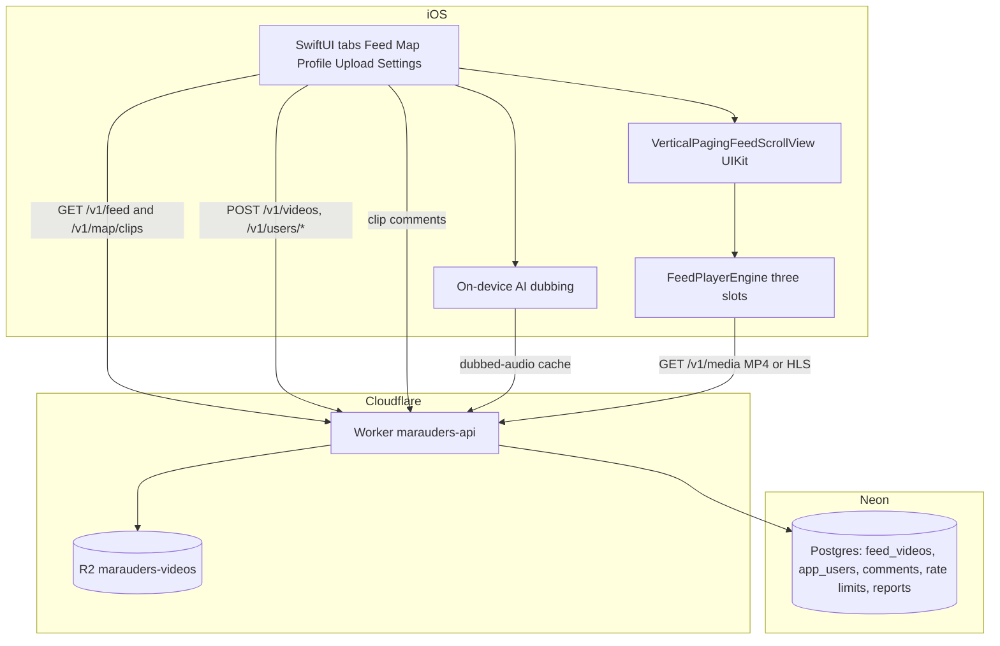
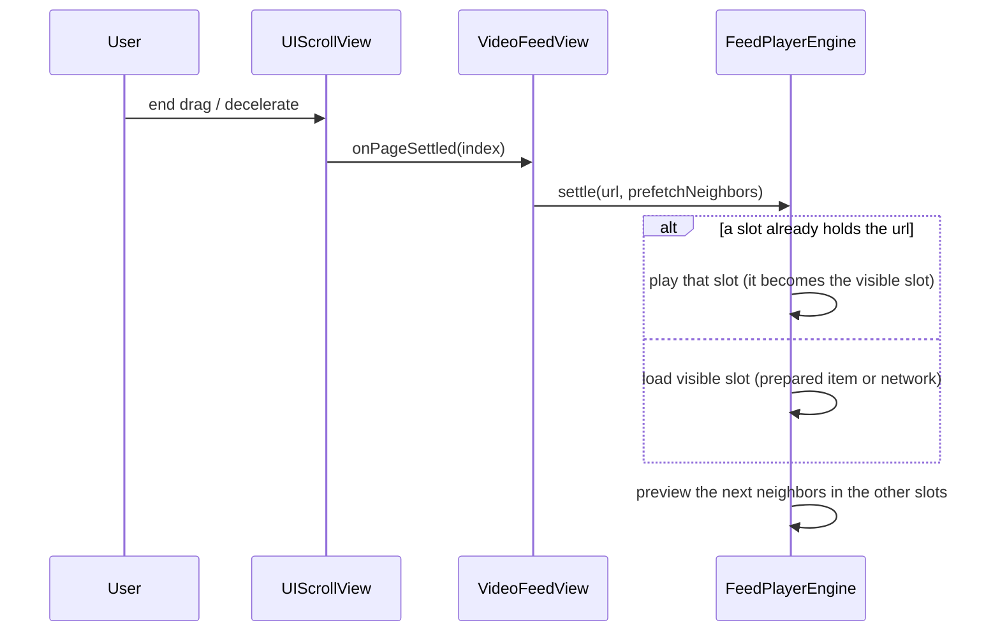
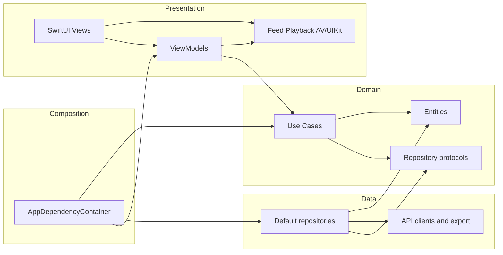
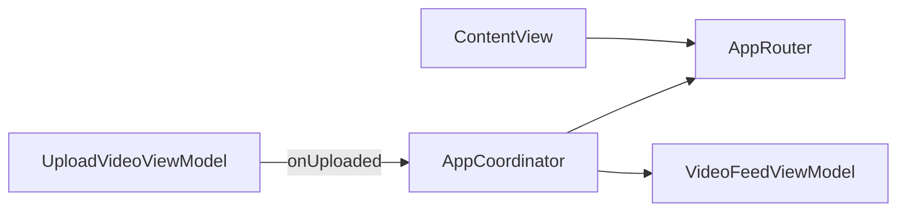
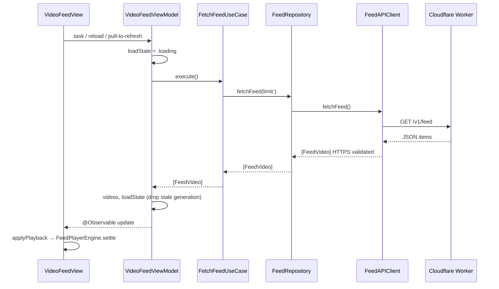
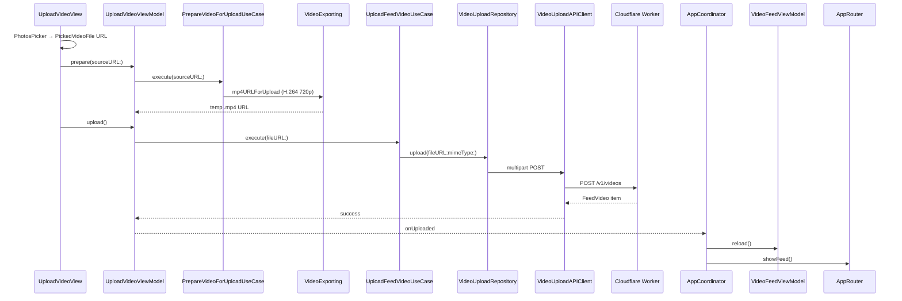
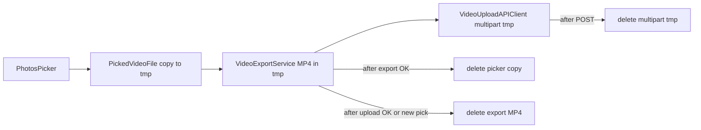

# Marauders — Architecture

Portfolio vertical-video app: **SwiftUI + AVFoundation** on iOS, **Cloudflare Workers + R2 + Neon** on the backend.

**Related:** [docs/adr/](docs/adr/) (decision records) · [deployment/video-pipeline.md](deployment/video-pipeline.md) (faststart, HLS) · [deployment/AI_DUBBING.md](deployment/AI_DUBBING.md) (AI dubbing, shared audio cache, language detection) · [docs/ci-cd.md](docs/ci-cd.md) (Jenkins → TestFlight)

## System context



| Surface | Responsibility |
|---------|----------------|
| `GET /v1/feed` | Paginated `{ items, viewerID }` via `limit` (default 20, max 50) + `cursor` (last item UUID) + optional `country` (ISO-2, joins uploader's `app_users.country`); public read, ordered `sort_order DESC, created_at DESC, id DESC`. Everyone sees the same clips, the viewer's own included; a supplied `Authorization` header is still validated (bad session → 401). `authorName` is the uploader's **live** `@handle` (`COALESCE(app_users.handle, feed_videos.author_name)`); each item also carries `authorAvatarURL` from `app_users.avatar_url`, `country`, coordinates and the optional `audioAssessment` |
| `GET /v1/map/clips` | Same handler and response as `/v1/feed`; the map tab calls it by its own path |
| `POST /v1/auth/apple` | `{ identityToken, country? }` → verify with Apple JWKS → upsert `app_users.country` → `{ accessToken }` (HS256, 30d) |
| `POST /v1/auth/dev` | Debug sign-in for the Simulator: `{ secret, label, country? }` → `{ accessToken }` for the stable user `dev:<label>`. Answers **404** unless the `DEV_LOGIN_SECRET` Worker secret (≥ 32 chars) is set; the app side is `#if DEBUG` and simulator-only. Shares the `auth` rate limit |
| `POST /v1/videos` | **Bearer** required; multipart `file` (MP4/MOV, ≤ 100 MB) + `latitude` + `longitude` + optional `caption` (≤500) + optional `audioAssessment` JSON (untrusted advisory, sanitized, stored in `feed_videos.audio_assessment`) → R2 + `feed_videos.owner_user_id` |
| `DELETE /v1/videos/:id` | **Bearer** required; deletes the caller's own video row + its R2 object + every shared dubbed-audio object for that clip |
| `GET` / `POST /v1/videos/:id/dubbed-audio?lang=` | Shared AI dubbed-audio cache (one R2 object per clip revision and language, 22 languages). GET is public (`missing` / `ready` + URL; a bad `Authorization` header still gets 401); every call carries the clip's source hash (`?source=<sha256 of stream_url>` on GET, `X-Source-SHA256` on POST/report) and a mismatch returns 409 `clip source changed`; POST is first-write-wins, 409s if the clip changed mid-upload, and needs a **Bearer** and a raw `audio/mp4` body ≤ 4 MiB; `kind=text` (409 `dubbed audio not saved yet` until the audio exists) reads/writes the subtitle text (≤ 16 KiB). `/v1/videos/:id/thai-audio` is the legacy path (= `lang=th`). Contract in [AI_DUBBING.md](deployment/AI_DUBBING.md) |
| `POST /v1/videos/:id/dubbed-audio/report?lang=` | **Bearer** required; reports a bad shared dub. The clip owner or the audio's uploader removes it alone, otherwise 2 different reporters do (`dubbed_audio_reports`, migration 016) |
| `GET /v1/videos/:id/comments?limit=&cursor=` | Public read (a bad `Authorization` header still gets 401). Newest first (`created_at DESC, id DESC`), `limit` default 30 / max 50, `cursor` = id of the previous page's last comment (once that comment is deleted the page comes back empty with `nextCursor: null`, and the app starts over from the newest). `{ items, nextCursor }`; each item is `{ id, body, language, createdAt, authorName, authorAvatarURL, canDelete }` with the author's live handle and avatar, and `canDelete` true for the viewer's own comments and for every comment on the viewer's own clip. **404** `video not found` |
| `POST /v1/videos/:id/comments` | **Bearer** required; `{ body, language? }`, at most 16 KiB of JSON (else **413**; a malformed or interrupted body is **400**). The body is trimmed and control characters other than tab and line breaks are dropped; only its first 10 line breaks are kept and each later one is stored as a space, so one comment cannot run to hundreds of lines. It must be 1–500 code points, hold at least one character a reader can see (text made only of whitespace, zero-width marks, variation selectors, Hangul fillers, the Braille blank or U+FFFC is refused) and contain no unpaired surrogate, else **422**. `language` is kept only when it is one of the 22 dubbing languages (Norwegian variants become `nb`), otherwise stored as null. **201** `{ comment }`; **404** when the clip is gone; **401** `account not found` when the token is valid but its `app_users` row is gone (the token is verified without a database lookup, so it outlives the account, and a retry can never succeed); rate-limited per user (`comment`, below) |
| `DELETE /v1/videos/:id/comments/:commentId` | **Bearer** required; the comment's author or the clip's owner removes it → `{ status: "deleted" }`; anyone else, or an unknown id, gets **404** `comment not found` (`comments`, migration 017) |
| `POST /v1/users/me/location` | **Bearer** required; `{ latitude, longitude }` → `app_users.latitude/longitude` |
| `GET /v1/users/me` | **Bearer** required; `{ handle, country, latitude, longitude, videoCount, avatarURL, videos[] }` for the signed-in user |
| `PATCH /v1/users/me` | **Bearer** required; `{ handle }` → normalize (`@lowercase`, `a-z0-9._`, 1–63, reserved names blocked) → `{ handle }`; unique violation → **409** |
| `POST /v1/users/me/avatar` | **Bearer** required; multipart `file` (JPEG/PNG ≤ 5 MB) → R2 `avatars/{uuid}.{jpg\|png}` → `{ avatarURL }`; replaces the previous object (best-effort delete) |
| `DELETE /v1/users/me/avatar` | **Bearer** required; clears `app_users.avatar_url`, deletes the R2 object → `{ avatarURL: null }` |
| `GET /v1/users/{handle}` | Public; `{ handle, country, videoCount, avatarURL, videos[] }` for any account (no auth) |
| `GET /v1/media/{key}` | Progressive MP4/MOV (**Range 206**), HLS playlist + `.ts` segments, avatar JPEG/PNG, or shared dubbed audio (`translations/…`, `must-revalidate` because a removed dub can be replaced; videos and avatars are `immutable`) |

A `/health` GET answers without auth. All `/v1/*` routes return JSON errors as `{ "error": … }`, except `GET`/`HEAD /v1/media/*`, whose own errors are plain text (`not found`, `invalid range`, …).

---

## Trust boundaries

```text
┌─────────────────────────────────────────────────────────┐
│  iOS app (untrusted client)                             │
│  · HTTPS-only playback URLs                             │
│  · No secrets in repo; API base URL in plist            │
│  · Access token in Keychain; disposable caches only     │
│  · Debug log tab: DEBUG builds only                     │
└───────────────────────────┬─────────────────────────────┘
                            │ TLS
┌───────────────────────────▼─────────────────────────────┐
│  Cloudflare Worker (validation, upload authz)           │
│  · Reject invalid paths, MIME, size                     │
│  · DATABASE_URL, JWT_SIGNING_SECRET, APPLE_CLIENT_ID    │
│    (and optional DEV_LOGIN_SECRET) via wrangler secret  │
└───────────────┬─────────────────────┬───────────────────┘
                │                     │
         ┌──────▼──────┐       ┌──────▼──────┐
         │ Neon Postgres│       │ R2 bucket   │
         │ metadata     │       │ video, audio│
         └─────────────┘       └─────────────┘
```

| Zone | Sensitive data | Controls |
|------|----------------|----------|
| iOS | Access token (Keychain); disposable feed/media cache in `Caches`; on-device language models | ATS HTTPS; fail closed on non-HTTPS `streamURL`; cache keyed by session and lifetime-limited; a token past its `exp`, or one the Worker answers 401, ends the session (the device only reads `exp`, the signature stays the Worker's to check) |
| Worker | `DATABASE_URL`, `JWT_SIGNING_SECRET`, `APPLE_CLIENT_ID`, optional `DEV_LOGIN_SECRET` | Secret bindings; input validation on every write; `/v1/auth/dev` inert (404) unless its secret is set |
| R2 | Video objects | Key allowlist `videos/{uuid}.mp4\|mov` or `videos/{uuid}/master.m3u8\|segNNN.ts` |
| R2 | Avatar objects | Key allowlist `avatars/{uuid}.{jpg\|jpeg\|png}` |
| R2 | Shared AI dubbed audio (untrusted, user-supplied) | Key allowlist `translations/{uuid}/{sha256}-{lang}-v1.m4a`; server validates AAC/M4A structure and size; first complete write wins; removable by report |
| Neon | `stream_url`, users, feed rows | Parameterized SQL; pooled connection string |

### Rate limiting

Two layers, cheapest first:

1. **Cloudflare Rate Limiting binding** (`RATE_LIMITER`, `AUTH_RATE_LIMITER` in `wrangler.toml`) — an in-runtime, per-location counter with zero added latency, applied to every `/v1/*` request except `/v1/media/*` (`AUTH_RATE_LIMITER` 30 / 60 s on the two sign-in routes, `RATE_LIMITER` 120 / 60 s elsewhere). Best-effort only: `isRateLimited()` fails open, and the binding is per-PoP. *Note:* as of Oct 2026 this binding is unreliable on live Workers (returns `success: true` regardless — cf. workers-sdk#16097), so it is defence-in-depth, not the enforcement point.
2. **Neon-backed limiter** (authoritative): `enforceDatabaseRateLimit` (`src/rateLimit.ts`) does an atomic fixed-window `INSERT … ON CONFLICT` into `rate_limit_counters` keyed by `scope:actor`. Counts are exact across Cloudflare locations. Applied to sensitive endpoints (table below). Over the limit → `429` with `Retry-After`. Fails open if the database is unreachable.

| Scope | Actor | Limit | Storage |
|-------|-------|-------|---------|
| `auth` (`/v1/auth/apple` and `/v1/auth/dev`) | client IP | 30 / 60 s | Neon fixed window |
| `upload` (`POST /v1/videos` and `POST /v1/users/me/avatar`, one shared bucket) | user id | 10 / 60 s | Neon fixed window |
| `dubbed-audio-upload` | user id | 10 / 60 s | Neon fixed window |
| `dubbed-audio-report` | user id | 10 / 60 s | Neon fixed window |
| `comment` (`POST /v1/videos/:id/comments`) | user id | 10 / 60 s | Neon fixed window |
| all `/v1/*` except media | IP | 120 / 60 s (30 / 60 s on sign-in), see `wrangler.toml` | CF binding (per-PoP, best-effort) |

---

## iOS — feed playback

See **[ADR-001: UIKit paging + dual AVPlayer](docs/adr/001-feed-playback-dual-player.md)** for options and tradeoffs. The ADR records the original two-slot decision; the engine has since grown to **three** slots (below).

### Problem (historical)

Per-cell `AVPlayer` instances caused teardown races. A single player in a fixed SwiftUI overlay did not scroll with the finger and stuttered on `replaceCurrentItem` when the page changed.

### Current design

| Piece | Role |
|-------|------|
| `VerticalPagingFeedScrollView` | SwiftUI wrapper around `VerticalFeedPagingView`: `UIScrollView` + `isPagingEnabled` on a black background; owns one `FeedPlayerLayerHostView` per player slot |
| `FeedPlayerEngine` | **Three** `AVPlayer` slots (visible clip + up to two preview neighbors), prefetch via `FeedMediaPreparationService`, `settle(on:prefetchNeighbors:)` |
| `VideoFeedView` | SwiftUI chrome, buffering overlay, tap → play/pause, `FeedClipCaptionOverlay` (author / caption) and `FeedClipActionRail` (Comments button, audio choice and tappable avatar, bottom-right) for the current page |

Each slot's layer host is a **subview of the scroll view’s content**, positioned at `y = index(of its URL) × pageHeight`, so video moves with the user during a drag; slots without a URL are hidden. Paging only selects which clip should play; surfaces are not moved on settle.

### Settle sequence (after finger release)



### Prefetch

- `prefetch` / `warmURLs` build `AVPlayerItem` until **readyToPlay** (cached by URL, at most 5 prepared items, 6 s forward buffer).
- On settle, the visible slot prefers **prepared items**; the other slots preview up to **two** neighbors (paused at zero).
- **Startup cache** (`FeedStartupCache` / `SessionFeedStartupCache`): the feed list plus whole MP4s (≤ 12 MiB each, 6 h lifetime) in `Caches`, kept per signed-in session. When a cached feed was restored, the splash is dismissed without its minimum delay and a cached file is played instead of the network URL. Disabled under `UITEST`.
- Buffering UI appears only after **~380 ms** of stall.

### UX / lifecycle

- **Tap** toggles play/pause (`FeedPlayerPhase.paused` when user-initiated).
- `AppRootView` splash (~650 ms min, skipped when the startup cache restored the feed) + initial feed load during splash.
- `scenePhase` / tab disappear → `pause()`; active → `settle` again, unless the comments sheet, the AI-audio choice or the sign-in screen the viewer is on the way to is up (`applyPlayback` keeps the clip paused then).

### Upload path (client)

`PhotosPicker` → `PickedVideoFile` → `AVAssetVideoLocationReader` pre-fills `ClipLocation` from the video's embedded ISO 6709 metadata (when present; `ClipLocationPickerView` lets the user search for or adjust the place) → `PrepareVideoForUploadUseCase` / `VideoExportService` (H.264 720p MP4) → `FastClipAudioInspector` classifies the exported audio on-device (speech / music / mixed, advisory only, never blocks upload) → `UploadFeedVideoUseCase` → `POST /v1/videos` (includes `latitude` / `longitude` from `ClipLocation`, the `audioAssessment` JSON, plus optional `caption` typed in the upload form; blank values are omitted).

### Map tab

- **Data:** `GET /v1/map/clips` (same response as the feed, `forMap` in `FeedAPIClient`) via `VideoFeedViewModel.loadMapClips(country:)` into `mapFilteredClips`, independent of the feed list; clips with both `latitude` / `longitude` get a `FeedVideo.mapCoordinate`. The response also carries `authorName` / `caption`, used by client-side search.
- **Layout:** full-screen `Map` (no navigation bar) with a country filter button (flag, 🌐 for all) and a locate FAB. `MapView` tracks the visible region via `.onMapCameraChange(frequency: .onEnd)`. Sign out lives in the Profile tab.
- **Pins & clustering:** `MapClipClustering` collapses nearby clips into `MapClipCluster`s using a grid sized from the visible span, so zooming in breaks clusters apart again; single clips render as circular thumbnail pins (`MapClipPinView`) and clusters as a count bubble (`MapClusterPinView`) — tapping a cluster zooms in, tapping a single pin opens the shared `ClipPlayerView` in a sheet (looping, with a "Play in Feed" shortcut).
- **Search (hidden):** `MapClipSearch` filters already-loaded clips client-side by author handle, caption and country (no network round-trip) and re-fits the camera. `MapView.isSearchVisible` is `false` for now; the `MapSearchBar` pill and logic stay in place to re-enable later.
- **Country filter:** filter button → `MapCountryFilterSheet`; selection re-fetches `/v1/map/clips?country=<ISO2>`.
- **Near me:** the locate FAB recenters the camera on you (`MapClipProximity`); `MapClipProximity` also limits the pins to the visible region, and the clip player shows the distance from you when location is known.
- **Open in feed:** tap pin → `ClipPlayerView` → **Play in Feed** → `AppCoordinator` calls `ensureVideoLoaded`, which paginates with `cursor` until the clip is in memory, then `requestFocus(on:)` and `router.showFeed()`; `VideoFeedView` scrolls via `focusVideoID` / `consumeFocusRequest()`. The clip's author handle opens the public profile.
- **Auth:** Map, Upload and Profile gate on sign-in (`SignInRequiredView` / `SignInWithAppleGateView`; the Feed is open to guests). Sign-in needs location permission and detects the country (`SignInLocationViewModel`, changeable in `CountryPickerView`); `identityToken` → `POST /v1/auth/apple` → access token in Keychain; authenticated requests send `Authorization: Bearer`. Debug builds on the Simulator can instead sign in through `/v1/auth/dev` (`DevAuthAPIClient`, secret passed via launch environment, never stored in the project).
- **Session end:** the access token is a 30-day JWT. `AuthViewModel.restoreSession()` (run when the app opens and whenever the Map, Upload or Profile tab appears, so it also catches a token that runs out while the app is open; nothing re-checks the token on the Feed or Settings tabs, so the first 401 ends the session there) reads its `exp` with `APIAccessTokenExpiry` and treats a token that is expired, or whose `exp` cannot be read, like a missing one: the stored session and token are cleared and the viewer is signed out, which brings up the sign-in gates. A 401 to a request that carried the token ends the session the same way (see *iOS — HTTP API contract* below). Nothing opens the sign-in screen by itself: the viewer reaches it from a gate, the feed's sign-in prompts or **Sign in to comment**. Guests are unaffected.
- **Location:** Required to open the Map tab (`MapLocationRequiredView` gate + system permission). **Current Location** recenters the map after access is granted. The first fix delivered in a session is reported once to `POST /v1/users/me/location` via `ReportUserLocationUseCase` (composition root), so the account keeps a last-known location.

### Profile tab

- **Data:** `GET /v1/users/me` (Bearer) via `UserProfileAPIClient` → `UserProfile` (handle, country, last-known coords, clip count, `avatarURL`, and the user's own `[FeedVideo]`).
- **UI:** `ProfileView` shows a header (tappable avatar + `@handle` + country flag/name + clip count), a 3-column grid of the user's clips and a **Sign Out** action. Tapping a clip plays it inline with `ClipPlayerView`; pull-to-refresh re-fetches.
- **Handle:** every account gets an auto `@user_<hex>` handle on sign-up. Tapping the handle opens an edit alert → `PATCH /v1/users/me` via `UpdateUserHandleUseCase`; server-normalized value is written back to the profile (409 → "already taken").
- **Avatar:** the header photo is a `PhotosPicker`; the picked image is downscaled to ≤ 512px + JPEG-encoded by `DefaultAvatarImagePreparer` inside `UpdateAvatarUseCase`, then `POST /v1/users/me/avatar` via `UserProfileAPIClient` (multipart); the returned URL updates the profile and is broadcast to the feed (`onAvatarChanged` → `VideoFeedViewModel.applyAuthorAvatar`). `AvatarView` falls back to a deterministic gradient + initial when there is no photo.
- **Delete:** long-press a clip (or tap the trash button in the player) → confirm → `DELETE /v1/videos/:id` via `DeleteUserClipUseCase`; the clip is removed from the grid optimistically and the count decremented.
- **State:** `ProfileViewModel` (`idle → loading → loaded/failed`) loads once via `loadIfNeeded()` and re-fetches on `reload()`. When the session ends, `ContentView` calls its `resetForSessionChange()`, so the next sign-in loads that account's profile instead of showing the last one, or the error of a load that failed as the session ended. The feed resets on every session change; the profile only when one ends, because after a sign-in the Profile tab may already be loading the new viewer's. A load or edit that was still out when the session ended can no longer write into the view model or raise an alert (a delete still tells the feed which clip went).
- **Auth:** gated on Sign in with Apple (same `SignInWithAppleGateView` as Upload/Map). When the session ends while the tab is open (expired token, 401 from the profile request itself), the tab falls back to this gate.
- **`ClipPlayerView`** is shared between the map pins and the profile grid (`Presentation/Common`).

### Public profiles (`@handle`)

- **Open:** tapping the author handle in the feed caption (`FeedClipCaptionOverlay`), the avatar in the right-edge rail (`FeedClipActionRail`) or the author on a map clip calls `AppRouter.openPublicProfile(handle:)`, which the `ContentView` `TabView` presents as a sheet.
- **Data:** `GET /v1/users/{handle}` (no auth) via `UserProfileAPIClient.fetchPublicProfile` → `PublicUserProfile` (`handle`, country, count, `avatarURL`, `[FeedVideo]`).
- **UI/State:** `PublicProfileView` + `PublicProfileViewModel` (`Presentation/Profile`) reuse `ProfileClipThumbnail` and `ClipPlayerView`; read-only (no delete), with `Retry` on failure.
- **Layout note:** the feed caption respects the bottom safe area so the tappable author clears the tab bar, while the video layers keep `.ignoresSafeArea()` for full-bleed playback.

### Comments

- **Open:** the **Comments** button at the top of the feed's right-edge rail (`FeedClipActionRail`, `feed.comments`) opens `CommentsView` as a medium / large sheet for the current clip. The feed pauses while the sheet is up and resumes when it closes, unless the viewer had paused the clip themselves (`FeedPlayerPhase.shouldResumeAfterInterruption`: only `.paused` stays paused, so a clip that was still buffering or had failed is started again; the AI-audio menu uses the same rule). A second tap on the button while a sheet is up or closing does not overwrite what the first one noted. Leaving through **Sign in to comment** keeps the clip paused behind the sign-in screen; it plays again when the viewer backs out of it.
- **Guests** can read. In place of the composer they get **Sign in to comment**, which closes the sheet first and opens the shared sign-in screen from the sheet's `onDismiss`, so two sheets are never stacked; after signing in the viewer is back on the feed, not in the sheet, and because every sign-in or sign-out reloads the feed (`ContentView` calls `resetForSessionChange()`) the feed starts again at its first clip, not at the one that was being commented on.
- **Data:** `CommentsAPIClient` behind `CommentRepository` (`DefaultCommentRepository`) and `LoadCommentsUseCase` / `PostCommentUseCase` / `DeleteCommentUseCase`. Pages are 30 comments, newest first; the next page loads when a row within 5 of the end appears, and a failed page waits for a tap on **Try Again** instead of looping. A 401 on a read that carried a token is retried once as a guest, so an expired session never blocks reading. The same 401 also ends the session (see *iOS — HTTP API contract*): the sheet stays open with the comments the guest retry returned, and its composer gives way to **Sign in to comment** (a draft that was typed no longer keeps the sheet from being swiped away).
- **Rules:** `CommentRules` (Domain) trims the text and allows 1–500 Unicode scalars (the Worker counts code points) with at least one visible character (`hasVisibleCharacter`, the same rule as the Worker: not whitespace, control, default-ignorable, U+2800 or U+FFFC); `PostCommentUseCase` refuses anything else before a request is made. The Worker alone limits line breaks (10 per comment, see the endpoint table); the app shows the text the Worker stored. The app sends no `language` yet.
- **State:** `CommentsViewModel` (`idle → loading → loaded / failed`) keeps the list on screen when a refresh fails (unless the viewer's deletes emptied it meanwhile while older comments exist: then the failed screen with Retry takes over) and clears its message when the next refresh starts, drops a stale page that arrives after a newer reload (`loadGeneration`), does not start a next-page request while a refresh is in flight (`isReloading`; a row near the end that appeared meanwhile gets its page as soon as the refresh is over), and asks again (up to 3 requests) when a post or delete finished while the refresh request was out (the third answer is accepted as it is, minus the comments the viewer deleted and plus any post whose answer arrived during that request); a page request that overlapped a delete is asked once more. The comments the viewer deleted are remembered while the sheet is open, so no answer, however late, puts one back. The next page is requested after the last comment still listed rather than with the Worker's `nextCursor` (only its presence is used), so deleting the last row never strands the older ones; an empty page after a cursor, or deleting every listed comment while older ones exist, reloads from the newest. The draft is kept when a post fails and when the viewer typed more during the request. `AppDependencyContainer.makeCommentsViewModel` builds a fresh one each time the sheet opens; under `UITEST` the container uses `UITestCommentRepository` (not with `UITEST_REJECTED_SESSION`, which keeps the real comments client over the rejecting transport).
- **Composer:** while the draft holds text the sheet cannot be swiped away (`interactiveDismissDisabled`; the close button still can), the list dismisses the keyboard as it scrolls, a tap anywhere on the input pill focuses it, a failed post is announced to VoiceOver and the character counter has a spoken label.
- **Delete:** swipe a row with `canDelete` (the viewer's own comments, or any comment on the viewer's own clip) → confirm.

### Settings tab and AI dubbing

Full detail (cache contract, local processing limits, language detection, Dutch/English/Spanish sources) is in **[deployment/AI_DUBBING.md](deployment/AI_DUBBING.md)**; this is only where it sits in the architecture.

- **Settings tab** (`SettingsView`): the viewer's **listening language** (`ListeningLanguageStore`, one of the 22 `ListeningLanguage.codes`, mirrored by `DUBBING_LANGUAGES` in the Worker) and **Language models** (`LanguageModelsView`: on-device speech / translation models and the detection model, downloaded on demand).
- **Dubbing runs on the viewer's iPhone** (`Presentation/Dubbing`, `DubbingViewModel`): the viewer explicitly picks original or AI audio. The player first asks the shared cache (`DubbedAudioCacheClient`: GET/POST `dubbed-audio`, subtitle text, report); on a miss it recognizes the clip's speech, translates (Apple Translation) and narrates with a system voice, then uploads the finished AAC/M4A so later viewers reuse it. Dubbing sources are English, Spanish and Dutch. Nothing about the clip's audio or transcript is sent to a third-party AI service.
- **Language detection** is also viewer-side: when a clip declares no language, `StagedClipLanguageDetector` picks up to two speech-like windows (`SpeechWindowSelector`) and names the language with the Whisper **base** model (WhisperKit, `WhisperEngine`, downloaded once via `LanguageDetectionModelStore`), falling back to system recognizers. Results are remembered per clip on the phone only (`DetectedLanguageMemo`).
- **Bad shared audio:** signed-in viewers can report a shared dub (`DubbedAudioReportMemory` remembers what this phone reported); the Worker removes it per the rules in the route table.
- **Layering note:** the dubbing clients and view model live in `Presentation/Dubbing`, next to the UI that drives them, so they are an exception to the strict "ViewModels use only use cases" rule below.

### Swift 6 concurrency

| Setting | Value |
|---------|--------|
| Language | **Swift 6** (`SWIFT_VERSION = 6.0`) |
| Deployment target | **iOS 26.5** (`IPHONEOS_DEPLOYMENT_TARGET`) |
| Default isolation | **MainActor** (`SWIFT_DEFAULT_ACTOR_ISOLATION`) |
| Strictness | Approachable concurrency (`SWIFT_APPROACHABLE_CONCURRENCY`) |

**Isolation model (intentional split):**

- **MainActor:** `FeedPlayerEngine`, ViewModels, `AppLogStore`, SwiftUI views — `AVPlayer` control and UI state only.
- **`FeedMediaPreparationService` (actor):** `AVURLAsset` cache, prefetch until `readyToPlay`, `beginPlaybackItem` for visible-slot loads — runs off the main actor between `await` points.
- **Sendable value types:** `FeedVideo`, `FeedPlayerPhase`, `FeedLoadState`, API DTOs, `FeedAPIClient` / `VideoUploadAPIClient` — safe across `Task` boundaries.
- **UIKit bridge:** `VerticalPagingFeedScrollView` settle callbacks use `Task { @MainActor in … }` before updating bindings / engine.
- **Feed reload:** `VideoFeedViewModel` ignores stale API results when a newer `reload()` started while the previous request was in flight.
- **Feed pagination:** scroll near the end → `loadMoreIfNearEnd` with `cursor` = last loaded id; upload → `reload()`; Map tab → `syncHeadWithServer()` merges new clips into the shared list (pins update).
- **Tests:** engine tests `@MainActor`; `FeedMediaPreparationServiceTests` cover HTTPS rules on the actor.

See **[ADR-002](docs/adr/002-ios-concurrency.md)** for rationale.

### MVVM + Clean Architecture

See **[ADR-003](docs/adr/003-mvvm-clean-architecture.md)**. Packaging: **[ADR-004](docs/adr/004-single-app-target.md)** (single Xcode target, folder boundaries; splitting into local SPM modules deferred). The target does use remote SwiftPM packages: POC_MyLibrary, Alamofire, waypointsdk (private JFrog registry), lottie-spm and WhisperKit (pinned to 1.1.1).

| Layer | Folder | Role |
|-------|--------|------|
| Composition | `Composition/` | `AppDependencyContainer` wires use cases |
| Domain | `Domain/` | `FeedVideo`, repository protocols, use cases |
| Data | `Data/` | API clients, `Default*Repository`, export |
| Presentation | `Presentation/` | SwiftUI Views + ViewModels; `Feed/Playback/` for AVFoundation |

#### Dependency rules

Single app target — boundaries are **folder + convention** ([ADR-004](docs/adr/004-single-app-target.md)). Arrows show allowed compile-time dependency direction.



| Layer | May import / call | Must not |
|-------|-------------------|----------|
| **Domain** | `Foundation` only | SwiftUI, UIKit, AVFoundation, PhotosUI, `URLSession` in use cases |
| **Data** | Domain (+ Apple frameworks needed for I/O) | SwiftUI; Presentation types |
| **Presentation (ViewModel)** | Domain use cases and entities | `FeedAPIClient`, `VideoUploadAPIClient`, concrete `Default*Repository` |
| **Presentation (View)** | ViewModels; playback types in `Feed/Playback/` | Use cases or repositories directly (except wiring in previews) |
| **Composition** | Domain, Data, Presentation ViewModels | UI layout |

**Playback exception:** `FeedPlayerEngine` is presentation infrastructure. `VideoFeedView` drives it for scroll/settle; it is not a domain use case.

#### Navigation (Coordinator / Router)

See **[ADR-005](docs/adr/005-coordinator-router.md)**.

| Type | Role |
|------|------|
| `AppRouter` | Observable tab state (`MainTab`: feed, map, profile, upload, settings, and log in DEBUG); views bind `TabView(selection:)`; also presents the public-profile sheet (`openPublicProfile(handle:)`) |
| `AppCoordinator` | Cross-tab flows: splash feed load, upload finished → reload feed + show feed tab, map **Play in Feed** → load clip + focus it + show feed tab |
| ViewModels | Feature logic only; no direct tab switching |



#### MVVM flow (feed reload)



#### MVVM flow (upload)



(`AppCoordinator` performs reload + tab change; see ADR-005.)

### Module map

```text
Marauders-ios/Marauders/
  App/              MaraudersApp
  Composition/      AppDependencyContainer, AppRuntimeConfiguration, UITestFeedMode, UITestRejectedSession, MyLibraryIntegration, WaypointJourneyIntegration
  Domain/           Entities, Repositories (protocols), Services (protocols), UseCases, Auth
  Data/             API/, Auth/ (Keychain stores), Repositories/, Services/ (export, caches, speech, Whisper), Photos/
  Presentation/
    Navigation/     AppRouter, AppCoordinator, MainTab
    Main/           ContentView
    Splash/         AppRootView, SplashView
    Auth/           AuthViewModel, sign-in gate, country picker
    Feed/           VideoFeedView, VideoFeedViewModel, FeedClipActionRail
    Feed/Playback/  FeedPlayerEngine, VerticalPagingFeedScrollView, FeedMediaPreparationService, …
    Comments/       CommentsView, CommentRow, CommentsViewModel (sheet opened from the feed rail)
    Map/            MapView, MapViewModel, clustering, proximity, search, country filter
    Profile/        ProfileView, PublicProfileView + view models
    Upload/         UploadVideoView, UploadVideoViewModel, ClipLocationPicker
    Settings/       SettingsView, listening-language picker, language models
    Dubbing/        DubbingViewModel, DubbingClient, DubbedAudioCacheClient, language-detection memo
    Common/         AvatarView, ClipPlayerView
    Debug/          AppLogStore, DebugLogView (#if DEBUG)
```

### iOS — HTTP API contract

Clients live in `Data/API/`; ViewModels never call them directly ([ADR-003](docs/adr/003-mvvm-clean-architecture.md)). Base URL: `APIConfiguration.plist` → Info.plist (`https` origin only).

| Endpoint | Client | Method | Timeout | Client-side validation | Success | Error mapping |
|----------|--------|--------|---------|------------------------|---------|----------------|
| `/v1/feed?limit=&cursor=&country=` (map: `/v1/map/clips`) | `FeedAPIClient` | GET (Bearer when signed in; a 401 on a request that carried a token is retried once as a guest) | 30s | `limit` 1…50; each `streamURL` must be **HTTPS** | `FeedPage` (`[FeedVideo]` + `hasMore`) | `invalidLimit`, `invalidResponse`, `serverError(status)`; **retry** up to 3× on 502/503/504 + transient `URLError` ([ADR-006](docs/adr/006-feed-get-retry.md)) |
| `/v1/videos` | `VideoUploadAPIClient` | POST multipart `file`, `latitude`, `longitude`, optional `caption`, `audioAssessment` | 300s | MIME `video/mp4` \| `video/quicktime`; size 1…100 MB; coords WGS84 | `FeedVideo` (+ optional lat/lng) | `unsupportedFormat`, `fileTooLarge`, `serverError(status)`, server `{ "error" }` message, `invalidResponse` |
| `/v1/users/me/location` | `UserLocationAPIClient` | POST JSON `{ latitude, longitude }` (Bearer) | 15s | coords WGS84 (validated server-side) | 200 `{ latitude, longitude }` | `notAuthenticated`, `serverError(status)`, `invalidResponse` |
| `/v1/users/me` | `UserProfileAPIClient` | GET (Bearer) | 15s | none | `UserProfile` (handle, country, coords, count, `avatarURL`, `[FeedVideo]`) | `notAuthenticated`, `notFound`, `serverError(status)`, `invalidResponse` |
| `/v1/users/me` | `UserProfileAPIClient` | PATCH JSON `{ handle }` (Bearer) | 15s | handle `a-z0-9._`, 1–63 | `{ handle }` (normalized) | `notAuthenticated`, `handleTaken` (409), `invalidHandle` (400), `serverError(status)`, `invalidResponse` |
| `/v1/users/me/avatar` | `UserProfileAPIClient` | POST multipart `file` (Bearer) | 60s | image downscaled ≤ 512px, JPEG `image/jpeg` | `{ avatarURL }` | `notAuthenticated`, `unsupportedFormat`, `fileTooLarge`, `serverError(status)`, `invalidResponse` |
| `/v1/users/me/avatar` | `UserProfileAPIClient` | DELETE (Bearer) | 15s | none | `{ avatarURL: null }` | `notAuthenticated`, `serverError(status)`, `invalidResponse` |
| `/v1/users/{handle}` | `UserProfileAPIClient` | GET (public) | 15s | none | `PublicUserProfile` (handle, country, count, `avatarURL`, `[FeedVideo]`) | `notFound`, `invalidHandle` (400), `serverError(status)`, `invalidResponse` |
| `/v1/videos/:id` | `UserProfileAPIClient` | DELETE (Bearer) | 15s | video id is a UUID | 204/200 | `notAuthenticated`, `notFound`, `serverError(status)`, `invalidResponse` |
| `/v1/videos/:id/comments?limit=&cursor=` | `CommentsAPIClient` | GET (Bearer optional; a 401 on a request that carried a token is retried once as a guest) | 15s | `limit` 1…50 | `CommentPage` (`[Comment]` + `nextCursor`) | `notFound`, `serverError(status)`, `invalidResponse` |
| `/v1/videos/:id/comments` | `CommentsAPIClient` | POST JSON `{ body, language? }` (Bearer) | 15s | none in the client; `PostCommentUseCase` trims and enforces 1…500 Unicode scalars with a visible one | `Comment` | `signInRequired` (no token or 401, which includes the Worker's `account not found`), `notFound`, `invalidBody` (400 / 422), `rateLimited` (429), `serverError(status)` (413 and 5xx), `invalidResponse` |
| `/v1/videos/:id/comments/:commentId` | `CommentsAPIClient` | DELETE (Bearer) | 15s | none | 2xx | `signInRequired`, `notFound`, `serverError(status)` |

Not in the table: `POST /v1/auth/apple` and the debug-only `/v1/auth/dev` (`AuthAPIClient`, `DevAuthAPIClient`, 30s) and the dubbed-audio routes (`DubbedAudioCacheClient`, see [AI_DUBBING.md](deployment/AI_DUBBING.md)).

**A 401 ends the session.** The container builds every client in the table over one `HTTPClient`, wrapped in `RejectedSessionReportingHTTPClient`. When the Worker answers 401 to a request whose `Authorization` header carried a Bearer token, the wrapper calls `AuthViewModel.handleRejectedAccessToken(_:)` with that token **before** it hands the response back, so the viewer is already signed out when the client throws. The clients keep their own error mapping above (`serverError(401)`, `notAuthenticated`, `signInRequired`) and the public reads (feed, map clips, comments) still retry once as a guest, so a session the Worker no longer accepts never keeps clips or comments from the viewer. The report is ignored when the token is no longer the stored one, so a late answer to an old request cannot end a newer session, and a request without a token (a guest's, or the sign-in exchange itself) is never reported. `DubbedAudioCacheClient` is built outside the container and is not covered yet.

**Tests:** `FeedAPIClientTests`, `VideoUploadAPIClientTests`, `UserLocationAPIClientTests`, `UserProfileAPIClientTests`, `CommentsAPIClientTests` use `StubURLProtocol` (no live network in CI); `RejectedSessionReportingTests` covers the wrapper and `SessionExpiryTests` the same real clients over it.

**Not implemented:** automatic retry on **upload**, certificate pinning (ATS + HTTPS validation only). Authorization is attached through `APIAuthorization` (Keychain access token).

### iOS — upload file lifecycle (staging)

User videos are **never** written to Documents or the photo library. All client-side bytes stay in **`NSTemporaryDirectory()`** until deleted.



| Stage | Location | Removed when |
|-------|----------|----------------|
| Library import | `PickedVideoFile` → tmp | After successful export, or when user picks another clip / clears |
| H.264 export | tmp `.mp4` (`uploadFileURL`) | After successful upload, failed prepare, new pick, or reset |
| Multipart body | tmp (upload client) | Immediately after `URLSession.upload` completes |

`TemporaryFileCleanup` only deletes URLs under the system temp directory (defense in depth). Logs record byte counts and outcomes, not file paths or video content.

---

## Backend — video on write and read

### Upload

1. Validate multipart `file` (size, MIME).
2. For MP4 ≤ 80 MB: **faststart** remux (`moov` before `mdat`) in the Worker.
3. `put` to R2; insert `stream_url` → `/v1/media/videos/{object-uuid}.mp4`.

`feed_videos.id` (row UUID) **≠** R2 object UUID in the path; both appear in API responses.

### HLS (optional, ops script)

`npm run video:hls -- <feed_videos.id>` downloads the row’s current MP4 (if needed), ffmpeg → `videos/{object-uuid}/master.m3u8` + `segNNN.ts`, updates `stream_url`. AVPlayer needs no app change.

### Media GET

- Keys: `videos/{uuid}.mp4|mov`, `videos/{uuid}/master.m3u8`, `videos/{uuid}/segNNN.ts`, `avatars/{uuid}.jpg|jpeg|png`, `translations/{clip-uuid}/{sha256}-{lang}-v1.m4a` (shared dubbed audio)
- `Accept-Ranges: bytes`, `ETag` / `304`, `Content-Disposition: inline`

### Operational scripts

| Script | Purpose |
|--------|---------|
| `npm run dev` / `npm run deploy` | `wrangler dev` / `wrangler deploy`; secrets are set with `wrangler secret put` (see `wrangler.toml`) |
| `npm run db:migrate` | Apply `sql/001`…`017` in order (`IF NOT EXISTS` statements; `004_purge_feed_videos.sql` is not in the list) |
| `npm run db:purge` | (`db:migrate` and `db:purge` read `DATABASE_URL` from `backend/.dev.vars`; purge also accepts the env var) Clear `feed_videos` + delete R2 objects referenced by URLs |
| `npm run video:hls` | ffmpeg HLS from feed row → R2 + update `stream_url` |
| `npm run test:feed` / `test:dubbed-audio` / `test:dev-auth` / `test:comments` | Backend checks, see **Tests** |

### Data model

Migrations live in `backend/sql/` (`001`…`017`); `scripts/reset-all-data.sql` is a manual wipe script, not a migration.

| Table | Purpose | Notable columns / migration |
|-------|---------|------------------------------|
| `feed_videos` | One row per clip | `id`, `stream_url` (HTTPS check), `author_name`, `caption` (≤ 500), `sort_order`, `created_at`; `latitude` / `longitude` (005); `owner_user_id` → `app_users` (006); `audio_assessment jsonb` (015); `music_title` dropped (013) |
| `app_users` | Accounts (Apple `sub`, or `dev:<label>`) | `apple_sub` unique (006); `country` + index (007, 008); `latitude` / `longitude` / `location_updated_at` (009); `handle` (011, backfilled into feed rows by 012); `avatar_url` (014) |
| `rate_limit_counters` | Neon fixed-window limiter | `bucket_key` PK, `window_start`, `count` (010) |
| `dubbed_audio_reports` | Reports against shared AI dubs | PK (`video_id`, `language`, `source_hash`, `reporter_user_id`), cascades with clip and user (016) |
| `comments` | Comments on a clip | `id`, `video_id` → `feed_videos` and `author_user_id` → `app_users` (both cascade), `body` (1–500 characters), `language` (nullable base code; the app does not send it yet), `created_at`; index `(video_id, created_at DESC, id DESC)` (017) |

R2 (`marauders-videos`) holds `videos/`, `avatars/` and `translations/` objects (see Media GET). Dubbed audio and its subtitle text are keyed by clip id, SHA-256 of the clip's `stream_url` and language, so a changed source never reuses an old dub.

---

## Failure modes

| Symptom | Likely cause | Mitigation |
|---------|----------------|------------|
| Spinner forever | Bad `stream_url`, 404 media | In-app retry; fix DB/R2; `db:purge` |
| Hitch on release only | Next clip not yet preloaded in a neighbor slot | Wait on clip for prefetch; HLS; `video:hls` |
| Scroll smooth but black gap | Empty feed | Feed shows an empty-state error (`feed.error`) with retry |
| Bad AI dubbed audio | Machine translation / narration error | Viewer reports it; owner/uploader (1) or two viewers remove the shared file |
| Signed out without tapping Sign Out | The 30-day access token ran out, or the Worker answered 401 to it (signing secret changed, account removed) | `restoreSession()` and the first 401 clear the stored session and show the sign-in gates; the viewer signs in again |
| Comments sheet says "This clip is no longer available." on every clip | The app is ahead of the Worker: the old Worker has no comments route and answers 404 `not found` (a clip that really is gone gives the same text, with 404 `video not found`) | Deploy the Worker, after migration 017 |
| Comments sheet says "Couldn't load comments" on every clip | Offline, or the Worker is deployed but migration 017 was not run (500 `failed to load comments`) | Run 017; `npx wrangler tail` shows `comments list failed 42P01 …` while the request is retried |
| Slow MP4 start | No faststart / large file | Re-upload; HLS script |
| Mixed HLS + MP4 in feed | By design during migration | Convert remaining rows with `video:hls` |

---

## Future (not implemented)

- Per-user upload quotas and feed visibility policies (global feed today; `owner_user_id` stored on upload)
- Automatic HLS transcode queue (Worker Queue + ffmpeg worker)
- Metrics: time-to-first-frame after settle, rebuffer count
- Adaptive HLS ladder (multi-bitrate `master.m3u8`)
- Offline cache / `AVAssetDownloadTask`
- Comments: translating a comment on the reader's iPhone, a comment count on the rail, likes, reporting and blocking

---

## Tests

- **Unit (`MaraudersTests`, Swift Testing, ~570 `@Test` cases across 51 files):** feed engine and media preparation (`FeedPlayerEngineTests`, `FeedMediaPreparationServiceTests`, `FeedPagingGestureTests`), feed view model and startup cache, API clients on `StubURLProtocol` (no network), map (clustering, proximity, search, view model with `FakeLocationManager`), profile / public profile view models, comments (`CommentRulesTests`, `CommentsAPIClientTests`, `PostCommentUseCaseTests`, `CommentsViewModelTests`), sign-in + location, session end (`APIAccessTokenExpiryTests` for expired, valid, malformed and `exp`-less tokens; `RejectedSessionReportingTests` and `SessionExpiryTests` for `restoreSession()` and for a 401 signing the viewer out through the real API clients, with no network), upload use cases, and the dubbing stack (listening languages, dubbing plan and sources, shared cache, reports, language detection, speech-window selection, model store, Settings language models). A few `*DeviceTests` files target real-device behavior.
- **UI (`MaraudersUITests`, XCTest):** smoke and flow tests with deterministic mock data: feed / map / upload / profile tabs, empty feed, delete own clip, place search, public profile from feed avatar and map clip, avatar control, streaming feed swipes, guest sign-in gates, country change at sign-in, location-denied, the AI-audio choice, and the comments sheet (read, post, delete offered only on comments the viewer may delete, guest sign-in gate that leaves the viewer on the feed (signing in swaps the button for the composer; the clip stays paused behind the sign-in screen and plays again when the viewer backs out of it), closing it with the button or a swipe, with or without the keyboard up, and a half-written comment surviving a swipe), and a rejected session (the 401 signs the viewer out: Profile and Upload fall back to the sign-in gate, and the comments sheet stays open and readable as a guest).
- **Backend (`backend/scripts`, plain Node):** `npm run test:feed` (real router, auth and SQL builder against a database spy), `npm run test:dubbed-audio` (shared audio cache, reports), `npm run test:dev-auth` (esbuild-bundled `test/authDev.test.ts` on `node:test` with a fake users module), `npm run test:comments` (`test/comments.test.ts` for text and language normalization and `test/commentsRoutes.test.ts` for the real `worker.fetch` router with a recording fake of the Neon driver, on the same esbuild + `node:test` setup: auth, validation, the 16 KiB request cap (announced length, streamed pieces), status codes, the text of each statement (pinned whole, so any edit to it needs the test changed too) and the values bound to it, the generic 500 and what is logged for it (SQLSTATE and message, never the comment); it does not run the SQL itself, which has not been executed against a real Postgres). `test-upload.mjs` and `test-audio-assessment.mjs` exist but have no npm script. `npm run typecheck` runs `tsc --noEmit`.
- Run iOS tests: Xcode **Product → Test** or `xcodebuild test -scheme Marauders` (the fastlane `test` lane runs `MaraudersTests` only and emits JUnit + Cobertura coverage).
- **CI state:** the `Jenkinsfile` currently runs Checkout → Install dependencies → Resolve Swift packages → Deploy to TestFlight (`main` only). The **Unit tests** and **Coverage report** stages are commented out ("temporarily disabled to keep the TestFlight build fast"), so CI does not run any tests today. [docs/ci-cd.md](docs/ci-cd.md) still describes the older flow with unit tests and should be read with that caveat.

### UI test launch flags (`UITEST`)

Pass these via `XCUIApplication.launchArguments` (and matching `launchEnvironment` keys where noted) so UI tests do not hit the network or wait on splash.

| Flag / env | Effect |
|------------|--------|
| `UITEST` (`UITEST=1` in env) | Composition root uses `UITestFeedRepository` (plus a stub profile repository and an in-memory `UITestCommentRepository`) instead of the real ones (with `UITEST_REJECTED_SESSION` the real profile and comments repositories stay); the startup cache is off and the splash skips its 650 ms minimum after the first feed load completes. |
| `UITEST_EMPTY_FEED` (`UITEST_EMPTY_FEED=1` in env) | Mock repository returns an empty list → feed shows the empty-state error UI (message contains `Feed is empty`). Requires `UITEST`. |
| `UITEST_STREAMING_FEED` | Mock feed of streaming clips for the swipe / paging tests. |
| `UITEST_GUEST` | Starts signed out, to test the sign-in gates. |
| `UITEST_REJECTED_SESSION` | Starts signed in, but with an in-memory session (`UITestRejectedSession`, never the Keychain) whose token a stub transport (`UITestRejectingHTTPClient`) answers with 401, so the real `AuthViewModel`, `RejectedSessionReportingHTTPClient` and API clients must sign the viewer out. A guest's comments read gets one canned comment. Requires `UITEST`. |
| `UITEST_LOCATION_DENIED` | Sign-in location check reports permission denied. |

Resolution lives in `UITestFeedMode` / `AppRuntimeConfiguration` and is applied when `AppDependencyContainer` wires the feed repository. Splash awaits `VideoFeedViewModel.awaitInitialLoad()` so smoke tests assert against a settled feed state.

Key accessibility identifiers used by tests: `feed.root`, `feed.error`, `feed.comments`, `feed.pausedIndicator`, `comments.root`, `comments.input`, `comments.send`, `comments.row`, `comments.close`, `comments.signIn`, `comments.delete`, `comments.confirmDelete`, `map.root`, `settings.root`, `upload.pickVideo`, `upload.caption`.
