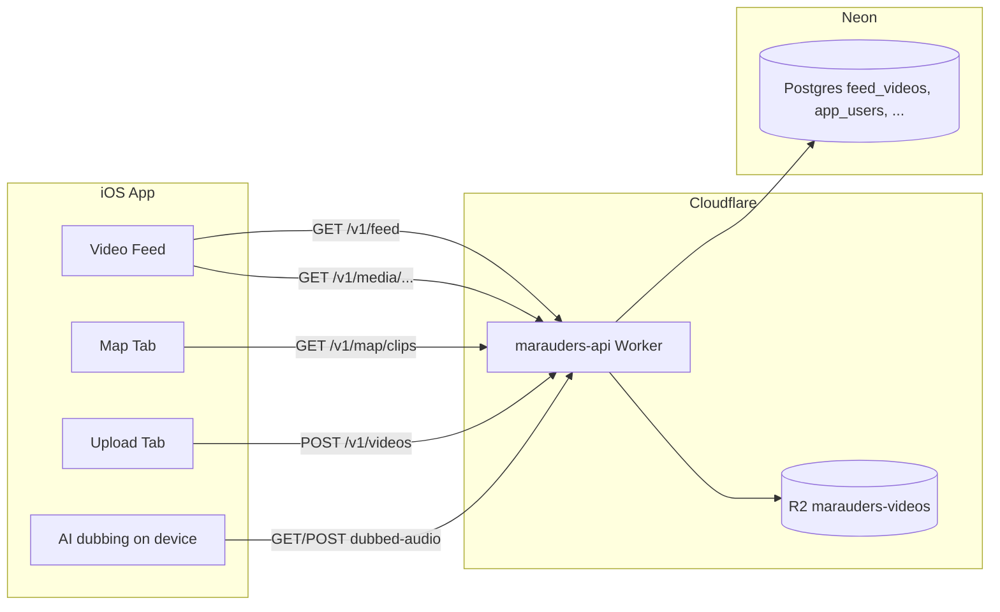

# Marauders

แอป iOS สไตล์สั้น ๆ แบบ TikTok: **ฟีดวิดีโอแนวตั้ง**, **อัปโหลดคลิป**, metadata ใน **Neon (Postgres)**, ไฟล์วิดีโอใน **Cloudflare R2**, API บน **Cloudflare Workers**

โปรเจกต์ portfolio สำหรับสมัครงาน — เน้น full-stack บน cloud จริง ไม่ใช่ mock ในเครื่องอย่างเดียว

## Features

| ส่วน | รายละเอียด |
|------|------------|
| **ฟีด** | เลื่อนแนวตั้งเต็มจอ (paging), เล่นเฉพาะคลิปที่อยู่กลางจอ |
| **แผนที่** | หมุดคลิปบนแผนที่ + Near Me; กรองเฉพาะโพสต์ของคนประเทศที่เลือก |
| **อัปโหลด** | เลือกวิดีโอจากคลัง → เติมตำแหน่งจาก metadata ของวีดีโอให้อัตโนมัติ (ISO 6709) หรือปักหมุดเอง → ตรวจเสียงในคลิปบนเครื่อง (SoundAnalysis, เป็นข้อมูลประกอบ ไม่บล็อกการอัปโหลด) → ส่ง multipart ไป API → โผล่บนฟีด |
| **โปรไฟล์** | โปรไฟล์ของตัวเอง (เปลี่ยนรูป/`@handle`, ลบคลิป) และโปรไฟล์สาธารณะของคนอื่นต่อ `@handle` |
| **ความคิดเห็น** | อ่าน / เขียน / ลบความคิดเห็นใต้คลิปจากชีตที่เปิดด้วยปุ่ม Comments บน rail ของฟีด ผู้เยี่ยมชมอ่านได้ ต้องล็อกอินก่อนเขียน |
| **ไลก์** | ปุ่มหัวใจบน rail ของฟีดกดถูกใจ / เลิกถูกใจคลิป พร้อมจำนวนไลก์ หรือแตะคลิปสองครั้งเพื่อไลก์พร้อมหัวใจเด้งแบบ TikTok ผู้เยี่ยมชมเห็นจำนวนแต่ต้องล็อกอินก่อนกด |
| **Settings** | เลือก **ภาษาที่ฟัง** (listening language) และดาวน์โหลด/จัดการโมเดลภาษา (Whisper base สำหรับตรวจภาษาในคลิป) |
| **AI dubbing** | ผู้ชมเลือกฟังเสียงต้นฉบับหรือเสียงพากย์ AI ในภาษาของตัวเอง; แปลและสร้างเสียงบน iPhone ของผู้ชม แล้วแชร์ไฟล์ผ่านแคชบน R2 — รายละเอียดใน [deployment/AI_DUBBING.md](deployment/AI_DUBBING.md) |
| **Auth** | Sign in with Apple → แลก identity token เป็น session; เลือกประเทศตอน login (Debug build บน Simulator ใช้ `/v1/auth/dev` แทนได้) |
| **API** | REST บน Workers, validate input ฝั่งเซิร์ฟเวอร์ |
| **Debug** | แท็บ Log ในแอป (เฉพาะ **Debug** build, `#if DEBUG`) + `os.Logger` |

เอกสารสถาปัตยกรรม: [ARCHITECTURE.md](ARCHITECTURE.md) · บันทึกการตัดสินใจ (ADR): [docs/adr/](docs/adr/) · AI dubbing: [deployment/AI_DUBBING.md](deployment/AI_DUBBING.md) · CI/CD: [docs/ci-cd.md](docs/ci-cd.md)

## Architecture



- **Neon** เก็บ `feed_videos` (`stream_url`, caption, พิกัด, `audio_assessment`), `app_users` (`@handle`, ประเทศ, พิกัดล่าสุด, รูปโปรไฟล์, สวิตช์แชร์ตำแหน่ง `shares_location`), `comments` (ความคิดเห็นใต้คลิป), `video_likes` (ไลก์ของคลิป), `user_follows` (ใครติดตามใคร), `rate_limit_counters`, `dubbed_audio_reports`
- **R2** เก็บไฟล์ `.mp4` / `.mov` (วิดีโอ), `.jpg` / `.png` (รูปโปรไฟล์ `avatars/`) และเสียงพากย์ AI `.m4a` (`translations/`)
- **Worker** อ่าน/เขียน DB, อัปโหลด/เสิร์ฟวิดีโอ (รองรับ **HTTP Range** สำหรับ AVPlayer)
- **iPhone** ทำงานหนักของ dubbing เอง (ตรวจภาษา, แปล, สร้างเสียง) ไม่มี AI provider ฝั่งเซิร์ฟเวอร์

## Repository layout

```text
Marauders/
├── Marauders-ios/          # SwiftUI + AVFoundation (MVVM + Clean Architecture)
│   ├── Marauders/
│   │   ├── App/, Composition/   # entry point, dependency container
│   │   ├── Domain/              # Entities, UseCases, Repositories/Services (protocol)
│   │   ├── Data/                # API clients, Auth, Repositories, Services (cache, Whisper, ...)
│   │   ├── Presentation/        # Feed, Map, Upload, Profile, Settings, Dubbing, Auth, Debug (Log), ...
│   │   └── APIConfiguration.plist   # Base URL ของ Worker (HTTPS)
│   ├── MaraudersTests/     # unit tests (Swift Testing)
│   ├── MaraudersUITests/   # XCUITest
│   └── fastlane/           # lanes: test, build, beta
├── backend/                # Cloudflare Worker (TypeScript)
│   ├── src/                # index.ts (router), routes/, auth/, db/, audio/, media/
│   ├── sql/                # schema, seed, migrations 001–020
│   ├── scripts/            # migrate, test-*, HLS/purge utilities
│   ├── test/               # authDev, comments, commentsRoutes, likes, follows, followLists, friendLocations tests + fakes (users, neon)
│   └── wrangler.toml
├── deployment/             # คู่มือ deploy, AI_DUBBING.md, video-pipeline.md
├── docs/                   # adr/, ci-cd.md
├── ARCHITECTURE.md
└── Jenkinsfile             # Jenkins → TestFlight
```

## Prerequisites

- **Xcode** (deployment target iOS 26.6 — ปรับใน Xcode ตามเครื่องคุณได้) · SwiftPM dependency (WhisperKit, lottie-spm) เป็นแพ็กเกจสาธารณะ ถูก resolve ตอน build ไม่ต้องใช้ token หรือสิทธิ์เข้าถึงพิเศษ
- **Node.js** (เวอร์ชันล่าสุดที่ Wrangler 4 รองรับ) สำหรับ Worker
- บัญชี **[Neon](https://neon.tech)** และ **[Cloudflare](https://dash.cloudflare.com)** (Workers + R2)

## Quick start

### 1. Database (Neon)

```bash
cd backend
npm install
npm run db:migrate    # รัน migration ใน backend/sql/ (001–018 ยกเว้น 004 ที่ล้างข้อมูล รันเองเมื่อจำเป็น)
```

หรือรัน SQL ใน Neon SQL Editor ตามไฟล์ใน `backend/sql/` ทีละไฟล์

ตั้ง connection string (ไม่ commit):

```bash
cp .env.example .dev.vars   # ใส่ DATABASE_URL, JWT_SIGNING_SECRET, APPLE_CLIENT_ID สำหรับ wrangler dev / migrate
```

### 2. API (Cloudflare)

```bash
cd backend
npx wrangler login
npx wrangler r2 bucket create marauders-videos
npx wrangler secret put DATABASE_URL
npx wrangler secret put JWT_SIGNING_SECRET   # openssl rand -base64 48
npx wrangler secret put APPLE_CLIENT_ID      # bundle id ของแอป
npm run deploy
```

ทดสอบ:

```bash
curl "https://<your-worker>.workers.dev/v1/feed?limit=5"
```

รายละเอียดเพิ่ม: [deployment/README.md](deployment/README.md)

### 3. iOS

1. เปิด `Marauders-ios/Marauders.xcodeproj`
2. แก้ `Marauders/APIConfiguration.plist` → `MARAUDERS_API_BASE_URL` เป็น URL Worker ของคุณ (ไม่มี `/` ท้าย)
3. Run บน Simulator หรือเครื่องจริง (ต้องมีเน็ต)

Simulator ไม่มี Apple ID: ตั้ง secret `DEV_LOGIN_SECRET` ให้ Worker (`npx wrangler secret put DEV_LOGIN_SECRET`, ≥ 32 ตัวอักษร) แล้วเปิด Debug build บน Simulator พร้อม environment `MARAUDERS_DEV_LOGIN_SECRET` (และ `MARAUDERS_DEV_LOGIN_LABEL` เลือกผู้ใช้ทดสอบ ค่าเริ่มต้น `simulator`) เช่น `SIMCTL_CHILD_MARAUDERS_DEV_LOGIN_SECRET=… xcrun simctl launch …` เพื่อล็อกอินผ่าน `POST /v1/auth/dev` — secret ไม่ถูกเก็บในโปรเจกต์; ถ้า Worker ไม่ตั้ง secret route นี้ตอบ `404`

## API (สรุป)

| Method | Path | คำอธิบาย |
|--------|------|----------|
| `GET` | `/health` | health check |
| `GET` | `/v1/map/clips?limit=20&country=<ISO2>` | หมุดแผนที่ ใช้ข้อมูลชุดเดียวกับฟีด (รวมคลิปของตัวเอง) |
| `POST` | `/v1/auth/apple` | `{ identityToken, country? }` → `{ accessToken }` (Sign in with Apple) |
| `POST` | `/v1/auth/dev` | `{ secret, label, country? }` → `{ accessToken }` — เฉพาะเมื่อ Worker ตั้ง `DEV_LOGIN_SECRET`, ไม่งั้น `404` (ใช้กับ Debug build บน Simulator) |
| `GET` | `/v1/feed?limit=20&cursor=<uuid>&country=<ISO2>` | ฟีด; ทุกคนเห็นคลิปชุดเดียวกัน รวมคลิปของตัวเอง (Bearer ไม่เปลี่ยนผลลัพธ์ แต่ถ้าส่งมาและไม่ถูกต้องจะคืน 401); คำตอบมี `viewerID` เมื่อส่ง Bearer |
| `POST` | `/v1/videos` | `multipart/form-data`: `file` + `latitude` + `longitude` + `caption` (ไม่บังคับ) + `audioAssessment` (JSON ไม่บังคับ) — ต้องส่ง `Authorization: Bearer <accessToken>` |
| `DELETE` | `/v1/videos/:id` | ลบคลิปของตัวเอง (ลบทั้ง row และไฟล์ใน R2) — ต้องส่ง Bearer |
| `POST` | `/v1/users/me/location` | `{ latitude, longitude, whileClosed? }` — บันทึกพิกัดล่าสุดของผู้ใช้ที่ล็อกอิน → `{ latitude, longitude, sharesLocation }` (Bearer) — ถ้า `whileClosed: true` (แอปส่งตอนปิดอยู่) จะเก็บเฉพาะเมื่อผู้ใช้เปิดแชร์ตำแหน่งอยู่ ไม่เช่นนั้นตำแหน่งเดิมคงไว้ และแอปหยุดส่งเมื่อได้ `sharesLocation: false` |
| `GET` | `/v1/users/me/friend-locations` | ตำแหน่งล่าสุดของคนที่ผู้ใช้ติดตามและติดตามกลับ (ติดตามกัน) ซึ่งเปิดแชร์ตำแหน่ง → `{ sharing, located, items: [{ handle, avatarURL, latitude, longitude, locationUpdatedAt }] }` เรียงตามเวลาอัปเดตล่าสุด สูงสุด 500 คน พิกัดปัดเหลือทศนิยม 3 ตำแหน่ง (ประมาณ 100 เมตร) (Bearer) — ถ้าผู้ใช้เองไม่ได้เปิดแชร์ หรือยังไม่มีตำแหน่งของตัวเองในระบบ (`located: false`) จะได้ `items: []` เสมอ; บัญชีที่ถูกลบไปแล้วได้ `401` |
| `PUT` | `/v1/users/me/location-sharing` | `{ enabled: true \| false }` — เปิด / ปิดการแชร์ตำแหน่งกับคนที่ติดตามกัน → `{ sharesLocation }` ตอนเปิดจะลบตำแหน่งเดิมที่เก็บไว้ก่อนผู้ใช้ยินยอมทิ้ง (Bearer; ค่าอื่นที่ไม่ใช่ boolean ได้ `400`, เกิน 20 ครั้ง/นาทีต่อ user ได้ `429`; migration 020) |
| `GET` | `/v1/users/me` | โปรไฟล์ผู้ใช้ที่ล็อกอิน (handle, ประเทศ, พิกัดล่าสุด, จำนวนคลิป, `avatarURL`, `followerCount`, `followingCount`, `sharesLocation`) + คลิปของตัวเอง (Bearer) |
| `PATCH` | `/v1/users/me` | `{ handle }` — เปลี่ยน `@handle` ของตัวเอง (ตัวพิมพ์เล็ก, `a-z0-9._`, 1–63 ตัว, ตรวจคำสงวน) → `{ handle }`; ซ้ำคืน `409` (Bearer) |
| `POST` | `/v1/users/me/avatar` | `multipart/form-data`: `file` (JPEG/PNG ≤ 5 MB) → อัปโหลด R2 แล้วคืน `{ avatarURL }` (Bearer) |
| `DELETE` | `/v1/users/me/avatar` | ลบรูปโปรไฟล์ของตัวเอง (ลบไฟล์ใน R2) → `{ avatarURL: null }` (Bearer) |
| `GET` | `/v1/users/<handle>` | โปรไฟล์สาธารณะของคนอื่น (handle, ประเทศ, จำนวนคลิป, `avatarURL`, คลิป, `followerCount`, `followingCount`) — ไม่ต้องล็อกอิน; ถ้าส่ง Bearer มาจะได้ `followedByViewer` (ผู้ดูติดตามบัญชีนี้อยู่ไหม) กับ `isViewer` (เป็นโปรไฟล์ของผู้ดูเองไหม) ด้วย ส่วน guest ได้ `false` ทั้งคู่ และถ้าส่ง Bearer ที่ไม่ถูกต้องจะคืน 401 เหมือนฟีด |
| `PUT` / `DELETE` | `/v1/users/<handle>/follow` | ติดตาม / เลิกติดตามบัญชีนั้น (Bearer; ทำซ้ำได้ ไม่นับซ้ำ) คืน `{ following, followerCount, viewerFollowingCount }` หลังเปลี่ยนแล้ว (`followerCount` ของบัญชีนั้น, `viewerFollowingCount` จำนวนบัญชีที่ผู้ดูติดตามอยู่); handle ผิดรูปแบบได้ `400`, บัญชีที่ไม่มีได้ `404`, ติดตามตัวเองได้ `422`, บัญชีของผู้ดูที่ถูกลบไปแล้วได้ `401`, เกิน 30 ครั้ง/นาทีต่อ user ได้ `429` (`user_follows`, migration 019) |
| `GET` | `/v1/users/<handle>/followers` และ `/following` | รายชื่อบัญชีที่ติดตามโปรไฟล์นั้น / ที่โปรไฟล์นั้นติดตามอยู่ เรียงใหม่สุดก่อน (ต้องล็อกอิน: Bearer) คืน `{ items: [{ handle, avatarURL, followedByViewer, isViewer }], nextCursor }`; `limit` 1–50 (ค่าเริ่มต้น 20) และ `cursor` ที่เป็นค่าทึบซึ่ง Worker สร้างให้ (ส่งกลับมาตามเดิม ไม่ใช่ของ Worker ได้ `400`); handle ผิดรูปแบบได้ `400`, บัญชีที่ไม่มีได้ `404`, ไม่ได้ล็อกอินได้ `401`, เกิน 60 ครั้ง/นาทีต่อ user ได้ `429` (`follow-list`) ไม่ต้องมี migration เพิ่ม (ใช้ index ของ migration 019) |
| `GET` / `POST` | `/v1/videos/:id/dubbed-audio?source=<sha256>&lang=<code>` | แคชเสียงพากย์ AI ที่แชร์กัน: GET (guest อ่านได้) คืน `missing` / `ready` + URL; POST (Bearer, `audio/mp4`, `X-Source-SHA256`) อัปโหลดเสียงที่สร้างบนเครื่อง; `/thai-audio` เป็น path เดิมของแอปรุ่นเก่า (= `lang=th`); `?kind=text` ใช้กับข้อความแปล/คำบรรยาย: GET อ่าน, POST (Bearer, ≤ 16 KiB) บันทึกครั้งแรกครั้งเดียว และถูกลบพร้อมเสียงเมื่อมีการรายงานจนลบ |
| `POST` | `/v1/videos/:id/dubbed-audio/report?lang=<code>` | รายงานเสียงพากย์ที่แชร์ว่าไม่ดี (Bearer + header `X-Source-SHA256` ต้องตรงกับคลิปปัจจุบัน ไม่งั้น `409`) — ผู้รายงานต่างกัน 2 คน หรือเจ้าของคลิป/ผู้อัปโหลด 1 คน ทำให้ไฟล์ถูกลบ (migration 016) |
| `GET` | `/v1/videos/:id/comments?limit=30&cursor=<uuid>` | ความคิดเห็นใต้คลิป เรียงใหม่สุดก่อน (ไม่ต้องล็อกอิน; ถ้าส่ง Bearer ที่ไม่ถูกต้องคืน 401) — `limit` เริ่มต้น 30 สูงสุด 50, `cursor` คือ id ของความคิดเห็นสุดท้ายในหน้าก่อน (ถ้าความคิดเห็นนั้นถูกลบไปแล้วจะได้หน้าว่างกับ `nextCursor` เป็น null แอปจึงเริ่มโหลดใหม่จากล่าสุด); คืน `{ items, nextCursor }` แต่ละรายการมี `id`, `body`, `language`, `createdAt`, `authorName`, `authorAvatarURL`, `canDelete` (จริงสำหรับความคิดเห็นของผู้ดูเอง และทุกความคิดเห็นใต้คลิปของผู้ดู) |
| `POST` | `/v1/videos/:id/comments` | `{ body, language? }` — เขียนความคิดเห็น (Bearer) request ใหญ่ได้ไม่เกิน 16 KiB (`413`) ตัดช่องว่างหัวท้ายกับอักขระควบคุมที่ไม่ใช่ tab/ขึ้นบรรทัดออก แล้วต้องยาว 1–500 ตัวอักษร (นับเป็น code point) มีอย่างน้อยหนึ่งตัวที่มองเห็น (ข้อความที่มีแต่ช่องว่าง อักขระ zero-width ตัวเติมฮันกึล หรือ variation selector ถูกปฏิเสธ) และไม่มี surrogate เดี่ยว ไม่งั้น `422` (การขึ้นบรรทัดเก็บไว้ไม่เกิน 10 ครั้ง ครั้งที่เกินถูกเก็บเป็นช่องว่าง กันความคิดเห็นเดียวสูงเป็นร้อยบรรทัด); `language` เก็บเฉพาะภาษาที่แอปแปลได้ (22 ภาษา) นอกนั้นเป็น null; คืน `201 { comment }`; `401 account not found` เมื่อ token ยังไม่หมดอายุแต่แถวผู้ใช้ใน `app_users` ถูกลบไปแล้ว; จำกัด 10 ครั้ง / 60 วินาทีต่อผู้ใช้ (`429`) (migration 017) |
| `DELETE` | `/v1/videos/:id/comments/:commentId` | ลบความคิดเห็น — ผู้เขียนหรือเจ้าของคลิปเท่านั้น (Bearer) คนอื่นได้ `404` |
| `PUT` / `DELETE` | `/v1/videos/:id/like` | กดถูกใจ / เลิกถูกใจคลิป (Bearer; ทำซ้ำได้ ไม่นับซ้ำ) คืน `{ liked, likeCount }` หลังเปลี่ยนแล้ว; คลิปที่ไม่มีได้ `404`, บัญชีที่หายไปแล้วได้ `401`, เกิน 60 ครั้ง/นาทีต่อ user ได้ `429` (`video_likes`, migration 018) |
| `GET` / `HEAD` | `/v1/media/videos/<uuid>.{mp4,mov}` | สตรีมไฟล์วิดีโอจาก R2 |
| `GET` / `HEAD` | `/v1/media/avatars/<uuid>.{jpg,png}` | สตรีมไฟล์รูปโปรไฟล์จาก R2 |

**ข้อจำกัดอัปโหลด (server):** วิดีโอ MP4 / QuickTime สูงสุด 100 MB · รูปโปรไฟล์ JPEG / PNG สูงสุด 5 MB · เสียงพากย์ AI สูงสุด 4 MiB (AAC/M4A)

**ประเทศตอน login:** แอปส่ง `country` เป็น ISO 3166-1 alpha-2 (เช่น `TH`) พร้อม identity token; Worker ตรวจรูปแบบแล้วเก็บใน `app_users.country` (ไม่ทับค่าที่มีอยู่)

**กรองแผนที่ตามประเทศ:** แท็บ Map มีตัวกรองเลือกดูเฉพาะโพสต์ของคนประเทศนั้น โดยส่ง `country` ไปกับ `/v1/map/clips` (ฝั่ง Worker join `feed_videos.owner_user_id` กับ `app_users.country`)

**แผนที่สไตล์ Instagram:** แท็บ Map เป็นแผนที่เต็มจอ ไม่มี navigation bar มีเมนูตัวกรอง (ประเทศ / ใกล้ฉัน) โดยเริ่มต้นแสดงทุกประเทศ และปุ่มหาตำแหน่ง หมุดวงกลมถูกจัดกลุ่มอัตโนมัติ (clustering) ตามระยะ zoom — แตะกลุ่มเพื่อซูมเข้า แตะหมุดเดี่ยวเพื่อเล่นวิดีโอทันที (วนซ้ำ มีปุ่มไปเล่นในฟีด) (แถบค้นหาแบบ client-side ยังซ่อนไว้ เปิดใช้ได้ด้วย `MapView.isSearchVisible`)

**บันทึกตำแหน่งผู้ใช้:** เมื่อผู้ใช้ให้สิทธิ์และแอปได้พิกัดครั้งแรกในเซสชัน หน้า Map จะส่งพิกัดไปที่ `POST /v1/users/me/location` (ครั้งเดียวต่อการเปิดแอป) → เก็บใน `app_users.latitude/longitude` ส่วนผู้ที่เปิดแชร์ตำแหน่ง แอปจะส่งพิกัดเพิ่มอีกทั้งระหว่างที่ใช้แอปและตอนปิดแอป (ดูหัวข้อแชร์ตำแหน่ง)

**แชร์ตำแหน่งกับคนที่ติดตามกัน:** ในแท็บ Map มีปุ่ม **แชร์ตำแหน่ง** ค่าเริ่มต้นปิด กดแล้วแอปจะถามยืนยันก่อน (บอกว่าใครจะเห็นอะไร) เมื่อเปิดแล้วปุ่มเปลี่ยนเป็น **กำลังแชร์ตำแหน่ง** ขอบสีเขียว และกดครั้งเดียวก็ปิดได้ทันทีโดยไม่ต้องยืนยัน การแชร์เป็นแบบแลกกัน: ผู้ใช้จะเห็นตำแหน่งของคนที่ตัวเองติดตามและติดตามกลับเฉพาะเมื่อ**ทั้งสองฝ่าย**เปิดแชร์ และตัวเองต้องมีตำแหน่งในระบบแล้วด้วย (ไม่มีใครแอบดูคนอื่นโดยที่ตัวเองไม่ถูกเห็นได้) คนที่ปิดแชร์จะไม่เห็นใครเลย และเลิกติดตามฝ่ายใดฝ่ายหนึ่งก็หยุดเห็นกันทันที ตอนเปิดแชร์ Worker จะลบตำแหน่งเดิมที่แท็บ Map เคยเก็บไว้ก่อนผู้ใช้ยินยอม คนอื่นจึงเห็นเฉพาะตำแหน่งหลังจากเปิดแชร์ (แอปส่งตำแหน่งใหม่ทันที ระหว่างรอแผนที่ขึ้นว่า "กำลังหาตำแหน่งของคุณ…") หน้า Settings ก็มีสวิตช์เดียวกัน จึงปิดได้แม้ปิดสิทธิ์ตำแหน่งไปแล้ว (แท็บ Map จะถูกปิดไว้) และหน้าขอสิทธิ์ตำแหน่งของแท็บ Map มีปุ่ม "หยุดแชร์ตำแหน่ง" ให้ด้วย แอปถามสถานะการแชร์ใหม่ทุกครั้งที่กลับเข้าแอป ระหว่างที่ยังไม่รู้สถานะ ปุ่มจะขึ้นวงหมุนแทนเปิด / ปิด บนแผนที่ คนที่ติดตามกันแสดงเป็นรูปโปรไฟล์ในวงสีเขียว พร้อม handle และเวลาที่อัปเดตล่าสุด (เช่น "5 นาทีที่แล้ว") โดยแสดงตำแหน่งล่าสุดเสมอไม่ว่าจะเก่าแค่ไหน แตะแล้วเปิดโปรไฟล์ แผนที่ถามตำแหน่งเพื่อนใหม่ทุก 60 วินาทีระหว่างที่เปิดอยู่ ถ้าถามไม่สำเร็จติดกันเกิน 5 นาที หมุดเพื่อนจะถูกเอาออกจนกว่าจะถามสำเร็จ ผู้ที่เปิดแชร์จะส่งพิกัดเมื่อเปิดแอปหรือกลับเข้าแอป และไม่บ่อยกว่าทุก 5 นาทีระหว่างที่แอปเปิดอยู่ (ความแม่นยำประมาณ 100 เมตร) และตอนปิดแอปก็ยังส่งต่อ (แบบเดียวกับ Protego) ด้วยบริการตำแหน่งแบบประหยัดแบตของ iOS: เมื่อเครื่องย้ายไปราว 500 เมตร และเมื่อไปถึงที่ที่อยู่นาน iOS จะปลุกแอปหรือเปิดแอปขึ้นมาเบื้องหลังให้ส่งพิกัด ต้องให้สิทธิ์ตำแหน่ง "เสมอ" (ตอนล็อกอินขออยู่แล้ว ถ้าผู้ใช้ลดสิทธิ์ทีหลัง หน้า Settings จะบอกและมีปุ่มไปตั้งค่า) ไม่ใช้ background mode `location` จึงไม่มีลูกศรสีน้ำเงินค้างบนแถบสถานะ แอปไม่ขอสิทธิ์ตำแหน่งเพิ่ม ตำแหน่งที่ขอไว้ก่อนผู้ใช้ปิดแชร์หรือออกจากระบบจะถูกทิ้งไม่ส่ง และการออกจากระบบจะหยุดส่งตอนปิดแอปด้วย ข้อควรรู้: การออกจากระบบหรือลบแอปไม่ได้ปิดการแชร์ และเพราะไม่จำกัดอายุตำแหน่ง ตำแหน่งสุดท้ายจะยังแสดงให้คนที่ติดตามกันเห็นจนกว่าจะปิดแชร์ ข้อความขอสิทธิ์ตำแหน่งของ iOS บอกแล้วว่าตำแหน่งจะแสดงให้คนอื่นเห็นเฉพาะเมื่อเปิดแชร์ และเฉพาะคนที่ติดตามกัน และเมื่อเปิดแชร์ แอปจะส่งตำแหน่งตอนเคลื่อนที่แม้ปิดแอปอยู่

**ลำดับการ deploy การแชร์ตำแหน่ง:** รัน `cd backend && npm run db:migrate` (migration 020 เพิ่มคอลัมน์ `app_users.shares_location` ค่าเริ่มต้น `false`) ก่อน แล้วค่อย `npm run deploy` เพราะ `GET /v1/users/me` อ่านคอลัมน์นี้ — **ถ้า deploy Worker ก่อน แท็บ Profile จะโหลดไม่ได้ (500)** แอปรุ่นเก่ากับ Worker ใหม่ไม่พัง แอปรุ่นใหม่กับ Worker เก่าจะไม่มีปุ่มให้กด (ปุ่มรอคำตอบจาก Worker ก่อน)

**ขอความยินยอมใหม่ (migration 021):** คนที่เปิดแชร์ไว้ก่อนตกลงแค่ว่าเพื่อนจะเห็นที่ที่ใช้แอปล่าสุด ไม่ใช่ตำแหน่งตอนปิดแอป `npm run db:migrate` จึงปิด `shares_location` ของทุกคนหนึ่งครั้ง ให้แต่ละคนเปิดเองใหม่กับข้อความยืนยันใหม่ เพราะสคริปต์ migrate รันทุกไฟล์ซ้ำทุกครั้ง การปิดนี้จึงผูกกับแถวในตาราง `data_migrations` และเกิดแค่ครั้งแรก ควรรัน migration และ deploy Worker (ที่ตอบ `sharesLocation` และไม่เก็บตำแหน่งตอนปิดแอปของคนที่ไม่ได้แชร์) ก่อนแอปรุ่นนี้ถึงมือผู้ใช้ ลำดับระหว่างสองอย่างนี้ไม่สำคัญ (Worker ใหม่ใช้แค่คอลัมน์จาก migration 020) ถ้าแอปรุ่นนี้เจอ Worker เก่า ตำแหน่งตอนปิดแอปจะถูกเก็บเสมอ และแอปจะรู้ว่าถูกปิดแชร์จากเครื่องอื่นก็ต่อเมื่อเปิดแอป

**แท็บของแอป:** Feed · Map · Profile · Upload · Settings (และ Log เฉพาะ Debug build)

**แท็บ Settings:** เลือกภาษาที่ฟัง (22 ภาษา) และจัดการโมเดลภาษาที่ดาวน์โหลดไว้ (รวม Whisper base ที่ใช้ตรวจภาษาพูดของคลิปบนเครื่อง ผ่าน WhisperKit โดยเลือกช่วงที่มีเสียงพูดมากที่สุดมาตรวจ); ต้นทางที่พากย์ได้คืออังกฤษ สเปน และดัตช์ — ดู [deployment/AI_DUBBING.md](deployment/AI_DUBBING.md)

**แท็บ Profile:** เรียก `GET /v1/users/me` (Bearer) เพื่อโชว์รูปโปรไฟล์ + `@handle` + ประเทศ + จำนวนกำลังติดตาม / ผู้ติดตาม / คลิป และกริดคลิปที่ตัวเองอัปโหลด (แตะเพื่อเล่นวนซ้ำ) พร้อมปุ่มออกจากระบบ — แตะรูปเพื่อเปลี่ยนรูปโปรไฟล์ (ย่อภาพ ≤ 512px แล้ว `POST /v1/users/me/avatar`), แตะ handle เพื่อแก้ไข (`PATCH /v1/users/me`) และลบคลิปของตัวเองได้ด้วยการกดค้างที่คลิปหรือกดถังขยะตอนเล่น (ยืนยันก่อนลบ → `DELETE /v1/videos/:id`)

**รูปโปรไฟล์ (avatar):** ฟีดคืน `authorAvatarURL` (ของเจ้าของโพสต์) และโปรไฟล์คืน `avatarURL` — แสดงเป็นวงกลมมุมขวาล่างของคลิปแบบ TikTok (แตะเพื่อเปิดโปรไฟล์สาธารณะ) ถ้าไม่มีรูปจะแสดงวงกลมสีไล่เฉดพร้อมอักษรแรกของ handle

**Player ในฟีด:** ใช้ `AVPlayer` 3 ตัว (visible + เตรียมคลิปข้างเคียง) บน `UIScrollView` paging — ดู [ADR-001](docs/adr/001-feed-playback-dual-player.md) (ชื่อไฟล์ยังเป็น dual-player จากรุ่นแรก)

**โปรไฟล์สาธารณะต่อ `@handle`:** ทุกบัญชีมี `@handle` อัตโนมัติตอนสมัคร (`@user_<hex>`) แก้ไขได้ในแท็บ Profile แตะชื่อผู้เขียนหรือรูปในฟีดเพื่อเปิดโปรไฟล์สาธารณะของคนนั้นได้แบบไม่ต้องล็อกอิน (`GET /v1/users/<handle>`) — ฟีดใช้ `handle` ของเจ้าของเป็น `authorName`

**ความคิดเห็น:** ปุ่ม Comments บน rail ขวาของฟีดเปิดชีตความคิดเห็นของคลิปที่กำลังดู (ฟีดหยุดเล่นระหว่างเปิดชีตและเล่นต่อเมื่อปิด ยกเว้นผู้ใช้หยุดคลิปไว้เอง) ผู้เยี่ยมชมอ่านได้ แต่ต้องล็อกอินก่อนเขียน — ปุ่ม *Sign in to comment* จะปิดชีตแล้วเปิดหน้า sign-in เดียวกับที่ใช้ทั้งแอป (คลิปหยุดค้างอยู่หลังหน้า sign-in จนผู้ใช้กดย้อนกลับ ถ้า sign-in สำเร็จฟีดจะโหลดใหม่และเริ่มที่คลิปแรก ไม่ใช่คลิปที่กำลังจะคอมเมนต์) ผู้ที่ล็อกอินเขียนได้ไม่เกิน 500 ตัวอักษร (ระหว่างที่มีข้อความร่างค้างอยู่ ปัดชีตลงไม่ปิด ต้องกดปุ่ม ✕) และลบของตัวเองได้ด้วยการปัดแถวไปทางซ้าย (เจ้าของคลิปลบความคิดเห็นใดๆ ใต้คลิปของตัวเองได้) โหลดทีละ 30 รายการ ใหม่สุดก่อน ใต้ปุ่มแสดงจำนวนความคิดเห็นของคลิป (`commentCount` จากฟีด) และนับเพิ่ม / ลดทันทีเมื่อผู้ใช้โพสต์หรือลบ ความคิดเห็นที่คนอื่นเขียนจะขึ้นเมื่อโหลดฟีดใหม่ ถ้า Worker ยังไม่ส่งจำนวนมา ปุ่มจะเขียนว่า Comments แทน ยังไม่ได้ทำ: แปลความคิดเห็นบน iPhone ของผู้อ่าน, รายงาน/บล็อก

**ลำดับการ deploy ความคิดเห็น:** รัน `cd backend && npm run db:migrate` (migration 017 สร้างตาราง `comments`) ก่อน แล้วค่อย `npm run deploy` Worker เพราะ route ใหม่ query ตารางนี้ แอปรุ่นใหม่กับ Worker เก่าไม่พัง แต่ชีตจะอ่านความคิดเห็นไม่ได้จนกว่าจะ deploy (ชีตขึ้น *This clip is no longer available.* ทุกคลิป เพราะ Worker เก่าตอบ 404 `not found`) — Jenkins ส่งแอปขึ้น TestFlight จาก `main` โดยไม่รอ Worker ส่วน Worker deploy ด้วยมือ (ดู [docs/ci-cd.md](docs/ci-cd.md)) จึงควร migrate และ deploy Worker ก่อนที่ build จาก `main` ที่มีฟีเจอร์นี้จะถึงผู้ทดสอบ

**ไลก์:** ปุ่มหัวใจบน rail ขวาของฟีด (เหนือปุ่ม Comments) กดแล้วหัวใจเปลี่ยนและจำนวนเปลี่ยนทันที จากนั้นใช้จำนวนที่ Worker ตอบกลับแทนค่าที่เดา ถ้าส่งไม่สำเร็จจะย้อนกลับเป็นค่าล่าสุดที่ Worker บอก กดรัวระหว่างรอ request จะส่งทีละ request และ request สุดท้ายเป็นตัวตัดสิน ผู้เยี่ยมชมเห็นจำนวนไลก์แต่การกดจะพาไปหน้า sign-in เดียวกับทั้งแอป (คลิปหยุดค้างหลังหน้า sign-in และเล่นต่อเมื่อผู้ใช้กดย้อนกลับ; sign-in สำเร็จแล้วฟีดโหลดใหม่ ต้องกดหัวใจอีกครั้ง) ฟีดส่ง `likeCount` กับ `likedByViewer` มากับทุกคลิป — `likedByViewer` เป็น `false` เสมอสำหรับ guest และถูกตัดสินจากคำขอที่ส่ง Bearer เท่านั้น (query ของฟีดเองยังเหมือนกันทุกคน) ไลก์ที่ผู้ใช้กดวางแยกจากรายการคลิป (ไม่แก้ `videos`) และยอมให้ข้อมูลที่ฟีดโหลดใหม่ทีหลังชนะ

**แตะสองครั้งเพื่อไลก์ (แบบ TikTok):** แตะคลิปสองครั้งเร็ว ๆ จะไลก์คลิปพร้อมหัวใจใหญ่เด้งขึ้นตรงจุดที่แตะ (เอียงเล็กน้อย ลอยขึ้นแล้วจางหายในหนึ่งวินาที ถ้าเปิด Reduce Motion จะแค่จางเข้าออก) แตะต่อเร็ว ๆ ได้หัวใจเพิ่มทุกครั้ง การแตะสองครั้งไม่ยกเลิกไลก์ (ยกเลิกได้ที่ปุ่มหัวใจเท่านั้น) และส่ง request ครั้งเดียวไม่ว่าจะแตะกี่ครั้ง ปุ่มหัวใจบน rail เป็นหัวใจทึบสีขาว พอไลก์จะเป็นสีแดง (#FE2C55) เด้ง และสั่นเบา ๆ ส่วนการแตะครั้งเดียวยังหยุด / เล่นคลิปเหมือนเดิม แต่จะรอ 0.3 วินาทีเพื่อดูว่ามีแตะที่สองตามมาหรือไม่ ผู้เยี่ยมชมที่แตะสองครั้งจะไปหน้า sign-in เหมือนกดปุ่มหัวใจ

**ติดตาม (follow):** มุมล่างของรูปคนโพสต์บน rail ของฟีดมีปุ่ม "+" สีแดงแบบ TikTok กดแล้วติดตามคนนั้นทันที ปุ่ม "+" กลายเป็นเครื่องหมายถูกครู่หนึ่งแล้วหายไป (และหายจากทุกคลิปของคนนั้น) ปุ่ม "+" ใช้ติดตามอย่างเดียว ถ้าจะเลิกติดตามต้องไปที่โปรไฟล์ คลิปของตัวเองไม่มีปุ่ม "+" ส่วนโปรไฟล์สาธารณะแสดงจำนวน *กำลังติดตาม* / *ผู้ติดตาม* / *คลิป* และปุ่ม **ติดตาม** สีแดง (กดแล้วเปลี่ยนเป็น **กำลังติดตาม** สีเทา กดอีกครั้งเพื่อเลิกติดตาม) ซึ่งไม่แสดงในโปรไฟล์ของตัวเอง แท็บ Profile แสดงจำนวนกำลังติดตามกับผู้ติดตามของตัวเอง และอัปเดตจำนวนกำลังติดตามทันทีหลังติดตามหรือเลิกติดตามโดยไม่ต้องโหลดใหม่ ผู้เยี่ยมชมที่กด "+" บนฟีดจะไปหน้า sign-in เหมือนกดไลก์ ส่วนการกดติดตามในโปรไฟล์จะเปิดหน้า sign-in ซ้อนบนโปรไฟล์ เมื่อ sign-in เสร็จจึงยังอยู่ที่โปรไฟล์เดิมและกดติดตามต่อได้ (ไม่มีการติดตามแทนผู้ใช้) กดแล้วเห็นผลทันที จากนั้นใช้จำนวนที่ Worker ตอบกลับ ถ้าส่งไม่สำเร็จจะย้อนกลับ request การติดตามออกไปทีละอันแม้จะต่างบัญชีกัน (ไม่งั้นจำนวน "กำลังติดตาม" ที่ Worker ตอบอาจขาดไปหนึ่ง) สิ่งที่ผู้ใช้ทำชนะข้อมูลที่ฟีดโหลดไว้ก่อน และโปรไฟล์ที่เริ่มโหลดหลังจาก Worker ตอบครั้งล่าสุดถือเป็นข้อมูลใหม่กว่า ซึ่งปุ่ม "+" ในฟีดก็ใช้ด้วย ฟีดส่ง `postedByViewer` กับ `authorFollowedByViewer` มากับทุกคลิป (`authorFollowedByViewer` เป็น `null` สำหรับคลิปที่ไม่มีบัญชีเจ้าของ ซึ่งติดตามไม่ได้ จึงไม่มีปุ่ม "+"; ทั้งคู่เป็น `false` สำหรับ guest และมาจาก query ที่สองซึ่งรันเฉพาะคำขอที่ส่ง Bearer query ของฟีดเองยังเหมือนกันทุกคน) **รายชื่อผู้ติดตาม / กำลังติดตาม:** แตะตัวเลข *กำลังติดตาม* หรือ *ผู้ติดตาม* บนแท็บ Profile หรือบนโปรไฟล์สาธารณะ จะเปิดหน้ารายชื่อซ้อนต่อจากหน้านั้น (สลับระหว่างสองรายชื่อได้ที่แถบด้านบน) เรียงใหม่สุดก่อน โหลดทีละ 30 รายการและโหลดหน้าถัดไปเมื่อเลื่อนใกล้ท้ายรายชื่อ แต่ละแถวแตะเพื่อเปิดโปรไฟล์ของบัญชีนั้น (กดย้อนกลับแล้วอยู่ที่รายชื่อเดิม) และมีปุ่ม **ติดตาม** / **กำลังติดตาม** ที่ใช้สถานะเดียวกับปุ่ม "+" ในฟีดและโปรไฟล์ทุกหน้า โดยแถวของตัวเองไม่มีปุ่ม และบัญชีที่เพิ่งเลิกติดตามยังค้างในรายชื่อจนกว่าจะโหลดใหม่ เหมือน TikTok รายชื่อมีไว้สำหรับผู้ที่ล็อกอิน: ผู้เยี่ยมชมเห็นแต่ตัวเลข ถ้าแตะจะเปิดหน้า sign-in ซ้อนบนโปรไฟล์ และเมื่อ sign-in เสร็จรายชื่อจะไม่เปิดขึ้นเอง ยังไม่ได้ทำ: ฟีดเฉพาะคนที่ติดตาม (Following)

**ลำดับการ deploy การติดตาม:** รัน `cd backend && npm run db:migrate` (migration 019 สร้างตาราง `user_follows`) ก่อน แล้วค่อย `npm run deploy` เพราะ query ของโปรไฟล์ทั้งสองแบบนับผู้ติดตามจากตารางนี้ และฟีดของผู้ที่ล็อกอินก็ถามตารางนี้ — **ถ้า deploy Worker ก่อน โปรไฟล์จะตอบ 500 ทุกคำขอ และฟีดของผู้ที่ล็อกอินก็ตอบ 500** (ฟีดของ guest ยังใช้ได้) แอปรุ่นเก่ากับ Worker ใหม่ไม่พัง (ไม่รู้จัก field ใหม่ก็ข้ามไป และไม่ได้ส่ง Bearer ไปกับโปรไฟล์สาธารณะ) ส่วนแอปรุ่นใหม่กับ Worker เก่าจะไม่แสดงปุ่ม "+" ปุ่มติดตาม และจำนวนผู้ติดตาม เพราะ Worker เก่าไม่ส่ง field เหล่านี้มา

**ลำดับการ deploy ไลก์:** รัน `cd backend && npm run db:migrate` (migration 018 สร้างตาราง `video_likes`) ก่อน แล้วค่อย `npm run deploy` เพราะ query ของฟีดนับไลก์จากตารางนี้ — **ถ้า deploy Worker ก่อน ฟีดจะตอบ 500 ทุกคำขอ** (ต่างจากความคิดเห็นที่พังแค่ชีต) แอปรุ่นเก่ากับ Worker ใหม่ไม่พัง (ไม่รู้จัก field ใหม่ก็ข้ามไป) ส่วนแอปรุ่นใหม่กับ Worker เก่าแสดงหัวใจ 0 และกดแล้วย้อนกลับ (Worker เก่าตอบ `405` กับ PUT และ `400 invalid video id` กับ DELETE โดยไม่ลบอะไร)

ตัวอย่าง response ฟีด:

```json
{
  "items": [
    {
      "id": "uuid",
      "streamURL": "https://.../v1/media/videos/....mp4",
      "latitude": 13.7563,
      "longitude": 100.5018,
      "country": "TH",
      "authorName": "@marauders",
      "authorAvatarURL": "https://.../v1/media/avatars/....jpg",
      "caption": "Sunset over the river",
      "likeCount": 12,
      "likedByViewer": false,
      "commentCount": 3,
      "postedByViewer": false,
      "authorFollowedByViewer": true
    }
  ]
}
```

## Security notes (portfolio scope)

- `DATABASE_URL` เก็บใน **Wrangler secret** / `backend/.dev.vars` (gitignore) — ไม่ใส่ใน repo  
- API validate query/body ฝั่ง Worker; อัปโหลดจำกัดชนิดไฟล์และขนาด  
- แอปโหลดวิดีโอผ่าน **HTTPS** เท่านั้น  
- **Auth:** Sign in with Apple → verify identity token ฝั่ง Worker → ออก JWT (เก็บใน Keychain); อัปโหลดต้องมี Bearer token  
- **Dev login:** `/v1/auth/dev` ปิดอยู่จนกว่าจะตั้ง `DEV_LOGIN_SECRET` (ปล่อยว่างใน production) และฝั่งแอป compile เฉพาะ Debug
- **Rate limiting:** sign-in (Apple/dev) จำกัด 30 ครั้ง/นาทีต่อ IP และอัปโหลด (วิดีโอ/รูปโปรไฟล์) 10 ครั้ง/นาทีต่อ user, อัปโหลดเสียงพากย์ AI, รายงานเสียงพากย์ และโพสต์คอมเมนต์อย่างละ 10 ครั้ง/นาทีต่อ user, ติดตาม / เลิกติดตาม 30 ครั้ง/นาทีต่อ user, เปิด / ปิดแชร์ตำแหน่ง 20 ครั้ง/นาทีต่อ user (นับในตาราง `rate_limit_counters` บน Neon แบบ atomic — คืน `429` + `Retry-After`); `/v1/*` (ยกเว้น `/v1/media/*`) มีชั้นแรกเป็น Cloudflare Rate Limiting binding ต่อ IP (route auth 30/นาที, อื่น ๆ 120/นาที) ช่วยกันต่อ PoP ด้วย

## Troubleshooting

| อาการ | แนวทาง |
|--------|--------|
| อัปโหลด 500 `storage write failed` | สร้าง R2 bucket `marauders-videos` แล้ว deploy Worker ใหม่ |
| ไม่พบ API URL ในแอป | ตรวจ `APIConfiguration.plist` |
| วิดีโอ seed จาก Google เล่นไม่ได้ | รัน `003_remove_google_seeds.sql` (bucket ตัวอย่าง 403) |
| `player failed` / `Cannot Open` | ลองคลิปสั้น MP4; ดูแท็บ **Log** ในแอป |

## Tests

| ชุดทดสอบ | คำสั่ง | หมายเหตุ |
|-----------|--------|----------|
| Backend (router, auth, SQL ที่สร้าง — ไม่ต่อ PostgreSQL จริง) | `cd backend && npm run test:feed` | ตามด้วย `npm run typecheck` |
| Backend dubbed audio cache/report | `npm run test:dubbed-audio` | ใน `backend/` |
| Backend dev login | `npm run test:dev-auth` | ใช้ `node:test` + fake users |
| Backend likes | `npm run test:likes` | ใน `backend/` ใช้ `node:test` + fake ของ Neon driver ตรวจ route like/unlike (auth, 404/401/429, ไม่นับซ้ำ) และ `likeCount` / `likedByViewer` ในฟีด |
| Backend follows | `npm run test:follows` | ใน `backend/` ใช้ `node:test` + fake ของ Neon driver ตรวจ route follow/unfollow (auth, handle ที่ใช้ไม่ได้, 404/401/422/429, ไม่นับซ้ำ), จำนวนผู้ติดตามกับ `followedByViewer` / `isViewer` ในโปรไฟล์ และ `postedByViewer` / `authorFollowedByViewer` ในฟีด (guest ไม่ถามเรื่องการติดตามเลย) รวมทั้ง `test/friendLocations.test.ts` ที่ตรวจ route แชร์ตำแหน่ง (ต้องติดตามกันและเปิดแชร์ทั้งสองฝ่าย, ผู้ที่ไม่แชร์ไม่เห็นใคร, 400/401/429) และ `test/followLists.test.ts` ที่ตรวจ route รายชื่อผู้ติดตาม / กำลังติดตาม (auth, handle กับ cursor ที่ใช้ไม่ได้, 404/401/429/500 ที่ไม่เผยข้อความของฐานข้อมูล, ลำดับกับหน้าถัดไป, `followedByViewer` / `isViewer`, และต้องมาก่อน route โปรไฟล์ที่รับทุกอย่างหลัง `/v1/users/`) SQL ของรายชื่อรันกับ PostgreSQL 18.3 ผ่าน PGlite 0.5.8 ด้วย Worker จริงแล้ว 13/13 ข้อ (ลำดับกับเวลาเท่ากัน, สามหน้าต่อกัน, cursor ของบัญชีที่เลิกติดตาม / เปลี่ยนชื่อ / ถูกลบ, เวลาห่างกัน 1 ไมโครวินาที, `followedByViewer` / `isViewer`, ความยาวรายชื่อเท่ากับจำนวนในโปรไฟล์, 404 กับ `@Alice` / `alice`) สคริปต์ที่ใช้เป็นของชั่วคราวและไม่ได้เก็บใน repo |
| Backend comments | `npm run test:comments` | ใน `backend/` ใช้ `node:test` ตรวจการ normalize ข้อความและภาษาของความคิดเห็น กับ route จริง (`worker.fetch`) ที่ใช้ fake ของ Neon driver: การยืนยันตัวตน, validation, ขนาด request สูงสุด 16 KiB (ทั้งความยาวที่ประกาศและ body ที่ทยอยส่งมา), status code, ข้อความ SQL ของแต่ละ statement (ล็อกไว้ทั้งก้อน แก้ SQL แล้วต้องแก้เทสต์ตาม) กับค่าที่ bind และสิ่งที่ log เมื่อฐานข้อมูลผิดพลาด (SQLSTATE กับข้อความของฐานข้อมูล ไม่มีข้อความคอมเมนต์) รวมทั้ง `commentCount` ในทุก query ที่ list คลิป (ไม่ได้รัน SQL บน Postgres จริง) |
| Backend อื่น ๆ | `node backend/scripts/test-upload.mjs`, `test-audio-assessment.mjs` | ไม่มี npm script รันด้วย `node` ตรง ๆ |
| iOS unit tests (Swift Testing, `MaraudersTests`) | `cd Marauders-ios && bundle exec fastlane test` หรือ `xcodebuild test -scheme Marauders -only-testing:MaraudersTests -destination ...` | fastlane ใช้ `SIMULATOR_DESTINATION` (ค่าเริ่มต้น iPhone 17) |
| iOS UI tests (`MaraudersUITests`) | รันจาก Xcode / `xcodebuild test` | ใช้ launch argument `UITEST` กับ feed จำลอง (`UITEST_GUEST` เริ่มแบบยังไม่ล็อกอิน, `UITEST_REJECTED_SESSION` จำลอง session ที่ Worker ตอบ 401 — ดู [ARCHITECTURE.md](ARCHITECTURE.md)) |

## CI/CD

`Jenkinsfile` (agent macOS): Checkout → `bundle install` → resolve Swift packages → Deploy to TestFlight (`fastlane beta`, เฉพาะ `main`) ขั้น **Unit tests** และ Coverage report ถูก comment ปิดชั่วคราวใน Jenkinsfile (ให้ TestFlight build เร็ว) รายละเอียด: [docs/ci-cd.md](docs/ci-cd.md) (แผนภาพในนั้นยังแสดงขั้น Unit tests/Archive ซึ่งไม่ตรงกับ Jenkinsfile ปัจจุบัน)

## Roadmap (ideas)

- [x] Sign in with Apple + จำกัดอัปโหลดต่อ user  
- [x] เลือกประเทศตอน login  
- [x] Rate limiting ที่ Worker  
- [x] โปรไฟล์สาธารณะต่อ `@handle` (แก้ไขได้)  
- [x] ความคิดเห็นใต้คลิป (อ่าน / เขียน / ลบ)  
- [x] Like (ปุ่มหัวใจ + จำนวนไลก์บนฟีด)  
- [x] ติดตาม (ปุ่ม "+" บนรูปคนโพสต์, ปุ่มติดตามในโปรไฟล์, จำนวนผู้ติดตาม / กำลังติดตาม)  
- [x] แชร์ตำแหน่งกับคนที่ติดตามกัน (เปิดเอง, ต้องแชร์ทั้งสองฝ่าย, แสดงบนแผนที่)  
- [x] รายชื่อผู้ติดตาม / กำลังติดตาม (แตะตัวเลขในโปรไฟล์, ปุ่มติดตามในแต่ละแถว)  
- [ ] ฟีด Following  
- [x] ซ่อนแท็บ Log ใน Release build  
- [x] Jenkins → TestFlight  
- [ ] เปิด unit test stage ใน CI อีกครั้ง + `npm run typecheck`  

## คลิปของตัวเองในฟีด

`GET /v1/feed` และ `GET /v1/map/clips` ตอบรายการชุดเดียวกัน ไม่กรองคลิปของผู้ดูออกอีกแล้ว คลิปที่เพิ่งอัปโหลดอยู่บนสุดของฟีด และแอปเลื่อนไปที่คลิปนั้นให้หลังอัปโหลด การลบคลิปจากโปรไฟล์จะเอาคลิปนั้นออกจากฟีด แผนที่ และแคชด้วย ถ้าส่ง Bearer ที่ไม่ถูกต้องยังคืน 401 และคำตอบยังมี `viewerID` เพราะแอปรุ่นตั้งแต่ commit `8d3657d` จนถึงก่อนการแก้นี้ปฏิเสธฟีดของผู้ที่ล็อกอินที่ไม่มีค่านี้

**ลำดับการ deploy:** deploy Worker อย่างเดียวก็ทำให้แอปที่ติดตั้งอยู่แล้วเห็นคลิปตัวเอง (`cd backend && npm run test:feed && npm run typecheck && npm run deploy`) ไม่ต้อง migrate ฐานข้อมูลและไม่ต้องตั้ง secret ใหม่ แอปรุ่นใหม่กับ Worker เก่าไม่พัง แต่คลิปตัวเองจะยังไม่ขึ้นจนกว่าจะ deploy

**แคชเริ่มต้นของแอป** (`FeedStartupCache` สูงสุด 2 คลิป อายุ 6 ชั่วโมง) ถูกสร้างตอนที่ฟีดยังไม่มีคลิปตัวเอง ในการเปิดแอปแบบมีแคช คลิปที่แคชไว้จะขึ้นก่อน (แสดงข้อมูลสดจากเซิร์ฟเวอร์) แล้วคลิปอื่นต่อท้าย ดังนั้นคลิปล่าสุดของตัวเองอาจไม่อยู่บนสุดจนกว่าแคชจะหมดอายุ

## License

Private portfolio project — ปรับ license ตามต้องการก่อนเปิด public repo
