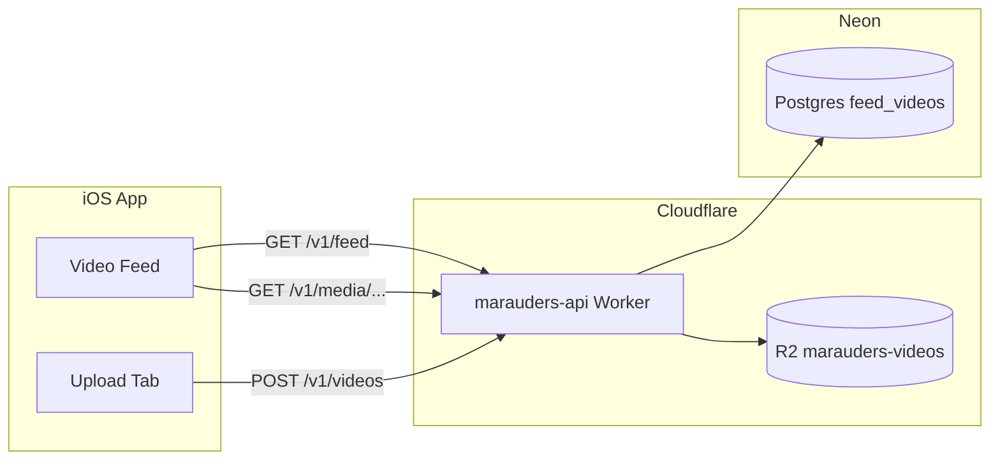

# Marauders

แอป iOS สไตล์สั้น ๆ แบบ TikTok: **ฟีดวิดีโอแนวตั้ง**, **อัปโหลดคลิป**, metadata ใน **Neon (Postgres)**, ไฟล์วิดีโอใน **Cloudflare R2**, API บน **Cloudflare Workers**

โปรเจกต์ portfolio สำหรับสมัครงาน — เน้น full-stack บน cloud จริง ไม่ใช่ mock ในเครื่องอย่างเดียว

## Features

| ส่วน | รายละเอียด |
|------|------------|
| **ฟีด** | เลื่อนแนวตั้งเต็มจอ (paging), เล่นเฉพาะคลิปที่อยู่กลางจอ |
| **แผนที่** | หมุดคลิปบนแผนที่ + Near Me; กรองเฉพาะโพสต์ของคนประเทศที่เลือก |
| **อัปโหลด** | เลือกวิดีโอจากคลัง → เติมตำแหน่งจาก metadata ของวีดีโอให้อัตโนมัติ (ISO 6709) → ส่ง multipart ไป API → โผล่บนฟีด |
| **Auth** | Sign in with Apple → แลก identity token เป็น session; เลือกประเทศตอน login |
| **API** | REST บน Workers, validate input ฝั่งเซิร์ฟเวอร์ |
| **Debug** | แท็บ Log ในแอป (เฉพาะ **Debug** build) + `os.Logger` |

เอกสารสถาปัตยกรรม: [ARCHITECTURE.md](ARCHITECTURE.md) · บันทึกการตัดสินใจ (ADR): [docs/adr/](docs/adr/)

## Architecture



- **Neon** เก็บ `stream_url`, caption, `@handle`, ลำดับฟีด  
- **R2** เก็บไฟล์ `.mp4` / `.mov` (วิดีโอ) และ `.jpg` / `.png` (รูปโปรไฟล์)
- **Worker** อ่าน/เขียน DB, อัปโหลด/เสิร์ฟวิดีโอ (รองรับ **HTTP Range** สำหรับ AVPlayer)

## Repository layout

```text
Marauders/
├── Marauders-ios/          # SwiftUI + AVFoundation
│   └── Marauders/
│       ├── Feed/           # ฟีด, player
│       ├── Upload/         # PhotosPicker, อัปโหลด
│       ├── Networking/     # API clients
│       ├── Logging/        # In-app log + copy
│       └── APIConfiguration.plist   # Base URL ของ Worker (HTTPS)
├── backend/                # Cloudflare Worker (TypeScript)
│   ├── src/
│   ├── sql/                # schema, seed, migrations
│   └── wrangler.toml
└── deployment/             # คู่มือ deploy แบบละเอียด
```

## Prerequisites

- **Xcode** (โปรเจกต์ตั้ง iOS 26.x — ปรับ deployment target ใน Xcode ตามเครื่องคุณได้)
- **Node.js 20+** สำหรับ Worker
- บัญชี **[Neon](https://neon.tech)** และ **[Cloudflare](https://dash.cloudflare.com)** (Workers + R2)

## Quick start

### 1. Database (Neon)

```bash
cd backend
npm install
npm run db:migrate    # รัน migration ทั้งหมดใน backend/sql/ (001–008)
```

หรือรัน SQL ใน Neon SQL Editor ตามไฟล์ใน `backend/sql/` ทีละไฟล์

ตั้ง connection string (ไม่ commit):

```bash
cp .env.example .dev.vars   # ใส่ DATABASE_URL สำหรับ wrangler dev / migrate
```

### 2. API (Cloudflare)

```bash
cd backend
npx wrangler login
npx wrangler r2 bucket create marauders-videos
npx wrangler secret put DATABASE_URL
npm run deploy
```

ทดสอบ:

```bash
curl "https://<your-worker>.workers.dev/v1/feed?limit=5"
```

รายละเอียดเพิ่ม: [deployment/README.md](deployment/README.md)

### 3. iOS

1. เปิด `Marauders-ios/Marauders.xcodeproj`
2. แก้ `Marauders/APIConfiguration.plist` → `MARAUDERS_API_BASE_URL` เป็น URL Worker ของคุณ (ไม่มี `/` ท้าย)
3. Run บน Simulator หรือเครื่องจริง (ต้องมีเน็ต)

## API (สรุป)

| Method | Path | คำอธิบาย |
|--------|------|----------|
| `GET` | `/health` | health check |
| `GET` | `/v1/map/clips?limit=20&country=<ISO2>` | หมุดแผนที่ ใช้ข้อมูลชุดเดียวกับฟีด (รวมคลิปของตัวเอง) |
| `POST` | `/v1/auth/apple` | `{ identityToken, country? }` → `{ accessToken }` (Sign in with Apple) |
| `GET` | `/v1/feed?limit=20&cursor=<uuid>&country=<ISO2>` | ฟีด; ทุกคนเห็นคลิปชุดเดียวกัน รวมคลิปของตัวเอง (Bearer ไม่เปลี่ยนผลลัพธ์ แต่ถ้าส่งมาและไม่ถูกต้องจะคืน 401); คำตอบมี `viewerID` เมื่อส่ง Bearer |
| `POST` | `/v1/videos` | `multipart/form-data`: `file` + `latitude` + `longitude` + `caption` (ไม่บังคับ) — ต้องส่ง `Authorization: Bearer <accessToken>` |
| `DELETE` | `/v1/videos/:id` | ลบคลิปของตัวเอง (ลบทั้ง row และไฟล์ใน R2) — ต้องส่ง Bearer |
| `POST` | `/v1/users/me/location` | `{ latitude, longitude }` — บันทึกพิกัดล่าสุดของผู้ใช้ที่ล็อกอิน (Bearer) |
| `GET` | `/v1/users/me` | โปรไฟล์ผู้ใช้ที่ล็อกอิน (handle, ประเทศ, พิกัดล่าสุด, จำนวนคลิป, `avatarURL`) + คลิปของตัวเอง (Bearer) |
| `PATCH` | `/v1/users/me` | `{ handle }` — เปลี่ยน `@handle` ของตัวเอง (ตัวพิมพ์เล็ก, `a-z0-9._`, 1–63 ตัว, ตรวจคำสงวน) → `{ handle }`; ซ้ำคืน `409` (Bearer) |
| `POST` | `/v1/users/me/avatar` | `multipart/form-data`: `file` (JPEG/PNG ≤ 5 MB) → อัปโหลด R2 แล้วคืน `{ avatarURL }` (Bearer) |
| `DELETE` | `/v1/users/me/avatar` | ลบรูปโปรไฟล์ของตัวเอง (ลบไฟล์ใน R2) → `{ avatarURL: null }` (Bearer) |
| `GET` | `/v1/users/<handle>` | โปรไฟล์สาธารณะของคนอื่น (handle, ประเทศ, จำนวนคลิป, `avatarURL`, คลิป) — ไม่ต้องล็อกอิน |
| `GET` / `HEAD` | `/v1/media/videos/<uuid>.{mp4,mov}` | สตรีมไฟล์วิดีโอจาก R2 |
| `GET` / `HEAD` | `/v1/media/avatars/<uuid>.{jpg,png}` | สตรีมไฟล์รูปโปรไฟล์จาก R2 |

**ข้อจำกัดอัปโหลด (server):** วิดีโอ MP4 / QuickTime สูงสุด 100 MB · รูปโปรไฟล์ JPEG / PNG สูงสุด 5 MB

**ประเทศตอน login:** แอปส่ง `country` เป็น ISO 3166-1 alpha-2 (เช่น `TH`) พร้อม identity token; Worker ตรวจรูปแบบแล้วเก็บใน `app_users.country` (ไม่ทับค่าที่มีอยู่)

**กรองแผนที่ตามประเทศ:** แท็บ Map มีตัวกรองเลือกดูเฉพาะโพสต์ของคนประเทศนั้น โดยส่ง `country` ไปกับ `/v1/map/clips` (ฝั่ง Worker join `feed_videos.owner_user_id` กับ `app_users.country`)

**แผนที่สไตล์ Instagram:** แท็บ Map เป็นแผนที่เต็มจอ ไม่มี navigation bar มีเมนูตัวกรอง (ประเทศ / ใกล้ฉัน) โดยเริ่มต้นแสดงทุกประเทศ และปุ่มหาตำแหน่ง หมุดวงกลมถูกจัดกลุ่มอัตโนมัติ (clustering) ตามระยะ zoom — แตะกลุ่มเพื่อซูมเข้า แตะหมุดเดี่ยวเพื่อเล่นวิดีโอทันที (วนซ้ำ มีปุ่มไปเล่นในฟีด) (แถบค้นหาแบบ client-side ยังซ่อนไว้ เปิดใช้ได้ด้วย `MapView.isSearchVisible`)

**บันทึกตำแหน่งผู้ใช้:** เมื่อผู้ใช้ให้สิทธิ์และแอปได้พิกัดครั้งแรกในเซสชัน หน้า Map จะส่งพิกัดไปที่ `POST /v1/users/me/location` (ครั้งเดียวต่อการเปิดแอป) → เก็บใน `app_users.latitude/longitude`

**แท็บ Profile:** เรียก `GET /v1/users/me` (Bearer) เพื่อโชว์รูปโปรไฟล์ + `@handle` + ประเทศ + จำนวนคลิป และกริดคลิปที่ตัวเองอัปโหลด (แตะเพื่อเล่นวนซ้ำ) พร้อมปุ่มออกจากระบบ — แตะรูปเพื่อเปลี่ยนรูปโปรไฟล์ (ย่อภาพ ≤ 512px แล้ว `POST /v1/users/me/avatar`), แตะ handle เพื่อแก้ไข (`PATCH /v1/users/me`) และลบคลิปของตัวเองได้ด้วยการกดค้างที่คลิปหรือกดถังขยะตอนเล่น (ยืนยันก่อนลบ → `DELETE /v1/videos/:id`)

**รูปโปรไฟล์ (avatar):** ฟีดคืน `authorAvatarURL` (ของเจ้าของโพสต์) และโปรไฟล์คืน `avatarURL` — แสดงเป็นวงกลมมุมขวาล่างของคลิปแบบ TikTok (แตะเพื่อเปิดโปรไฟล์สาธารณะ) ถ้าไม่มีรูปจะแสดงวงกลมสีไล่เฉดพร้อมอักษรแรกของ handle

**โปรไฟล์สาธารณะต่อ `@handle`:** ทุกบัญชีมี `@handle` อัตโนมัติตอนสมัคร (`@user_<hex>`) แก้ไขได้ในแท็บ Profile แตะชื่อผู้เขียนหรือรูปในฟีดเพื่อเปิดโปรไฟล์สาธารณะของคนนั้นได้แบบไม่ต้องล็อกอิน (`GET /v1/users/<handle>`) — ฟีดใช้ `handle` ของเจ้าของเป็น `authorName`

ตัวอย่าง response ฟีด:

```json
{
  "items": [
    {
      "id": "uuid",
      "streamURL": "https://.../v1/media/videos/....mp4",
      "latitude": 13.7563,
      "longitude": 100.5018,
      "country": "TH",
      "authorName": "@marauders",
      "authorAvatarURL": "https://.../v1/media/avatars/....jpg",
      "caption": "Sunset over the river"
    }
  ]
}
```

## Security notes (portfolio scope)

- `DATABASE_URL` เก็บใน **Wrangler secret** / `backend/.dev.vars` (gitignore) — ไม่ใส่ใน repo  
- API validate query/body ฝั่ง Worker; อัปโหลดจำกัดชนิดไฟล์และขนาด  
- แอปโหลดวิดีโอผ่าน **HTTPS** เท่านั้น  
- **Auth:** Sign in with Apple → verify identity token ฝั่ง Worker → ออก JWT (เก็บใน Keychain); อัปโหลดต้องมี Bearer token  
- **Rate limiting:** sign-in จำกัด 30 ครั้ง/นาทีต่อ IP และอัปโหลด (วิดีโอ/รูปโปรไฟล์) 10 ครั้ง/นาทีต่อ user (นับในตาราง `rate_limit_counters` บน Neon แบบ atomic — คืน `429` + `Retry-After`); ทุก `/v1/*` มีชั้นแรกเป็น Cloudflare Rate Limiting binding ช่วยกันต่อ PoP ด้วย

## Troubleshooting

| อาการ | แนวทาง |
|--------|--------|
| อัปโหลด 500 `storage write failed` | สร้าง R2 bucket `marauders-videos` แล้ว deploy Worker ใหม่ |
| ไม่พบ API URL ในแอป | ตรวจ `APIConfiguration.plist` |
| วิดีโอ seed จาก Google เล่นไม่ได้ | รัน `003_remove_google_seeds.sql` (bucket ตัวอย่าง 403) |
| `player failed` / `Cannot Open` | ลองคลิปสั้น MP4; ดูแท็บ **Log** ในแอป |

## Roadmap (ideas)

- [x] Sign in with Apple + จำกัดอัปโหลดต่อ user  
- [x] เลือกประเทศตอน login  
- [x] Rate limiting ที่ Worker  
- [x] โปรไฟล์สาธารณะต่อ `@handle` (แก้ไขได้)  
- [ ] Like  
- [ ] ซ่อนแท็บ Log ใน Release build  
- [ ] CI: `npm run typecheck` + Xcode build  

## คลิปของตัวเองในฟีด

`GET /v1/feed` และ `GET /v1/map/clips` ตอบรายการชุดเดียวกัน ไม่กรองคลิปของผู้ดูออกอีกแล้ว คลิปที่เพิ่งอัปโหลดอยู่บนสุดของฟีด และแอปเลื่อนไปที่คลิปนั้นให้หลังอัปโหลด การลบคลิปจากโปรไฟล์จะเอาคลิปนั้นออกจากฟีด แผนที่ และแคชด้วย ถ้าส่ง Bearer ที่ไม่ถูกต้องยังคืน 401 และคำตอบยังมี `viewerID` เพราะแอปรุ่นตั้งแต่ commit `8d3657d` จนถึงก่อนการแก้นี้ปฏิเสธฟีดของผู้ที่ล็อกอินที่ไม่มีค่านี้

**ลำดับการ deploy:** deploy Worker อย่างเดียวก็ทำให้แอปที่ติดตั้งอยู่แล้วเห็นคลิปตัวเอง (`cd backend && npm run test:feed && npm run typecheck && npm run deploy`) ไม่ต้อง migrate ฐานข้อมูลและไม่ต้องตั้ง secret ใหม่ แอปรุ่นใหม่กับ Worker เก่าไม่พัง แต่คลิปตัวเองจะยังไม่ขึ้นจนกว่าจะ deploy

**แคชเริ่มต้นของแอป** (สูงสุด 2 คลิป อายุ 6 ชั่วโมง) ถูกสร้างตอนที่ฟีดยังไม่มีคลิปตัวเอง ในการเปิดแอปแบบมีแคช คลิปที่แคชไว้จะขึ้นก่อน (แสดงข้อมูลสดจากเซิร์ฟเวอร์) แล้วคลิปอื่นต่อท้าย ดังนั้นคลิปล่าสุดของตัวเองอาจไม่อยู่บนสุดจนกว่าแคชจะหมดอายุ

## License

Private portfolio project — ปรับ license ตามต้องการก่อนเปิด public repo

ตรวจ backend โดยไม่ใช้ฐานข้อมูลจริง: `cd backend && npm run test:feed && npm run typecheck` (ทดสอบ router, auth และ SQL ที่สร้าง; ไม่ใช่ integration test กับ PostgreSQL)
