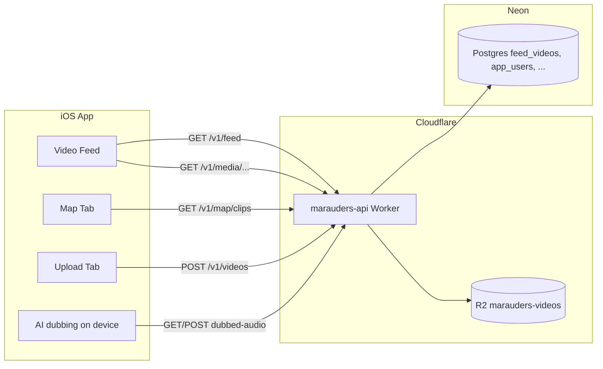

# Marauders

แอป iOS สไตล์สั้น ๆ แบบ TikTok: **ฟีดวิดีโอแนวตั้ง**, **อัปโหลดคลิป**, metadata ใน **Neon (Postgres)**, ไฟล์วิดีโอใน **Cloudflare R2**, API บน **Cloudflare Workers**

โปรเจกต์ portfolio สำหรับสมัครงาน — เน้น full-stack บน cloud จริง ไม่ใช่ mock ในเครื่องอย่างเดียว

## Features

| ส่วน | รายละเอียด |
|------|------------|
| **ฟีด** | เลื่อนแนวตั้งเต็มจอ (paging), เล่นเฉพาะคลิปที่อยู่กลางจอ |
| **แผนที่** | หมุดคลิปบนแผนที่ + Near Me; กรองเฉพาะโพสต์ของคนประเทศที่เลือก |
| **อัปโหลด** | เลือกวิดีโอจากคลัง → เติมตำแหน่งจาก metadata ของวีดีโอให้อัตโนมัติ (ISO 6709) หรือปักหมุดเอง → ตรวจเสียงในคลิปบนเครื่อง (SoundAnalysis, เป็นข้อมูลประกอบ ไม่บล็อกการอัปโหลด) → ส่ง multipart ไป API → โผล่บนฟีด |
| **โปรไฟล์** | โปรไฟล์ของตัวเอง (เปลี่ยนรูป/`@handle`, ลบคลิป) และโปรไฟล์สาธารณะของคนอื่นต่อ `@handle` |
| **Settings** | เลือก **ภาษาที่ฟัง** (listening language) และดาวน์โหลด/จัดการโมเดลภาษา (Whisper base สำหรับตรวจภาษาในคลิป) |
| **AI dubbing** | ผู้ชมเลือกฟังเสียงต้นฉบับหรือเสียงพากย์ AI ในภาษาของตัวเอง; แปลและสร้างเสียงบน iPhone ของผู้ชม แล้วแชร์ไฟล์ผ่านแคชบน R2 — รายละเอียดใน [deployment/AI_DUBBING.md](deployment/AI_DUBBING.md) |
| **Auth** | Sign in with Apple → แลก identity token เป็น session; เลือกประเทศตอน login (Debug build บน Simulator ใช้ `/v1/auth/dev` แทนได้) |
| **API** | REST บน Workers, validate input ฝั่งเซิร์ฟเวอร์ |
| **Debug** | แท็บ Log ในแอป (เฉพาะ **Debug** build, `#if DEBUG`) + `os.Logger` |

เอกสารสถาปัตยกรรม: [ARCHITECTURE.md](ARCHITECTURE.md) · บันทึกการตัดสินใจ (ADR): [docs/adr/](docs/adr/) · AI dubbing: [deployment/AI_DUBBING.md](deployment/AI_DUBBING.md) · CI/CD: [docs/ci-cd.md](docs/ci-cd.md)

## Architecture



- **Neon** เก็บ `feed_videos` (`stream_url`, caption, พิกัด, `audio_assessment`), `app_users` (`@handle`, ประเทศ, พิกัดล่าสุด, รูปโปรไฟล์), `comments` (ความคิดเห็นใต้คลิป), `rate_limit_counters`, `dubbed_audio_reports`
- **R2** เก็บไฟล์ `.mp4` / `.mov` (วิดีโอ), `.jpg` / `.png` (รูปโปรไฟล์ `avatars/`) และเสียงพากย์ AI `.m4a` (`translations/`)
- **Worker** อ่าน/เขียน DB, อัปโหลด/เสิร์ฟวิดีโอ (รองรับ **HTTP Range** สำหรับ AVPlayer)
- **iPhone** ทำงานหนักของ dubbing เอง (ตรวจภาษา, แปล, สร้างเสียง) ไม่มี AI provider ฝั่งเซิร์ฟเวอร์

## Repository layout

```text
Marauders/
├── Marauders-ios/          # SwiftUI + AVFoundation (MVVM + Clean Architecture)
│   ├── Marauders/
│   │   ├── App/, Composition/   # entry point, dependency container
│   │   ├── Domain/              # Entities, UseCases, Repositories/Services (protocol)
│   │   ├── Data/                # API clients, Auth, Repositories, Services (cache, Whisper, ...)
│   │   ├── Presentation/        # Feed, Map, Upload, Profile, Settings, Dubbing, Auth, Debug (Log), ...
│   │   ├── Resources/           # Localizable.xcstrings
│   │   └── APIConfiguration.plist   # Base URL ของ Worker (HTTPS)
│   ├── MaraudersTests/     # unit tests (Swift Testing)
│   ├── MaraudersUITests/   # XCUITest
│   └── fastlane/           # lanes: test, build, beta
├── backend/                # Cloudflare Worker (TypeScript)
│   ├── src/                # index.ts (router), routes/, auth/, db/, audio/, media/
│   ├── sql/                # schema, seed, migrations 001–017
│   ├── scripts/            # migrate, test-*, HLS/purge utilities
│   ├── test/               # authDev, comments, commentsRoutes tests + fakes (users, neon)
│   └── wrangler.toml
├── deployment/             # คู่มือ deploy, AI_DUBBING.md, video-pipeline.md
├── docs/                   # adr/, ci-cd.md
├── ARCHITECTURE.md
└── Jenkinsfile             # Jenkins → TestFlight
```

## Prerequisites

- **Xcode** (deployment target iOS 26.5 — ปรับใน Xcode ตามเครื่องคุณได้) · SwiftPM dependency เช่น WhisperKit ถูก resolve ตอน build แต่โปรเจกต์ยังใช้แพ็กเกจ private (`poc-sdk.waypointsdk` จาก Swift package registry ที่ต้องมี token, `POC_MyLibrary` จาก GitHub) ต้องมีสิทธิ์เข้าถึงจึง build ได้
- **Node.js** (เวอร์ชันล่าสุดที่ Wrangler 4 รองรับ) สำหรับ Worker
- บัญชี **[Neon](https://neon.tech)** และ **[Cloudflare](https://dash.cloudflare.com)** (Workers + R2)

## Quick start

### 1. Database (Neon)

```bash
cd backend
npm install
npm run db:migrate    # รัน migration ใน backend/sql/ (001–017 ยกเว้น 004 ที่ล้างข้อมูล รันเองเมื่อจำเป็น)
```

หรือรัน SQL ใน Neon SQL Editor ตามไฟล์ใน `backend/sql/` ทีละไฟล์

ตั้ง connection string (ไม่ commit):

```bash
cp .env.example .dev.vars   # ใส่ DATABASE_URL, JWT_SIGNING_SECRET, APPLE_CLIENT_ID สำหรับ wrangler dev / migrate
```

### 2. API (Cloudflare)

```bash
cd backend
npx wrangler login
npx wrangler r2 bucket create marauders-videos
npx wrangler secret put DATABASE_URL
npx wrangler secret put JWT_SIGNING_SECRET   # openssl rand -base64 48
npx wrangler secret put APPLE_CLIENT_ID      # bundle id ของแอป
npm run deploy
```

ทดสอบ:

```bash
curl "https://<your-worker>.workers.dev/v1/feed?limit=5"
```

รายละเอียดเพิ่ม: [deployment/README.md](deployment/README.md)

### 3. iOS

1. เปิด `Marauders-ios/Marauders.xcodeproj`
2. แก้ `Marauders/APIConfiguration.plist` → `MARAUDERS_API_BASE_URL` เป็น URL Worker ของคุณ (ไม่มี `/` ท้าย)
3. Run บน Simulator หรือเครื่องจริง (ต้องมีเน็ต)

Simulator ไม่มี Apple ID: ตั้ง secret `DEV_LOGIN_SECRET` ให้ Worker (`npx wrangler secret put DEV_LOGIN_SECRET`, ≥ 32 ตัวอักษร) แล้วเปิด Debug build บน Simulator พร้อม environment `MARAUDERS_DEV_LOGIN_SECRET` (และ `MARAUDERS_DEV_LOGIN_LABEL` เลือกผู้ใช้ทดสอบ ค่าเริ่มต้น `simulator`) เช่น `SIMCTL_CHILD_MARAUDERS_DEV_LOGIN_SECRET=… xcrun simctl launch …` เพื่อล็อกอินผ่าน `POST /v1/auth/dev` — secret ไม่ถูกเก็บในโปรเจกต์; ถ้า Worker ไม่ตั้ง secret route นี้ตอบ `404`

## API (สรุป)

| Method | Path | คำอธิบาย |
|--------|------|----------|
| `GET` | `/health` | health check |
| `GET` | `/v1/map/clips?limit=20&country=<ISO2>` | หมุดแผนที่ ใช้ข้อมูลชุดเดียวกับฟีด (รวมคลิปของตัวเอง) |
| `POST` | `/v1/auth/apple` | `{ identityToken, country? }` → `{ accessToken }` (Sign in with Apple) |
| `POST` | `/v1/auth/dev` | `{ secret, label, country? }` → `{ accessToken }` — เฉพาะเมื่อ Worker ตั้ง `DEV_LOGIN_SECRET`, ไม่งั้น `404` (ใช้กับ Debug build บน Simulator) |
| `GET` | `/v1/feed?limit=20&cursor=<uuid>&country=<ISO2>` | ฟีด; ทุกคนเห็นคลิปชุดเดียวกัน รวมคลิปของตัวเอง (Bearer ไม่เปลี่ยนผลลัพธ์ แต่ถ้าส่งมาและไม่ถูกต้องจะคืน 401); คำตอบมี `viewerID` เมื่อส่ง Bearer |
| `POST` | `/v1/videos` | `multipart/form-data`: `file` + `latitude` + `longitude` + `caption` (ไม่บังคับ) + `audioAssessment` (JSON ไม่บังคับ) — ต้องส่ง `Authorization: Bearer <accessToken>` |
| `DELETE` | `/v1/videos/:id` | ลบคลิปของตัวเอง (ลบทั้ง row และไฟล์ใน R2) — ต้องส่ง Bearer |
| `POST` | `/v1/users/me/location` | `{ latitude, longitude }` — บันทึกพิกัดล่าสุดของผู้ใช้ที่ล็อกอิน (Bearer) |
| `GET` | `/v1/users/me` | โปรไฟล์ผู้ใช้ที่ล็อกอิน (handle, ประเทศ, พิกัดล่าสุด, จำนวนคลิป, `avatarURL`) + คลิปของตัวเอง (Bearer) |
| `PATCH` | `/v1/users/me` | `{ handle }` — เปลี่ยน `@handle` ของตัวเอง (ตัวพิมพ์เล็ก, `a-z0-9._`, 1–63 ตัว, ตรวจคำสงวน) → `{ handle }`; ซ้ำคืน `409` (Bearer) |
| `POST` | `/v1/users/me/avatar` | `multipart/form-data`: `file` (JPEG/PNG ≤ 5 MB) → อัปโหลด R2 แล้วคืน `{ avatarURL }` (Bearer) |
| `DELETE` | `/v1/users/me/avatar` | ลบรูปโปรไฟล์ของตัวเอง (ลบไฟล์ใน R2) → `{ avatarURL: null }` (Bearer) |
| `GET` | `/v1/users/<handle>` | โปรไฟล์สาธารณะของคนอื่น (handle, ประเทศ, จำนวนคลิป, `avatarURL`, คลิป) — ไม่ต้องล็อกอิน |
| `GET` / `POST` | `/v1/videos/:id/dubbed-audio?source=<sha256>&lang=<code>` | แคชเสียงพากย์ AI ที่แชร์กัน: GET (guest อ่านได้) คืน `missing` / `ready` + URL; POST (Bearer, `audio/mp4`, `X-Source-SHA256`) อัปโหลดเสียงที่สร้างบนเครื่อง; `/thai-audio` เป็น path เดิมของแอปรุ่นเก่า (= `lang=th`); `?kind=text` ใช้กับข้อความแปล/คำบรรยาย: GET อ่าน, POST (Bearer, ≤ 16 KiB) บันทึกครั้งแรกครั้งเดียว และถูกลบพร้อมเสียงเมื่อมีการรายงานจนลบ |
| `POST` | `/v1/videos/:id/dubbed-audio/report?lang=<code>` | รายงานเสียงพากย์ที่แชร์ว่าไม่ดี (Bearer + header `X-Source-SHA256` ต้องตรงกับคลิปปัจจุบัน ไม่งั้น `409`) — ผู้รายงานต่างกัน 2 คน หรือเจ้าของคลิป/ผู้อัปโหลด 1 คน ทำให้ไฟล์ถูกลบ (migration 016) |
| `GET` | `/v1/videos/:id/comments?limit=30&cursor=<uuid>` | ความคิดเห็นใต้คลิป เรียงใหม่สุดก่อน (ไม่ต้องล็อกอิน; ถ้าส่ง Bearer ที่ไม่ถูกต้องคืน 401) — `limit` เริ่มต้น 30 สูงสุด 50, `cursor` คือ id ของความคิดเห็นสุดท้ายในหน้าก่อน (ถ้าความคิดเห็นนั้นถูกลบไปแล้วจะได้หน้าว่างกับ `nextCursor` เป็น null แอปจึงเริ่มโหลดใหม่จากล่าสุด); คืน `{ items, nextCursor }` แต่ละรายการมี `id`, `body`, `language`, `createdAt`, `authorName`, `authorAvatarURL`, `canDelete` (จริงสำหรับความคิดเห็นของผู้ดูเอง และทุกความคิดเห็นใต้คลิปของผู้ดู) |
| `POST` | `/v1/videos/:id/comments` | `{ body, language? }` — เขียนความคิดเห็น (Bearer) request ใหญ่ได้ไม่เกิน 16 KiB (`413`) ตัดช่องว่างหัวท้ายกับอักขระควบคุมที่ไม่ใช่ tab/ขึ้นบรรทัดออก แล้วต้องยาว 1–500 ตัวอักษร (นับเป็น code point) มีอย่างน้อยหนึ่งตัวที่มองเห็น (ข้อความที่มีแต่ช่องว่าง อักขระ zero-width ตัวเติมฮันกึล หรือ variation selector ถูกปฏิเสธ) และไม่มี surrogate เดี่ยว ไม่งั้น `422` (การขึ้นบรรทัดเก็บไว้ไม่เกิน 10 ครั้ง ครั้งที่เกินถูกเก็บเป็นช่องว่าง กันความคิดเห็นเดียวสูงเป็นร้อยบรรทัด); `language` เก็บเฉพาะภาษาที่แอปแปลได้ (22 ภาษา) นอกนั้นเป็น null; คืน `201 { comment }`; `401 account not found` เมื่อ token ยังไม่หมดอายุแต่แถวผู้ใช้ใน `app_users` ถูกลบไปแล้ว; จำกัด 10 ครั้ง / 60 วินาทีต่อผู้ใช้ (`429`) (migration 017) |
| `DELETE` | `/v1/videos/:id/comments/:commentId` | ลบความคิดเห็น — ผู้เขียนหรือเจ้าของคลิปเท่านั้น (Bearer) คนอื่นได้ `404` |
| `GET` / `HEAD` | `/v1/media/videos/<uuid>.{mp4,mov}` | สตรีมไฟล์วิดีโอจาก R2 |
| `GET` / `HEAD` | `/v1/media/avatars/<uuid>.{jpg,png}` | สตรีมไฟล์รูปโปรไฟล์จาก R2 |

**ข้อจำกัดอัปโหลด (server):** วิดีโอ MP4 / QuickTime สูงสุด 100 MB · รูปโปรไฟล์ JPEG / PNG สูงสุด 5 MB · เสียงพากย์ AI สูงสุด 4 MiB (AAC/M4A)

**ประเทศตอน login:** แอปส่ง `country` เป็น ISO 3166-1 alpha-2 (เช่น `TH`) พร้อม identity token; Worker ตรวจรูปแบบแล้วเก็บใน `app_users.country` (ไม่ทับค่าที่มีอยู่)

**กรองแผนที่ตามประเทศ:** แท็บ Map มีตัวกรองเลือกดูเฉพาะโพสต์ของคนประเทศนั้น โดยส่ง `country` ไปกับ `/v1/map/clips` (ฝั่ง Worker join `feed_videos.owner_user_id` กับ `app_users.country`)

**แผนที่สไตล์ Instagram:** แท็บ Map เป็นแผนที่เต็มจอ ไม่มี navigation bar มีเมนูตัวกรอง (ประเทศ / ใกล้ฉัน) โดยเริ่มต้นแสดงทุกประเทศ และปุ่มหาตำแหน่ง หมุดวงกลมถูกจัดกลุ่มอัตโนมัติ (clustering) ตามระยะ zoom — แตะกลุ่มเพื่อซูมเข้า แตะหมุดเดี่ยวเพื่อเล่นวิดีโอทันที (วนซ้ำ มีปุ่มไปเล่นในฟีด) (แถบค้นหาแบบ client-side ยังซ่อนไว้ เปิดใช้ได้ด้วย `MapView.isSearchVisible`)

**บันทึกตำแหน่งผู้ใช้:** เมื่อผู้ใช้ให้สิทธิ์และแอปได้พิกัดครั้งแรกในเซสชัน หน้า Map จะส่งพิกัดไปที่ `POST /v1/users/me/location` (ครั้งเดียวต่อการเปิดแอป) → เก็บใน `app_users.latitude/longitude`

**แท็บของแอป:** Feed · Map · Profile · Upload · Settings (และ Log เฉพาะ Debug build)

**แท็บ Settings:** เลือกภาษาที่ฟัง (22 ภาษา) และจัดการโมเดลภาษาที่ดาวน์โหลดไว้ (รวม Whisper base ที่ใช้ตรวจภาษาพูดของคลิปบนเครื่อง ผ่าน WhisperKit โดยเลือกช่วงที่มีเสียงพูดมากที่สุดมาตรวจ); ต้นทางที่พากย์ได้คืออังกฤษ สเปน และดัตช์ — ดู [deployment/AI_DUBBING.md](deployment/AI_DUBBING.md)

**แท็บ Profile:** เรียก `GET /v1/users/me` (Bearer) เพื่อโชว์รูปโปรไฟล์ + `@handle` + ประเทศ + จำนวนคลิป และกริดคลิปที่ตัวเองอัปโหลด (แตะเพื่อเล่นวนซ้ำ) พร้อมปุ่มออกจากระบบ — แตะรูปเพื่อเปลี่ยนรูปโปรไฟล์ (ย่อภาพ ≤ 512px แล้ว `POST /v1/users/me/avatar`), แตะ handle เพื่อแก้ไข (`PATCH /v1/users/me`) และลบคลิปของตัวเองได้ด้วยการกดค้างที่คลิปหรือกดถังขยะตอนเล่น (ยืนยันก่อนลบ → `DELETE /v1/videos/:id`)

**รูปโปรไฟล์ (avatar):** ฟีดคืน `authorAvatarURL` (ของเจ้าของโพสต์) และโปรไฟล์คืน `avatarURL` — แสดงเป็นวงกลมมุมขวาล่างของคลิปแบบ TikTok (แตะเพื่อเปิดโปรไฟล์สาธารณะ) ถ้าไม่มีรูปจะแสดงวงกลมสีไล่เฉดพร้อมอักษรแรกของ handle

**Player ในฟีด:** ใช้ `AVPlayer` 3 ตัว (visible + เตรียมคลิปข้างเคียง) บน `UIScrollView` paging — ดู [ADR-001](docs/adr/001-feed-playback-dual-player.md) (ชื่อไฟล์ยังเป็น dual-player จากรุ่นแรก)

**โปรไฟล์สาธารณะต่อ `@handle`:** ทุกบัญชีมี `@handle` อัตโนมัติตอนสมัคร (`@user_<hex>`) แก้ไขได้ในแท็บ Profile แตะชื่อผู้เขียนหรือรูปในฟีดเพื่อเปิดโปรไฟล์สาธารณะของคนนั้นได้แบบไม่ต้องล็อกอิน (`GET /v1/users/<handle>`) — ฟีดใช้ `handle` ของเจ้าของเป็น `authorName`

**ลำดับการ deploy ความคิดเห็น:** รัน `cd backend && npm run db:migrate` (migration 017 สร้างตาราง `comments`) ก่อน แล้วค่อย `npm run deploy` Worker เพราะ route ใหม่ query ตารางนี้ แอปรุ่นใหม่กับ Worker เก่าไม่พัง แต่ชีตจะอ่านความคิดเห็นไม่ได้จนกว่าจะ deploy (ชีตขึ้น *This clip is no longer available.* ทุกคลิป เพราะ Worker เก่าตอบ 404 `not found`) — Jenkins ส่งแอปขึ้น TestFlight จาก `main` โดยไม่รอ Worker ส่วน Worker deploy ด้วยมือ (ดู [docs/ci-cd.md](docs/ci-cd.md)) จึงควร migrate และ deploy Worker ก่อนที่ build จาก `main` ที่มีฟีเจอร์นี้จะถึงผู้ทดสอบ

ตัวอย่าง response ฟีด:

```json
{
  "items": [
    {
      "id": "uuid",
      "streamURL": "https://.../v1/media/videos/....mp4",
      "latitude": 13.7563,
      "longitude": 100.5018,
      "country": "TH",
      "authorName": "@marauders",
      "authorAvatarURL": "https://.../v1/media/avatars/....jpg",
      "caption": "Sunset over the river"
    }
  ]
}
```

## Security notes (portfolio scope)

- `DATABASE_URL` เก็บใน **Wrangler secret** / `backend/.dev.vars` (gitignore) — ไม่ใส่ใน repo  
- API validate query/body ฝั่ง Worker; อัปโหลดจำกัดชนิดไฟล์และขนาด  
- แอปโหลดวิดีโอผ่าน **HTTPS** เท่านั้น  
- **Auth:** Sign in with Apple → verify identity token ฝั่ง Worker → ออก JWT (เก็บใน Keychain); อัปโหลดต้องมี Bearer token  
- **Dev login:** `/v1/auth/dev` ปิดอยู่จนกว่าจะตั้ง `DEV_LOGIN_SECRET` (ปล่อยว่างใน production) และฝั่งแอป compile เฉพาะ Debug
- **Rate limiting:** sign-in (Apple/dev) จำกัด 30 ครั้ง/นาทีต่อ IP และอัปโหลด (วิดีโอ/รูปโปรไฟล์) 10 ครั้ง/นาทีต่อ user, อัปโหลดเสียงพากย์ AI, รายงานเสียงพากย์ และโพสต์คอมเมนต์อย่างละ 10 ครั้ง/นาทีต่อ user (นับในตาราง `rate_limit_counters` บน Neon แบบ atomic — คืน `429` + `Retry-After`); `/v1/*` (ยกเว้น `/v1/media/*`) มีชั้นแรกเป็น Cloudflare Rate Limiting binding ต่อ IP (route auth 30/นาที, อื่น ๆ 120/นาที) ช่วยกันต่อ PoP ด้วย

## Troubleshooting

| อาการ | แนวทาง |
|--------|--------|
| อัปโหลด 500 `storage write failed` | สร้าง R2 bucket `marauders-videos` แล้ว deploy Worker ใหม่ |
| ไม่พบ API URL ในแอป | ตรวจ `APIConfiguration.plist` |
| วิดีโอ seed จาก Google เล่นไม่ได้ | รัน `003_remove_google_seeds.sql` (bucket ตัวอย่าง 403) |
| `player failed` / `Cannot Open` | ลองคลิปสั้น MP4; ดูแท็บ **Log** ในแอป |

## Tests

| ชุดทดสอบ | คำสั่ง | หมายเหตุ |
|-----------|--------|----------|
| Backend (router, auth, SQL ที่สร้าง — ไม่ต่อ PostgreSQL จริง) | `cd backend && npm run test:feed` | ตามด้วย `npm run typecheck` |
| Backend dubbed audio cache/report | `npm run test:dubbed-audio` | ใน `backend/` |
| Backend dev login | `npm run test:dev-auth` | ใช้ `node:test` + fake users |
| Backend comments | `npm run test:comments` | ใน `backend/` ใช้ `node:test` ตรวจการ normalize ข้อความและภาษาของความคิดเห็น กับ route จริง (`worker.fetch`) ที่ใช้ fake ของ Neon driver: การยืนยันตัวตน, validation, ขนาด request สูงสุด 16 KiB (ทั้งความยาวที่ประกาศและ body ที่ทยอยส่งมา), status code, ข้อความ SQL ของแต่ละ statement (ล็อกไว้ทั้งก้อน แก้ SQL แล้วต้องแก้เทสต์ตาม) กับค่าที่ bind และสิ่งที่ log เมื่อฐานข้อมูลผิดพลาด (SQLSTATE กับข้อความของฐานข้อมูล ไม่มีข้อความคอมเมนต์) (ไม่ได้รัน SQL บน Postgres จริง) |
| Backend อื่น ๆ | `node backend/scripts/test-upload.mjs`, `test-audio-assessment.mjs` | ไม่มี npm script รันด้วย `node` ตรง ๆ |
| iOS unit tests (Swift Testing, `MaraudersTests`) | `cd Marauders-ios && bundle exec fastlane test` หรือ `xcodebuild test -scheme Marauders -only-testing:MaraudersTests -destination ...` | fastlane ใช้ `SIMULATOR_DESTINATION` (ค่าเริ่มต้น iPhone 17) |
| iOS UI tests (`MaraudersUITests`) | รันจาก Xcode / `xcodebuild test` | ใช้ launch argument `UITEST` กับ feed จำลอง |

## CI/CD

`Jenkinsfile` (agent macOS): Checkout → `bundle install` → resolve Swift packages → Deploy to TestFlight (`fastlane beta`, เฉพาะ `main`) ขั้น **Unit tests** และ Coverage report ถูก comment ปิดชั่วคราวใน Jenkinsfile (ให้ TestFlight build เร็ว) รายละเอียด: [docs/ci-cd.md](docs/ci-cd.md) (แผนภาพในนั้นยังแสดงขั้น Unit tests/Archive ซึ่งไม่ตรงกับ Jenkinsfile ปัจจุบัน)

## Roadmap (ideas)

- [x] Sign in with Apple + จำกัดอัปโหลดต่อ user  
- [x] เลือกประเทศตอน login  
- [x] Rate limiting ที่ Worker  
- [x] โปรไฟล์สาธารณะต่อ `@handle` (แก้ไขได้)  
- [ ] Like  
- [x] ซ่อนแท็บ Log ใน Release build  
- [x] Jenkins → TestFlight  
- [ ] เปิด unit test stage ใน CI อีกครั้ง + `npm run typecheck`  

## คลิปของตัวเองในฟีด

`GET /v1/feed` และ `GET /v1/map/clips` ตอบรายการชุดเดียวกัน ไม่กรองคลิปของผู้ดูออกอีกแล้ว คลิปที่เพิ่งอัปโหลดอยู่บนสุดของฟีด และแอปเลื่อนไปที่คลิปนั้นให้หลังอัปโหลด การลบคลิปจากโปรไฟล์จะเอาคลิปนั้นออกจากฟีด แผนที่ และแคชด้วย ถ้าส่ง Bearer ที่ไม่ถูกต้องยังคืน 401 และคำตอบยังมี `viewerID` เพราะแอปรุ่นตั้งแต่ commit `8d3657d` จนถึงก่อนการแก้นี้ปฏิเสธฟีดของผู้ที่ล็อกอินที่ไม่มีค่านี้

**ลำดับการ deploy:** deploy Worker อย่างเดียวก็ทำให้แอปที่ติดตั้งอยู่แล้วเห็นคลิปตัวเอง (`cd backend && npm run test:feed && npm run typecheck && npm run deploy`) ไม่ต้อง migrate ฐานข้อมูลและไม่ต้องตั้ง secret ใหม่ แอปรุ่นใหม่กับ Worker เก่าไม่พัง แต่คลิปตัวเองจะยังไม่ขึ้นจนกว่าจะ deploy

**แคชเริ่มต้นของแอป** (`FeedStartupCache` สูงสุด 2 คลิป อายุ 6 ชั่วโมง) ถูกสร้างตอนที่ฟีดยังไม่มีคลิปตัวเอง ในการเปิดแอปแบบมีแคช คลิปที่แคชไว้จะขึ้นก่อน (แสดงข้อมูลสดจากเซิร์ฟเวอร์) แล้วคลิปอื่นต่อท้าย ดังนั้นคลิปล่าสุดของตัวเองอาจไม่อยู่บนสุดจนกว่าแคชจะหมดอายุ

## License

Private portfolio project — ปรับ license ตามต้องการก่อนเปิด public repo
